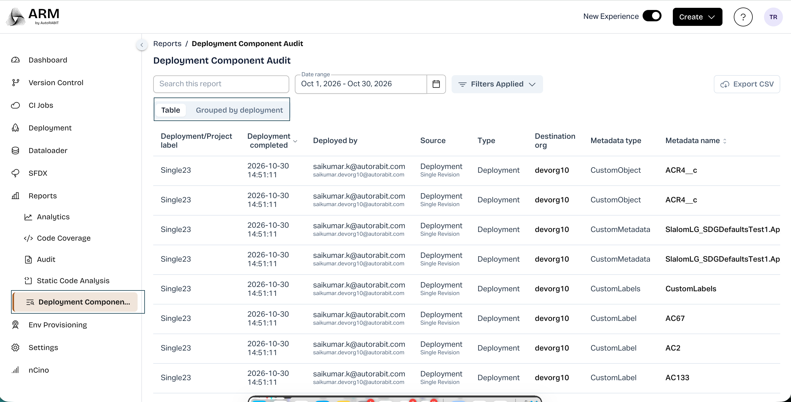
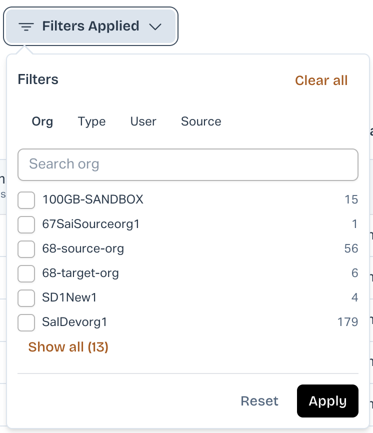

# Deployment Component Audit Report

### Overview

The **Deployment Component Audit Report** in AutoRABIT ARM provides centralized visibility into metadata components successfully deployed across Salesforce environments.

Users can track **what was deployed, when it was deployed, who performed the deployment, and where the changes originated**, including repository, branch, revision, and associated ALM story details.

This enhancement improves deployment traceability, auditing, and compliance reporting.

**Availability:** New UI Only\
**Module:** Reports → Deployment Component Audit

### Key Features

* **Component-Level Tracking:** View individual metadata components successfully deployed to Salesforce orgs.
* **Deployment Details:** Track deployment date, user, destination org, metadata type, and component name.
* **Version Control Information:** View repository, source branch, revision, commit label, and associated ALM stories.
* **Advanced Filters:** Filter records by destination org, metadata type, user, source, and date range.
* **Multiple Report Views:** Switch between Table View and Grouped by Deployment.
* **CSV Export:** Export filtered deployment records for auditing and further analysis.

### How to Access the Report

1. Log in to AutoRABIT ARM.
2. Enable the **New Experience** toggle.
3. Navigate to **Reports → Deployment Component Audit**.
4. The report displays metadata components deployed within the selected date range.

<figure><figcaption></figcaption></figure>

### Understanding the Report

The report displays individual metadata components along with their deployment and source information.

| Field                    | Description                                                                  |
| ------------------------ | ---------------------------------------------------------------------------- |
| Deployment/Project Label | Name or label associated with the deployment.                                |
| Deployment Completed     | Date and time of deployment completion.                                      |
| Deployed By              | User who initiated the deployment.                                           |
| Source                   | Deployment source, such as CI Job, Deployment, Org Sync, or Profile Manager. |
| Type                     | Deployment operation type.                                                   |
| Destination Org          | Salesforce org where the component was deployed.                             |
| Metadata Type            | Type of metadata, such as ApexClass, Flow, or CustomObject.                  |
| Metadata Name            | Name of the deployed component.                                              |
| Action                   | Indicates whether the component was created, modified, or deleted.           |
| Modified By              | Salesforce user who last modified the component.                             |
| Revision                 | Version control revision.                                                    |
| ALM Story                | Associated ALM story or work item.                                           |
| Commit Label             | Associated commit label.                                                     |
| Source Branch            | Branch containing the deployed changes.                                      |
| Repository               | Associated version control repository.                                       |

### Searching and Filtering Records

Users can search and filter deployment records to identify specific metadata components.

#### Search and Date Range

* Use **Search this report** to locate specific records.
* Select the required **Date Range** to view deployments completed during a particular period.

#### Advanced Filters

1. Click **Filters** at the top of the report.
2. Select the required category:
   * **Org:** Filter by destination Salesforce org.
   * **Type:** Filter by metadata type.
   * **User:** Filter by deployment user.
   * **Source:** Filter by deployment source.
3. Select one or more values using the checkboxes.
4. Click **Apply** to display matching records.

Users can also use **Show all** to expand available values, **Reset** to reset selections, or **Clear all** to remove applied filters.

<figure><figcaption></figcaption></figure>

### Report Views

The report provides two views:

**Table View**

Displays each successfully deployed metadata component as an individual record, including deployment and version control details.

**Grouped by Deployment**

Organizes metadata components under their respective deployments, allowing users to review all components associated with a specific deployment or CI Job.

Users can switch between these views using the **Table** and **Grouped by deployment** options.

### Exporting the Report

Users can export deployment component information in CSV format.

1. Open **Reports → Deployment Component Audit**.
2. Select the required date range and apply filters.
3. Click **Export CSV** in the upper-right corner.
4. The report is exported with the selected filters and date range applied.

The exported file can be used for compliance reviews, auditing, and deployment analysis.

### Supported Deployment Sources

The report includes successfully deployed metadata components from:

* Deployments
* CI Jobs
* Org Sync
* Profile Manager

**Note:** Failed deployments, validation-only operations, and Environment Provisioning operations are not included.
