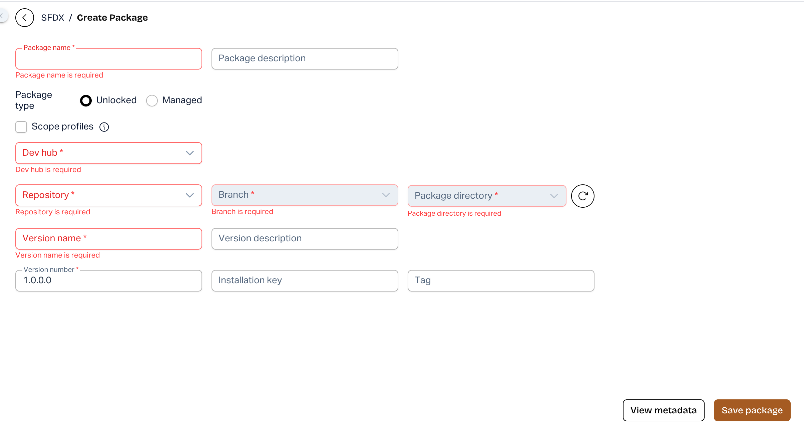

# Required Field Validation for SFDX Package Version Creation (New UI)

### Overview

AutoRABIT ARM has enhanced the **SFDX Package Version Creation** process in the New UI with improved required field validation and informative tooltips. These improvements help users identify missing or invalid information and create package versions more efficiently.

### What's New?

* **Required Field Validation:** When users click **Create** with missing or invalid mandatory information, ARM highlights the affected fields and displays clear inline error messages.
* **Automatic Navigation:** ARM automatically scrolls to the first invalid field, allowing users to quickly identify and correct the information.
* **Informative Tooltips:** When the **Create** button is unavailable, ARM displays a tooltip explaining why the action is disabled.

### How It Works

1. Navigate to the **SFDX Package Version Creation** screen in the New UI.
2. Enter the required package version details.
3. Click **Create**. If any mandatory fields are missing or contain invalid information, ARM highlights them and displays inline validation messages.
4. Correct the highlighted fields based on the validation messages.
5. Once all required information is valid, proceed with package version creation.

<figure><figcaption></figcaption></figure>

### Benefits

* Quickly identify and resolve missing or invalid fields.
* Reduce errors during package version creation.
* Understand why the Create action is unavailable.
* Improve the overall package version creation experience.

**Availability:** AutoRABIT ARM – New UI only.
