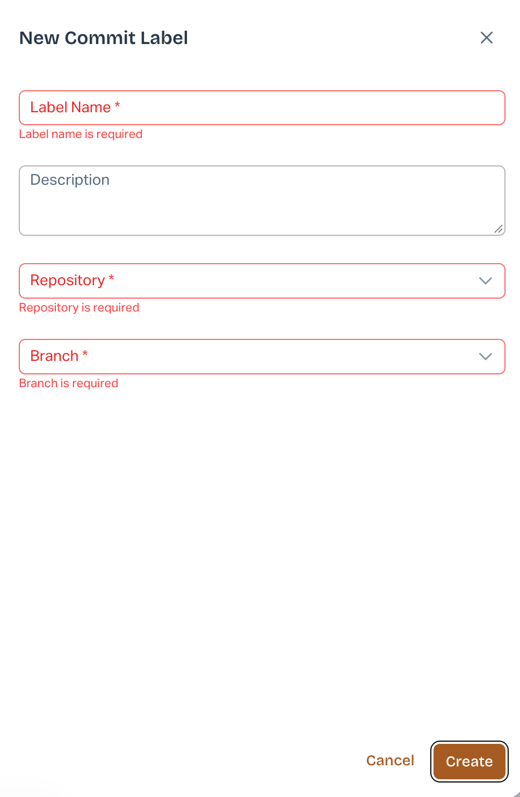

# Required Field Validation for Commit Label Creation (New UI)

### Overview

AutoRABIT ARM has enhanced the **Commit Label Creation** process in the New UI with improved required field validation and informative tooltips. These improvements help users identify missing information and create Commit Labels more efficiently.

### What's New?

* **Required Field Validation:** When users click **Create** without completing mandatory fields, ARM highlights the missing information and displays clear inline error messages.
* **Automatic Navigation:** ARM automatically scrolls to the first invalid field, allowing users to quickly identify and correct missing information.
* **Informative Tooltips:** When the **Create** button is unavailable, ARM displays a tooltip explaining why the action is disabled.

### How It Works

1. Navigate to the **Create Commit Label** screen in the New UI.
2. Enter the required Commit Label details.
3. Click **Create**. If any mandatory fields are missing, ARM highlights them and displays inline validation messages.
4. Correct the highlighted fields based on the validation messages.
5. Once all required information is provided, proceed with Commit Label creation.

<figure><figcaption></figcaption></figure>

### Benefits

* Quickly identify and resolve missing required fields.
* Reduce errors during Commit Label creation.
* Understand why the Create action is unavailable.
* Improve the overall Commit Label creation experience.

**Availability:** AutoRABIT ARM – New UI only.
