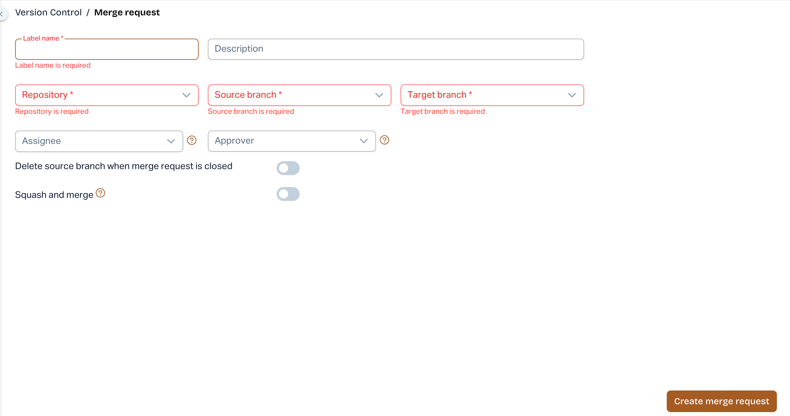

# Required Field Validation for Merge Request Creation (New UI)

### Overview

AutoRABIT ARM has enhanced the **Merge Request** creation process in the New UI with improved required field validation, automatic Target Branch selection, and informative tooltips. These improvements help users identify missing information and create Merge Requests more efficiently.

### What's New?

* **Required Field Validation:** When users click **Create Merge Request** with missing mandatory information, ARM highlights the required fields and displays clear inline error messages.
* **Automatic Navigation:** ARM automatically scrolls to the first invalid field, allowing users to quickly identify and correct missing information.
* **Target Branch Auto-Population:** The Target Branch is automatically populated based on the selected Source Branch's default configuration.
* **Informative Tooltips:** When the Create Merge Request action is unavailable, ARM displays a tooltip explaining why the action is disabled.

### How It Works

1. Navigate to **Version Control → Merge Request** in the New UI.
2. Select the repository and Source Branch. The Target Branch is automatically populated based on the configured default.
3. Enter the required Merge Request details.
4. Click **Create Merge Request**. If mandatory fields are missing, ARM highlights them and displays inline validation messages.
5. Correct the highlighted fields and proceed with Merge Request creation.

<figure><figcaption></figcaption></figure>

### Benefits

* Quickly identify and resolve missing required fields.
* Reduce manual effort with automatic Target Branch selection.
* Understand why Merge Request creation is unavailable.
* Improve the overall Merge Request creation experience.

**Availability:** AutoRABIT ARM – New UI only.
