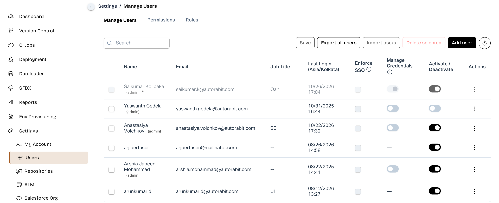

# Managing Credentials with Admin Permissions

### Overview

AutoRABIT ARM introduces the **Manage Credentials** permission, allowing Register User to grant selected Standard Admins the ability to manage credentials created by other users.

**Availability:** New UI only

### Prerequisites

Before using this feature, ensure that:

* You are using the **AutoRABIT ARM New UI**.
* You have Register User access to grant or revoke the Manage Credentials permission.
* Standard Admins who need to manage credentials belonging to other users have been granted the **Manage Credentials** permission.

**Note:** The Manage Credentials permission is disabled by default for Standard Admins. It is not available to Custom Admins or regular users.

***

### 1. Granting Manage Credentials Permission

Only the Super Admin (the organization's registered administrator) can enable or disable the Manage Credentials permission for Standard Admins.

#### Steps to enable the permission

1. Log in to AutoRABIT ARM using the **New UI** with Super Admin credentials.
2. From the left navigation menu, go to **Settings → Users**.
3. The **Manage Users** page appears.
4. Locate the Standard Admin for whom you want to enable credential management.
5. In the **Manage Credentials** column, turn the toggle **ON**.
6. Click **Save** to apply the changes.

Once enabled, the selected Standard Admin can manage Global credentials belonging to other users and delete Private credentials belonging to other users.

**Important:**

* The Super Admin always has Manage Credentials permission, and their toggle remains enabled and locked.
* Standard Admins can view the permission status but cannot modify it.
* Regular users and Custom Admins are not eligible for this permission.
* To revoke access, the Super Admin can turn the toggle OFF and save the changes. The additional credential-management capability is then removed.

<figure><figcaption></figcaption></figure>

***

### 2. Viewing and Managing Credentials

Once the Manage Credentials permission is enabled, the authorized Admin can access credentials created by other users.

#### Steps to view credentials

1. Log in to AutoRABIT ARM using the New UI.
2. Navigate to **Settings → Credentials**.
3. The Credentials page displays the available credentials.
4. Use the **Search** field to locate a specific credential.
5. Review the credential details, including:
   * Credential Name
   * Username
   * Scope (Global or Private)
   * Credential Type
   * Owner
   * Owner Status (Active or Inactive)
6. Click the **three-dot menu (⋮)** under the Actions column to view the available operations.

The available actions depend on the credential scope and the Admin's permissions.

#### Credential management permissions

| Credential Scope                             | Authorized Admin Actions                 |
| -------------------------------------------- | ---------------------------------------- |
| Global credential                            | Edit, rotate password/token, or delete   |
| Private credential belonging to another user | Delete only                              |
| OAuth repository credential                  | No additional access; remains owner-only |

**Note:** These permissions apply regardless of whether the original credential owner is Active or Inactive.

<figure><figcaption></figcaption></figure>

***

### 3. Editing or Rotating a Global Credential

Authorized Admins can update Global credentials created by other users without requiring access from the original credential owner.

This is useful when an existing password or access token expires and needs to be replaced.

#### Steps to update a Global credential

1. Navigate to **Settings → Credentials**.
2. Search for the Global credential you want to update.
3. Click the **three-dot menu (⋮)** under Actions.
4. Select **Edit**.
5. The **Edit Credential** window appears.
6. Review the credential information.
7. Update the applicable fields:
   * **Username:** Modify the username if required.
   * **Email:** Update the email address, where applicable.
   * **Token/Password:** Enter a new password or token to replace the existing value.
8. Click **Save** to apply the changes.

#### Important considerations

* The existing password or token cannot be viewed by another Admin.
* Leave the Token/Password field blank to retain the existing value.
* Entering a new password or token replaces the existing secret.
* The credential Name, Type, Scope, and Owner cannot be modified.
* The credential retains its existing internal reference after the update.

**Existing configurations remain associated with the same credential**, so users do not need to select or configure the credential again in Version Control repositories, CI Jobs, or other dependent configurations.

<figure><figcaption></figcaption></figure>

***

### 4. Deleting a Global or Private Credential

Authorized Admins can delete Global credentials and Private credentials belonging to other users.

For Private credentials, editing or replacing the password/token is not permitted. Only deletion is allowed.

#### Steps to delete a credential

1. Navigate to **Settings → Credentials**.
2. Search for the credential you want to delete.
3. Click the **three-dot menu (⋮)** under Actions.
4. Select **Delete**.
5. ARM displays a confirmation window.
6. Review the warning and any existing configuration references.
7. Choose one of the following options:
   * **Cancel:** Close the confirmation window without deleting the credential.
   * **Delete:** Confirm and proceed with deletion.

#### Credential dependency validation

Before deleting a credential, ARM checks whether it is referenced by supported configurations, including:

* Version Control Repositories
* CI Jobs
* Branch Mappings
* ALM Systems and ALM Mappings
* Plugins
* Proxies
* Salesforce-VC User Mappings

If the credential is currently being used, ARM displays a warning identifying the detected references.

For example, if a Private credential belonging to an inactive user is referenced by a Version Control repository, the confirmation window displays that dependency before deletion.

**Important:** Deleting a credential that is still being used may cause associated repositories, integrations, or automated workflows to fail.

If ARM cannot complete the dependency check, a warning indicates that credential usage could not be verified. The Admin can still choose whether to proceed.

<figure><figcaption></figcaption></figure>

***

### 5. Credential Security and Access Restrictions

The Manage Credentials feature includes safeguards to protect sensitive information and prevent unauthorized changes.

#### Password and token protection

* Existing passwords and tokens cannot be retrieved or viewed by another Admin.
* Authorized Admins can replace Global credential secrets without knowing their current values.
* Private credential secrets remain protected from other Admins.
* Credential ownership cannot be transferred through this feature.

#### Permission restrictions

* Only the Super Admin can grant or revoke Manage Credentials permission.
* Standard Admins cannot modify their own permission or another Admin's permission.
* Custom Admins and regular users cannot be granted this permission.
* OAuth repository credentials remain restricted to their original owners.

#### Audit tracking

ARM records administrative credential-management activities for auditability, including:

* Granting or revoking Manage Credentials permission.
* Updating or rotating Global credentials belonging to other users.
* Deleting credentials belonging to other users.

Audit records include relevant details such as the credential name, scope, original owner, action performed, administrator performing the action, timestamp, and changed fields where applicable.

**Security note:** Actual passwords, tokens, and other secret values are never recorded in audit history.

***

### Frequently Asked Questions

**Q1. Can a Standard Admin manage credentials created by another user?**

Yes. A Standard Admin can manage another user's credentials only after the Super Admin enables the Manage Credentials permission.

**Q2. Can an authorized Admin view an existing password or token?**

No. Existing passwords and tokens remain protected. For Global credentials, authorized Admins can replace the existing secret but cannot retrieve its current value.

**Q3. Can an authorized Admin edit another user's Private credential?**

No. Private credentials remain editable only by their original owners. Authorized Admins can delete another user's Private credential but cannot edit it or replace its secret.

**Q4. Does the credential owner need to be inactive before an Admin can manage the credential?**

No. The permission applies regardless of whether the original credential owner is Active or Inactive.

**Q5. Will updating a Global credential affect existing repository or CI Job configurations?**

The credential retains its existing internal reference, so it does not need to be reassigned to dependent configurations. However, the updated credentials must still be valid for the connected systems.

**Q6. Can an authorized Admin delete a credential that is currently being used?**

Yes. ARM displays a warning identifying detected dependencies before deletion. The Admin can review the information and decide whether to continue.

**Q7. Can Custom Admins be granted Manage Credentials permission?**

No. This permission is available only to Standard Admins and is controlled by the Super Admin.

**Q8. Is this functionality available in the Classic UI?**

No. The Manage Credentials enhancement is available only in the **AutoRABIT ARM New UI**.

***

### Summary

The Manage Credentials enhancement provides controlled administrative access to shared credentials in AutoRABIT ARM.

By allowing Super Admins to delegate credential-management capabilities to selected Standard Admins, organizations can rotate shared credentials, remove obsolete credentials, and maintain operational continuity without compromising the security of Private credentials.

The feature also provides dependency warnings, secret protection, and audit tracking to support secure credential administration.
