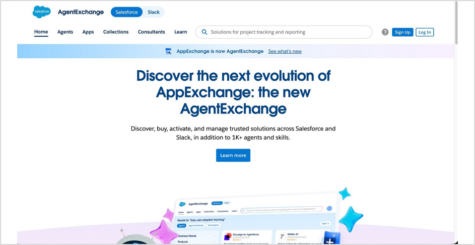

# AutoRABIT App - ARM Installation and Configuration Guide

PURPOSE: This guide walks administrators through installing the AutoRABIT Salesforce package,\
configuring the Salesforce OAuth settings required by the connector, authorizing inbound and outbound connections, enabling licensed products, assigning the AutoRABIT ARM permission set, and completing product-side Salesforce org registration for ARM.

## Process at a Glance

<table><thead><tr><th valign="top">1 Install</th><th valign="top">2 Configure Salesforce</th><th valign="top">3 Authorize Connector</th><th valign="top">4 Register Org</th></tr></thead><tbody><tr><td valign="top">AppExchange / AgentExchange</td><td valign="top">OAuth &#x26; External Client App</td><td valign="top">Inbound + outbound</td><td valign="top">Product visibility + permissions</td></tr></tbody></table>

## 1.  Before You Begin

Confirm the target Salesforce environment and the user accounts that will be used before starting the installation. This avoids installing into the wrong org or authorizing the connector with an unintended user.

* Choose the installation target: Production/Developer Org or Sandbox.
* Use a Salesforce account with sufficient access to install the package and update Setup settings.
* Identify the Salesforce user that will act as the AutoRABIT integration user.
* Before inbound authorization, make sure the integration user has the AutoRABIT Setup User permission set.
* Confirm that the customer has a valid ARM license enabled.


ENVIRONMENT CHOICE: The AppExchange flow is different for Production/Developer organizations and Sandboxes. Follow only the path that matches the org you are configuring.


## 2. Locate the AutoRABIT Package

#### 1.  Open Salesforce AppExchange / AgentExchange

Open the Salesforce marketplace in a browser. Sign in if prompted.

<figure><figcaption>
<em>Figure 1. Salesforce AppExchange / AgentExchange landing page</em>
</figcaption></figure>

#### 2. Search for AutoRABIT

Use the marketplace search field and search for “AutoRABIT.”

 

<figure><figcaption>
<em>Figure 2. Searching the marketplace for AutoRABIT.</em>
</figcaption></figure>

#### 3.  Open the AutoRABIT listing

Select the AutoRABIT Salesforce DevOps Platform listing from the search results.

<figure><figcaption>
<em>Figure 3. AutoRABIT listing in the marketplace search results.</em>
</figcaption></figure>

## 3.  Install in a Production or Developer Org

#### 1.  Select Get It Now

From the AutoRABIT listing, choose “Get It Now” to begin the production/developer installation flow.

<figure><figcaption>
<em>Figure 4. “Get It Now” on the AutoRABIT listing.</em>
</figcaption></figure>

#### 2.  Authenticate to Salesforce

Log in with the Salesforce credentials associated with the target Production/Developer org.

<figure><figcaption>
Figure 5. Salesforce sign-in prompt launched from the marketplace.
</figcaption></figure>

#### 3.  Use the correct Salesforce or business identity

If Salesforce requests account identification, use the Salesforce or business email tied to the intended org.

<figure><figcaption>
<em>Figure 6. Salesforce account identification screen.</em>
</figcaption></figure>

#### 4.  Select the target org

Choose the Production/Developer organization where the package should be installed. Verify the org before proceeding.

<figure><figcaption>
<em>Figure 7. Selecting the Production/Developer organization</em>
</figcaption></figure>

#### 5.  Accept the marketplace terms and confirm installation

Review the installation details, accept the Salesforce AppExchange terms and conditions, and select “Confirm and Install.” Salesforce then redirects you to the package installation page in the selected org.

<figure><figcaption>
<em>Figure 8. Confirm Installation Details and “Confirm and Install.”</em>
</figcaption></figure>

## 4.  Install in a Sandbox

#### 1.  Select Try It

For a Sandbox installation, use the “Try It” option on the AutoRABIT listing instead of “Get It Now.”

<figure><figcaption>
Figure 9. “Try It” option for the Sandbox installation path.
</figcaption></figure>

#### 2.  Continue to installation

On the trial setup page, confirm the information shown and select “Continue to Installation.”

<figure><figcaption>
Figure 10. Sandbox trial setup and “Continue to Installation.”
</figcaption></figure>

3\.  Log in and install

Select “Log In & Install,” then authenticate to the Sandbox in which the package will be installed.

<figure><figcaption>
<em>Figure 11. “Log In &#x26; Install” for the Sandbox installation.</em>
</figcaption></figure>

#### 4.  Install for Admins Only

When the Salesforce package installation screen opens, select “Install for Admins Only,” then click “Install.” This is the installation scope shown in the source procedure.

<figure><figcaption>
Figure 12. Package installation scope set to “Install for Admins Only.”
</figcaption></figure>

5\.  Approve required third-party access

Salesforce may request approval for access to login.salesforce.com and test.salesforce.com. Select the option to grant access to these third-party sites, then click “Continue.” 

<figure><figcaption>
<em>Figure 13. Approve Third-Party Access prompt.</em>
</figcaption></figure>


**WHY THIS IS REQUIRED** The package requires these Salesforce endpoints so the AutoRABIT applications can complete the authentication and connectivity flow shown in this procedure.


#### 6.  Wait for package installation to complete

Do not begin post-install configuration until Salesforce confirms the package has finished installing.

<figure><figcaption>
Figure 14. Salesforce package installation in progress.
</figcaption></figure>

<figure><figcaption>
Figure 15. Salesforce may send an email if the package installation takes longer than expected.
</figcaption></figure>


**LONG-RUNNING INSTALLATION** If Salesforce reports that the package is taking a long time to install, wait for either the completion screen or the Salesforce completion email before continuing.


## 5.  Configure Salesforce OAuth and External Client App Settings

After the package is installed, configure the Salesforce OAuth settings required by the AutoRABIT Connector.

#### 1.  Open OAuth and OpenID Connect Settings

In Salesforce Setup, search for and open “OAuth and OpenID Connect Settings.”

<figure><figcaption>
<em>Figure 16. Salesforce Setup navigation to OAuth and OpenID Connect Settings.</em>
</figcaption></figure>

#### 2.  Enable the required OAuth settings

Verify that both of the following settings are enabled. If either is disabled, enable it:

* Allow Authorization Code and Credentials Flows
* Require Proof Key for Code Exchange (PKCE) Extension for Supported Authorization Flows

<figure><figcaption>
<em>Figure 17. Required OAuth settings in Salesforce Setup.</em>
</figcaption></figure>

#### 3.  Confirm the Salesforce warning

When Salesforce displays a warning about changing the setting, review it and click “OK” to continue.

<figure><figcaption>
<em>Figure 18. Salesforce confirmation dialog when changing OAuth settings.</em>
</figcaption></figure>

#### 4. Confirm Session Settings

In Setup, search for and open “Session Settings.” Under “Session Settings,” make sure “Lock sessions to the IP address from which they originated” is disabled in the org.

<figure><figcaption>
Figure 19. Session Settings: “Lock sessions to the IP address from which they originated” disabled.
</figcaption></figure>

#### 5.  Open External Client App Manager

From Setup, open “External Client App Manager.”

<figure><figcaption>
<em>Figure 20. External Client App Manager in Salesforce Setup.</em>
</figcaption></figure>

#### 6.  Open AutoRABIT Connector

Select only the external client app named “AutoRABIT Connector.” Do not select “AutoRABIT Connector (Dev).” The (Dev) External Client App (ECA) is reserved for debugging and troubleshooting purposes and must not be used for the standard AutoRABIT installation and configuration process.

<figure><figcaption>
<em>Figure 21. Select the standard “AutoRABIT Connector” entry. Do not use “AutoRABIT Connector (Dev).”</em>
</figcaption></figure>

#### 7.  Edit Policies

On the AutoRABIT Connector page, open the Policies tab and click “Edit.”

<figure><figcaption>
<em>Figure 22. Edit action on the AutoRABIT Connector Policies page.</em>
</figcaption></figure>

#### 8.  Expand OAuth Policies and enable guest-user credential flow

Expand “OAuth Policies,” enable “Enable Code and Credentials Flow for Guest Users,” and then save the changes.

<figure><figcaption>
<em>Figure 23. OAuth Policies section before enabling the option.</em>
</figcaption></figure>

<figure><figcaption>
<em>Figure 24. “Enable Code and Credentials Flow for Guest Users” enabled.</em>
</figcaption></figure>

## 6.  Open the AutoRABIT Connector and Authorize the Inbound Connection

#### 1.  Launch AutoRABIT Connector

Open the Salesforce App Launcher, search for “AutoRABIT Connector,” and launch the app.

<figure><figcaption>
Figure 25. AutoRABIT Connector in the Salesforce App Launcher.
</figcaption></figure>

#### 2.  Open Configuration

From the AutoRABIT Connector home page, click the “Configuration” card.

<figure><figcaption>
Figure 26. Configuration card in AutoRABIT Connector.
</figcaption></figure>

#### 3.  Authorize the inbound connection

The System Connections page contains two authorization areas. Start with Inbound Connection and click “Authorize.” The Salesforce user that completes this authorization becomes the AutoRABIT integration user for the connection.

<figure><figcaption>
Figure 27. Inbound Connection authorization in AutoRABIT Connector.
</figcaption></figure>


**INTEGRATION USER REQUIREMENT** If the currently signed-in Salesforce user is not the intended integration user, use the “Not you?” option on the Salesforce authorization screen and sign in as the correct user. The user completing this authorization must have the “AutoRABIT Setup User” permission set.



**NON-ADMINISTRATOR PROFILE REQUIREMENT** If the Salesforce user connecting the org to the AutoRABIT product is not a System Administrator, their profile must also include the following permissions: API Enabled, Modify Metadata Through Metadata API Functions, and Customize Application.


#### 4.  Allow access

Review the Salesforce authorization request for AutoRABIT Connector and click “Allow” when the displayed user is the intended integration user.

<figure><figcaption>
<em>Figure 28. Salesforce “Allow Access?” authorization screen.</em>
</figcaption></figure>

## 7.  Configure and Authorize the Outbound Connection

After inbound authorization succeeds, complete the Outbound Connection. The connector requires three values from ARM: Subdomain, Client ID, and Client Secret.

<figure><figcaption>
<em>Figure 29. Outbound Connection fields in AutoRABIT Connector.</em>
</figcaption></figure>

#### 1. Sign in to the AutoRABIT product

Open ARM and sign in.


**CREDENTIAL HANDLING** Client Secret values are sensitive. Copy them only into the intended connector field and avoid placing them in tickets, chat messages, or documentation.


### 7.1  ARM – Register a Salesforce Org

**1.  Open Salesforce Org settings**

In ARM, go to Settings → Salesforce Org. This page lists the Salesforce orgs already registered to this product. To register a new one, click “Register Salesforce org” in the top right.

<figure><figcaption>
<em>Figure 30. ARM Settings → Salesforce Org, with “Register Salesforce org” in the top right.</em>
</figcaption></figure>

**1.  Choose the registration method**

In the “Register Salesforce Org” panel, keep “AutoRABIT Connector” selected under Registration method. Click the “Select Salesforce Org” dropdown to see Salesforce orgs already authorized through the AutoRABIT Connector.

<figure><figcaption>
Figure 31. Register Salesforce Org panel, AutoRABIT Connector method selected.
</figcaption></figure>

**3.  Select an already-authorized org, if available**

If the org you want to add already appears in the list, select it and skip to step 7.

<figure><figcaption>
Figure 32. Select Salesforce Org dropdown showing orgs already authorized with the AutoRABIT Connector.
</figcaption></figure>

#### 4. If the org isn’t listed, get the connector values from ARM

If you don’t see the org you need in the dropdown, expand “Authorize Org with AutoRABIT Connector” in ARM. This reveals the Subdomain, Client ID, and Client Secret for the org you want to connect.

<figure><figcaption>
<em>Figure 33. Authorize Org with AutoRABIT Connector, expanded to show the Subdomain, Client ID, and Client Secret to copy into Salesforce.</em>
</figcaption></figure>

**5.  Enter those values in Salesforce and authorize**

Switch to the Salesforce tab with AutoRABIT Connector open (Configuration → System Connections → Outbound Connection, shown earlier in Section 7). Paste the Subdomain, Client ID, and Client Secret from ARM into the matching fields, then click “Authorize.” Confirm the Outbound Connection changes from “Not Authorized” to an authorized state before continuing.

<figure><figcaption>
<em>Figure 34. Outbound Connection fields in Salesforce populated with the values copied from ARM, ready to authorize.</em>
</figcaption></figure>

**6.  Return to ARM and select the newly authorized org**

Back in ARM, reopen the “Select Salesforce Org” dropdown from step 3. The org you just authorized should now appear in the list — select it.

**7.  Add the org**

Once the org is selected, click “Add Org” in ARM to complete the registration.


**ABOUT THIS SECTION** ARM's registration panel doesn't show a separate first-time “welcome” screen the way some other AutoRABIT products do — the same panel is used whether this is the first org or an additional one. If ARM does expose a distinct first-time flow, let me know and I'll split this into first-time / adding-another-org subsections to match the source procedure's pattern exactly.


## 8.  Enable Products and Assign Permissions

#### 1.  Open Products

After system connection registration is complete, close Configuration and open the “Products” card in AutoRABIT Connector.

<figure><figcaption>
Figure 35. Products card in AutoRABIT Connector.
</figcaption></figure>

2. Review product availability and toggles

For products with valid licenses, the connector displays an enable/disable toggle. Enabled products can see the registered Salesforce org in the related AutoRABIT application. If the toggle is off, that product cannot use the org in its configuration.

<figure><figcaption>
Figure 36. Example of a licensed product enabled with its toggle (a different AutoRABIT product is shown here as the illustrative example from the source procedure; ARM's own toggle appears the same way when licensed).
</figcaption></figure>


**DEFAULT BEHAVIOR** After the org is registered, available licensed products are enabled by default in the flow shown. Turn off a product only when the org should not be exposed to that application.


#### 3.  Recognize products without a license

If there is no valid license for a product, the product page displays that no valid licenses are available instead of an active enablement toggle.

<figure><figcaption>
Figure 37. Example of a product with no valid licenses available (shown for a different product in the source procedure; this guide assumes ARM itself is licensed).
</figcaption></figure>

#### 4.  Open Licensing & Permissions

Return to the AutoRABIT Connector home page and click “Licensing & Permissions.”

<figure><figcaption>
Figure 38. Licensing &#x26; Permissions card.
</figcaption></figure>

#### 5.  Assign the required permission sets

Review the listed AutoRABIT permission sets and assign the AutoRABIT ARM permission set to the authorized/integration user. The detailed steps for configuring this permission set are in section 8.1 below.

<figure><figcaption>
Figure 39. AutoRABIT permission sets available from Licensing &#x26; Permissions.
</figcaption></figure>

8.1 AutoRABIT ARM Permission Set This section walks through configuring the AutoRABIT ARM permission set in Salesforce. Follow each step in order to grant the AutoRABIT ARM integration user the access it needs.

1. Open Licensing & Permissions In Salesforce, open the AutoRABIT Connector app and click Licensing & Permissions.

<figure><figcaption>
Figure 40. AutoRABIT Connector home page, with Licensing &#x26; Permissions highlighted.
</figcaption></figure>

**2.  Open Permission Sets**

Click Permission Sets.

<figure><figcaption>
Figure 41. Permission Sets option under Licensing &#x26; Permissions.
</figcaption></figure>

**3.  Select the AutoRABIT ARM Permission Set**

Click AutoRABIT ARM to open the permission set.

<figure><figcaption>
Figure 42. AutoRABIT ARM permission set in the Permission Sets list.
</figcaption></figure>

**4.  Open System Permissions**

Click System Permissions. This section controls permissions to perform actions that apply across apps, such as “Modify All Data.”

<figure><figcaption>
Figure 43. System Permissions option on the AutoRABIT ARM permission set.
</figcaption></figure>

**5.  Enable editing**

Click Edit to make the permission list editable.

<figure><figcaption>
Figure 44. Edit action on the AutoRABIT ARM System Permissions page.
</figcaption></figure>

**6.  Enable View All Data**

Search for View All Data and select its checkbox if it is not already selected.

<figure><figcaption>
<em>Figure 45. Searching for and enabling View All Data.</em>
</figcaption></figure>

&#x20;&#x37;**.  Enable Modify All Data**

Search for Modify All Data and select its checkbox if it is not already selected.

<figure><figcaption>
<em>Figure 46. Searching for and enabling Modify All Data.</em>
</figcaption></figure>

**8.  Enable Customize Application**

Search for Customize Application and select its checkbox if it is not already selected.

<figure><figcaption>
<em>Figure 47. Searching for and enabling Customize Application.</em>
</figcaption></figure>

**9.  Enable Manage Users**

Search for Manage Users and select its checkbox if it is not already selected, using the same System Permissions search-and-enable pattern shown in the previous step.

**10.  Save the permission set**

After selecting all the required checkboxes, click Save at the top of the page.

<figure><figcaption>
Figure 48. Save action on the System Permissions page.
</figcaption></figure>

**11.    Confirm the save**

In the Save Changes confirmation dialog box, click Save again to apply the changes.

<figure><figcaption>
<em>Figure 49. Save Changes confirmation dialog listing the permission dependencies.</em>
</figcaption></figure>


**ALTERNATIVE: OBJECT-BY-OBJECT PERMISSIONS** If you do not want to grant all View All Data and Modify All Data permissions at once, you can go back to step 4 and, instead of System Permissions, open Object Settings. From there, grant the required permissions object by object, based on your specific needs.


## 9.  Complete Salesforce Org Registration in ARM

#### 1.  Refresh the product-side org list

After the Salesforce-side registration and permissions are complete, return to the ARM “Register Salesforce Org” panel and click the refresh icon next to the “Select Salesforce Org” dropdown.

<figure><figcaption>
Figure 50. Refresh control next to the Select Salesforce Org dropdown in ARM.
</figcaption></figure>

#### &#x20;2.  Select the newly authorized Salesforce org

The newly authorized Salesforce org should now appear in the dropdown. Choose it to create the product configuration.

<figure><figcaption>
Figure 51. Select Salesforce Org dropdown in ARM, now showing the newly authorized org.
</figcaption></figure>

#### 3.  Add the org

With the correct org selected, click “Add Org.”

<figure><figcaption>
<em>Figure 52. “Add Org” action in the ARM Register Salesforce Org panel.</em>
</figcaption></figure>


**CROSS-PRODUCT BEHAVIOR** Once the Salesforce org has been configured for one AutoRABIT product, any other AutoRABIT application that has a valid license and is enabled for the org should display that org without repeating the connector configuration steps.


## 10.      Completion Checklist

Before handing the configuration over for use, verify each item below.

☐  AutoRABIT package installation completed successfully in the intended Salesforce org.

☐  Required OAuth settings are enabled in Salesforce Setup.

☐  “Lock sessions to the IP address from which they originated” is disabled in Session Settings.

☐  AutoRABIT Connector OAuth Policy is saved with Code and Credentials Flow for Guest Users enabled.

☐  The standard “AutoRABIT Connector” ECA is selected; “AutoRABIT Connector (Dev)” is not used for normal configuration.

☐  Inbound Connection is authorized with the intended integration user.

☐  The integration user has the AutoRABIT Setup User permission set.

☐  Outbound Connection contains the correct Subdomain, Client ID, and Client Secret and shows as authorized.

☐  ARM is enabled in the Products area.

☐  The AutoRABIT ARM permission set is configured and assigned to the authorized user.

☐  The Salesforce org appears in ARM after Refresh.

☐  The org was successfully added to the ARM product configuration.


**IF SOMETHING DOES NOT APPEAR** Recheck the package installation status, OAuth settings, connector authorization state, product license availability, the product enablement toggle, and the permission sets assigned to the integration user. The product-side org list may also need to be refreshed after Salesforce-side changes.

