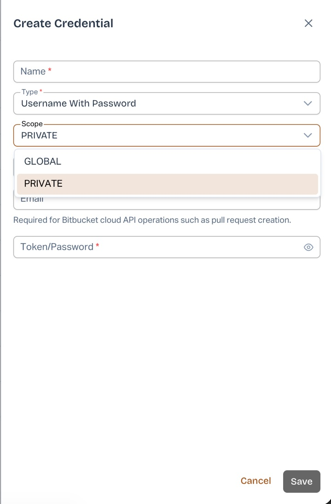
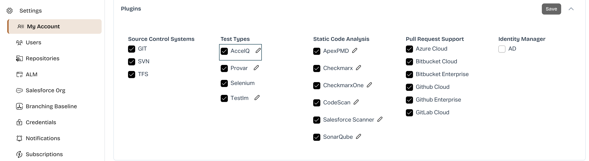
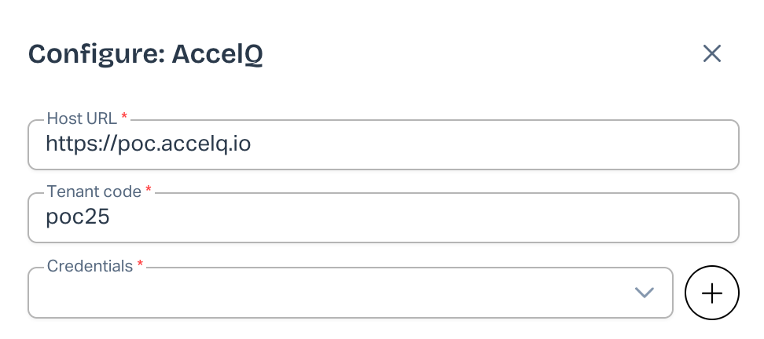
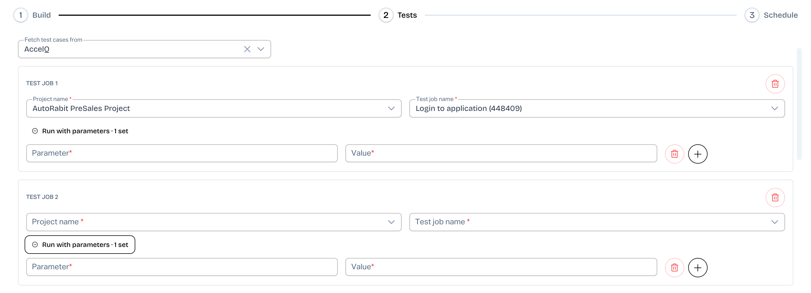

# AccelQ Integration with AutoRABIT ARM.

### Overview

AutoRABIT ARM integrates with **AccelQ**, a continuous test automation platform, to help teams automate functional testing as part of their Continuous Integration (CI) and deployment workflows.

With this integration, users can configure AccelQ test jobs in ARM and execute automated functional tests as part of their CI Job execution.

#### What's New?

The AccelQ integration has been enhanced in the **ARM New UI** to support configuring and executing **up to 5 AccelQ test jobs within a single CI Job**.

Previously, users could configure only one AccelQ project and one test job per CI Job. To execute multiple test suites, they had to create separate CI Jobs, resulting in repeated configurations and deployments.

With this enhancement, users can:

* Configure up to **5 AccelQ test jobs** within a single CI Job.
* Select multiple test jobs from the same AccelQ project.
* Configure test jobs from different AccelQ projects.
* Use a combination of test jobs from the same or different projects.
* Define individual run parameters for each test job.
* Execute all configured test jobs following a single deployment.
* View consolidated test results, including individual test job outcomes, from CI Job History.

**Important:** Multiple AccelQ test job configuration is available only in the **ARM New UI** and is supported for CI Jobs. Existing AccelQ configurations in Deployment workflows remain unchanged.

***

### Prerequisites

Before configuring AccelQ in ARM, ensure that:

1. You have an active AccelQ account with access to the required projects and test jobs.
2. You have a valid AccelQ API token.
3. You have the AccelQ Host URL and Tenant Code.
4. You have the necessary permissions to manage credentials, configure plugins, and create or edit CI Jobs in ARM.

### Step 1: Create AccelQ Credentials in ARM

To integrate AccelQ with ARM, you must first register your AccelQ credentials.

1. Log in to **AutoRABIT ARM**.
2. Navigate to **Settings > Credentials**.
3. Click **Create Credential**.
4. Enter the following information:

| Field          | Description                                                          |
| -------------- | -------------------------------------------------------------------- |
| Name           | Enter a descriptive name for the AccelQ credential.                  |
| Type           | Select **Username With Password**.                                   |
| Scope          | Select **PRIVATE** or **GLOBAL**, depending on your requirements.    |
| Username       | Enter your AccelQ username.                                          |
| Email          | Optional field. Required for certain Bitbucket Cloud API operations. |
| Token/Password | Enter your AccelQ API token.                                         |

5. Click **Save** to register the credential.

**Note:** Use your AccelQ username rather than the email address used to log in to AccelQ, unless they are the same.

<figure><figcaption></figcaption></figure>

### Step 2: Configure AccelQ as a Plugin

After creating the credential, configure AccelQ in ARM.

1. Navigate to **Settings > My Account**.
2. Locate the **Plugins** section.
3. Under **Test Types**, select **AccelQ**.
4. Click the **Edit (pencil)** icon next to AccelQ.
5. In the **Configure: AccelQ** window, provide the following information:

| Field       | Description                                                      |
| ----------- | ---------------------------------------------------------------- |
| Host URL    | Enter your AccelQ instance URL. Example: `https://poc.accelq.io` |
| Tenant Code | Enter the Tenant Code associated with your AccelQ account.       |
| Credentials | Select the AccelQ credential created in Step 1.                  |

6. Save the AccelQ configuration and any pending changes on the My Account page.

**Note:** The Tenant Code can be retrieved from the **AUTH PROPERTIES** section of your AccelQ user profile.

<figure><figcaption></figcaption></figure>

<figure><figcaption></figcaption></figure>

***

### Step 3: Configure Multiple AccelQ Test Jobs in a CI Job

Once the AccelQ plugin is configured, you can add multiple AccelQ test jobs to a single CI Job.

#### Create or Edit a CI Job

1. Navigate to **CI Jobs > CI Job List**.
2. Create a new CI Job or edit an existing CI Job.
3. Select the required CI Job type and configure the Build and Deployment settings, as applicable.
4. Navigate to the **Tests** step in the CI Job configuration wizard.
5. Under **Fetch test cases from**, select **AccelQ**.

<figure><figcaption></figcaption></figure>

#### Add AccelQ Test Jobs

Once AccelQ is selected, the Tests section displays **Test Job 1**.

1. Under **Test Job 1**, select the required **Project name**.
2. Select the corresponding **Test job name**.
3. If required, expand **Run with parameters** and provide the parameter names and values.
4. Click **+ Add Test Job** to configure an additional test job.
5. For each additional test job, select the required project and test job.
6. Repeat the process to configure up to **5 AccelQ test jobs**.

<figure><figcaption></figcaption></figure>

You can configure test jobs using any of the following combinations:

| Configuration                      | Example                                                                              |
| ---------------------------------- | ------------------------------------------------------------------------------------ |
| Single project, multiple test jobs | Project A – Test Job 1, 2, 3, 4, and 5                                               |
| Multiple projects                  | Project A – Test Job 1, Project B – Test Job 2, Project C – Test Job 3               |
| Mixed configuration                | Project A – Test Jobs 1 and 2, Project B – Test Jobs 3 and 4, Project C – Test Job 5 |

#### Configure Run Parameters

Each AccelQ test job supports its own run parameters.

1. Expand **Run with parameters** under the required test job.
2. Enter the **Parameter** name.
3. Enter the corresponding **Value**.
4. Use the **+** icon to add additional parameters.
5. Use the delete icon to remove a parameter.

Run parameters are maintained independently for each test job. Changing the project selection for one test job clears its associated parameters without affecting the other configured test jobs.

#### Remove a Test Job

To remove a configured test job, click the **Delete** icon displayed on the corresponding test job card.

#### Run Tests Even When Deployment Fails

The Tests section also provides the **Run Tests even when the Deployment fails** checkbox.

When enabled, ARM attempts to execute the configured AccelQ test jobs even if the deployment fails.

This setting applies to all AccelQ test jobs configured within the CI Job.

After completing the configuration, proceed through the remaining CI Job wizard steps and save the CI Job.&#x20;

**Important:** A maximum of 5 AccelQ test jobs can be configured within a single CI Job.

***

### Step 4: Execute the CI Job

After saving the CI Job, you can trigger its execution manually or through the configured CI Job trigger.

During execution:

1. ARM performs the configured build and deployment operations.
2. Following the deployment, ARM triggers the configured AccelQ test jobs.
3. AccelQ executes the test jobs using its available agents.
4. ARM collects the execution results for each configured test job.
5. The Functional Tests stage is marked as completed only after all configured test jobs have finished.

**Note:** All configured AccelQ test jobs are triggered as part of the same CI build after a single deployment. Actual execution may be parallel or sequential, depending on agent availability and configuration in AccelQ.

***

### Step 5: View AccelQ Test Results

ARM provides consolidated AccelQ test results in CI Job History, allowing users to review the overall test execution status and individual test job results.

#### Access the Results

1. Navigate to **CI Jobs > CI Job History**.
2. Select the required CI Job.
3. Locate the build for which you want to review the results.
4. Under the **Functional Tests** section, click the test results/details icon.
5. The **AccelQ Test Results** panel opens with the consolidated results.

<figure><figcaption></figcaption></figure>

#### Understanding the Consolidated Results

The AccelQ Test Results panel displays:

| Field             | Description                                                                                   |
| ----------------- | --------------------------------------------------------------------------------------------- |
| Overall Status    | Displays the consolidated test execution status, such as Passed or Failed.                    |
| Test Jobs Passed  | Displays the number of successfully completed test jobs out of the total configured jobs.     |
| Cases Passed      | Displays the total number of passed test cases out of the total executed/reported test cases. |
| Project           | Displays the AccelQ project associated with each test job.                                    |
| Test Job          | Displays the configured AccelQ test job name.                                                 |
| Result            | Displays the individual test job execution status.                                            |
| Cases             | Displays the passed and total test case counts for each test job.                             |
| Test Cases – View | Opens the detailed test case results.                                                         |
| AccelQ – View     | Opens the corresponding test job results in AccelQ.                                           |

#### Example

Consider a CI Job configured with two AccelQ test jobs:

| Project                    | Test Job                      | Result | Cases |
| -------------------------- | ----------------------------- | ------ | ----- |
| AutoRabit PreSales Project | Login to application (448409) | Passed | 1/1   |
| AutoRabit PreSales Project | Login to application (483174) | Passed | 1/1   |

The consolidated results display:

* **Overall Status:** Passed
* **Test Jobs Passed:** 2 of 2
* **Cases Passed:** 2 of 2

Users can select **View** to examine individual test case results or open the corresponding test execution in AccelQ.

#### Understanding Test Statuses

The overall test status is determined by the results of all configured AccelQ test jobs.

| Scenario                      | Overall Result                                       |
| ----------------------------- | ---------------------------------------------------- |
| All configured test jobs pass | Passed                                               |
| One or more test jobs fail    | Failed                                               |
| A test job is aborted         | Failed                                               |
| A test job cannot be started  | Failed; the affected test job is reported as Not Run |

**Important:** The overall AccelQ test status is marked as Passed only when every configured test job passes. A failure in any individual test job causes the consolidated test status to be marked as Failed.

***

### Step 6: View Detailed Results in AccelQ

For additional information about an individual test execution:

1. Open the **AccelQ Test Results** panel from CI Job History.
2. Locate the required test job.
3. Click **View** under the **AccelQ** column to open the corresponding test execution in AccelQ.
4. Review the available execution details, including test case outcomes and failure information.

Alternatively, click **Open in AccelQ** from the consolidated results panel to access AccelQ.

***

### Existing CI Jobs and Backward Compatibility

The enhanced AccelQ integration maintains compatibility with existing CI Jobs.

* Existing CI Jobs configured with a single AccelQ test job continue to execute without requiring any configuration changes.
* When an existing CI Job is opened for editing in the New UI, its AccelQ configuration is displayed as **Test Job 1**.
* Users can add additional AccelQ test jobs and save the updated configuration.
* Existing CI Job History and functional test reporting continue to be supported.

#### Classic UI Support

<figure><figcaption></figcaption></figure>

**New AccelQ CI Job configurations are supported only in the ARM New UI.**

The Classic UI does not support creating new AccelQ CI Job configurations. Users must switch to the New UI to configure AccelQ test jobs.

Existing CI Jobs with AccelQ configurations remain available and continue to execute.

This enhancement does not change the existing AccelQ configuration or behavior in Deployment workflows.
