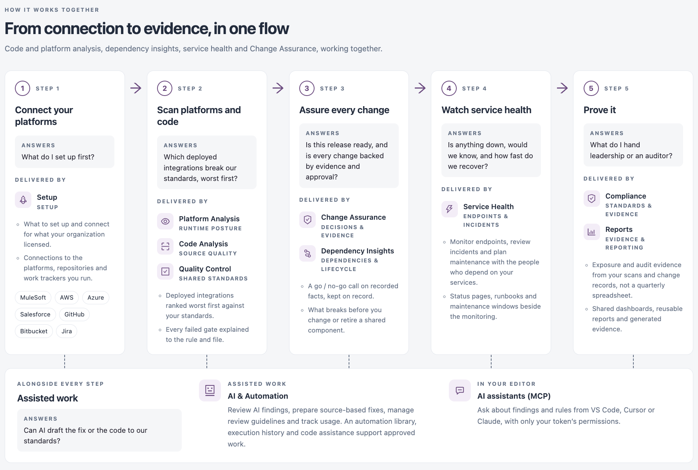

# About IZ Suite

IZ Suite checks your integration and cloud estate, and your code, against your standards. It maps dependencies, watches services and keeps evidence for every change. It covers MuleSoft, AWS, Azure, Kubernetes and application code, and it reads change from repositories, pipelines and work trackers.

This guide describes the modern IZ Suite interface in version 26.4.2. For the classic interface, see [IZ Suite (Legacy)](../iz-suite-legacy/).

## How It Works Together

The landing page that opens before you sign in shows IZ Suite as one flow in five steps. Each step answers one question and names the parts of the product that answer it.

<figure><figcaption></figcaption></figure>

| Step                           | Question it answers                                                         | Delivered by                                                                                                                                                                                          |
| ------------------------------ | --------------------------------------------------------------------------- | ----------------------------------------------------------------------------------------------------------------------------------------------------------------------------------------------------- |
| **1. Connect** your platforms  | What do I set up first?                                                     | **Setup**: connections to the platforms, repositories and work trackers you run (MuleSoft, AWS, Azure, GitHub, Bitbucket, Jira).                                                                      |
| **2. Scan** platforms and code | Which deployed integrations break our standards, worst first?               | **Platform Analysis**, **Code Analysis** and **Quality Control**: deployed integrations ranked worst first, and every failed gate explained down to the rule and file.                                |
| **3. Assure** every change     | Is this release ready, and is every change backed by evidence and approval? | **Change Assurance** and **Dependency Insights**: a go / no-go call on recorded facts, and what breaks before you change or retire a shared component.                                                |
| **4. Watch** service health    | Is anything down, would we know, and how fast do we recover?                | **Service Health**: monitors, status pages, runbooks and maintenance windows.                                                                                                                         |
| **5. Prove** it                | What do I hand leadership or an auditor?                                    | **Compliance** and **Reports** (the **Dashboards** entry in the sidebar): exposure and audit evidence from your scans and change records, shared dashboards, reusable reports and generated evidence. |

**AI & Automation** works alongside every step. It reviews AI findings, prepares source-based fixes and tracks usage. AI assistants that support MCP (for example in VS Code, Cursor or Claude) and the IZ IDE extension let developers ask about findings and rules from their editor, with only their own token's permissions.

## Workspaces and Areas

What you see in the sidebar depends on your organization's licences and your roles. Entries you cannot use are not shown.

| Area                                                   | What it is for                                                                                                            |
| ------------------------------------------------------ | ------------------------------------------------------------------------------------------------------------------------- |
| [Suite Home](suite-home.md)                            | Platform reports built from the workspaces you can use, with what to act on next.                                         |
| [Explore](explore.md)                                  | Stories, features and customer use cases that show what each part of the suite does, on your data or sample data.         |
| [Dashboards](dashboards/)                              | Build dashboards from familiar fields and schedule PDF reports.                                                           |
| [Platform Analysis](workspaces/platform-analysis/)     | Review deployed applications, investigate findings and compare assessment evidence.                                       |
| [Code Analysis](workspaces/code-analysis/)             | Inspect branches, establish baselines and review findings before release.                                                 |
| [Dependency Insights](workspaces/dependency-insights/) | Trace dependencies, compare versions and plan the work behind a change.                                                   |
| [Change Assurance](workspaces/change-assurance/)       | Review change, decisions, release readiness and the evidence supporting them.                                             |
| [Service Health](workspaces/service-health/)           | Monitor endpoints, review incidents and plan maintenance with the people who depend on your services.                     |
| [Compliance](workspaces/compliance/)                   | Manage assessment standards and change-control frameworks, map controls and inspect current results or retained evidence. |
| [AI & Automation](workspaces/ai-and-automation/)       | Choose a task, review its inputs and follow the execution evidence.                                                       |
| [Quality Control](operations/quality-control/)         | Define quality gates, maintain rules and manage the profiles used by application assessments.                             |
| [Schedules](operations/schedules/)                     | Configure scheduled work and inspect execution history.                                                                   |
| [Notifications](operations/notifications/)             | Review your updates and choose which changes you follow.                                                                  |
| [Setup](administration/setup.md)                       | What to set up and connect for what your organization licensed.                                                           |
| [Organizations](administration/organizations/)         | Manage organizations, environments, users and the roles that define their access.                                         |
| [System Activity](administration/system-activity/)     | Review archived records and system, server and scheduler audit logs.                                                      |
| [Global Settings](administration/global-settings/)     | Manage platform settings, connected systems, agents and subscription configuration.                                       |
| [My Account](administration/my-account/)               | Review your identity, credentials, IDE projects and activity.                                                             |

## Licences

Each workspace appears only when your organization holds its licence. The licences listed in **Setup** are **Platform Analysis**, **Code Analysis**, **Dependency Insights**, **Service Health**, **Change Assurance**, **AI & Automation** and **Reports**. Ask your administrator if a workspace you need is missing.

## Modern and Legacy Interfaces

IZ Suite has two interfaces. The top bar of every modern page has a **Modern** / **Legacy** switch.

1. Click **Legacy** to open the classic interface.
2. Click **Modern** to come back.

IZ Suite remembers your choice for your account in this browser. The classic interface is described in [IZ Suite (Legacy)](../iz-suite-legacy/).


Installing the server and agents is described in [Installation](installation/).


## Next Steps

* [Getting Started](getting-started/): sign in and find your way around.
* [Supported Platforms](supported-platforms/): see which platforms IZ Suite connects to and how they are synced and assessed.
* [CI/CD Integration](ci-cd-integration/): scan code in your pipelines.
* [Suite Home](suite-home.md): read the platform reports that open after you sign in.
* [Explore](explore.md): see what each part of the suite does for your role.
