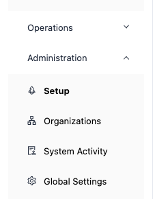

# Administration

The **Administration** group in the sidebar holds the screens administrators use to set up IZ Suite, manage organizations and access, review what the system did, and change platform settings. Each screen shows only what your roles allow.

<figure><figcaption>
The Administration group
</figcaption></figure>

| Menu              | What it is for                                                                                     |
| ----------------- | -------------------------------------------------------------------------------------------------- |
| [Setup](setup.md) | The get-started checklist: what to set up, in order, for what your organization licensed and uses. |
| Organizations     | Organizations, environments, users, access tokens and the roles that define access.                |
| System Activity   | System, server and scheduler audit logs, and archived records.                                     |
| Global Settings   | Platform settings, saved sign-ins, agents, subscription, IDE keys and email templates.             |

## Next steps

* [Setup](setup.md): work through the get-started checklist.
* Organizations: invite people and give them roles.
* System Activity: follow an action back to its evidence.
