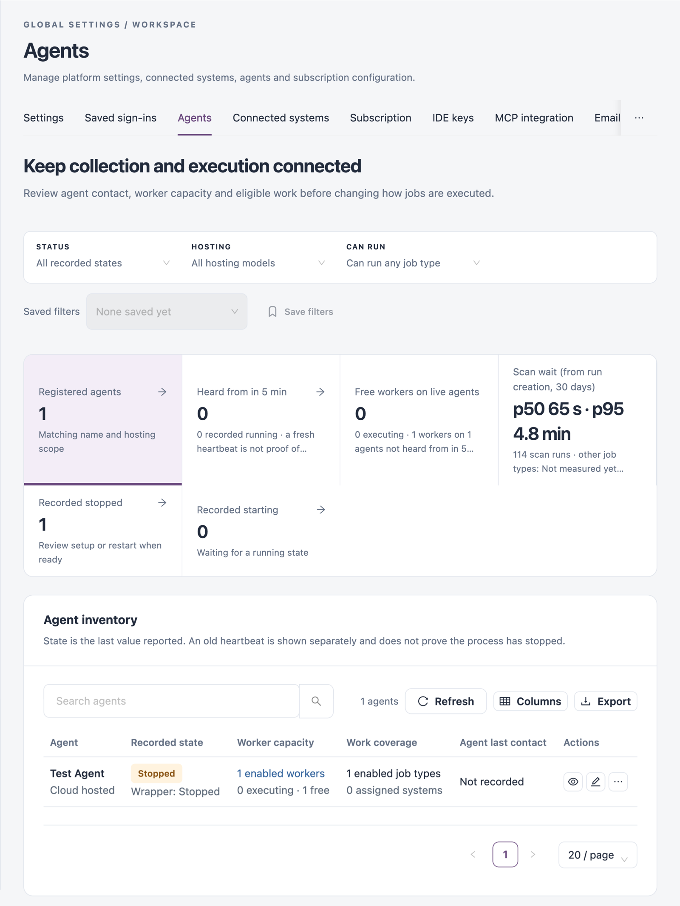
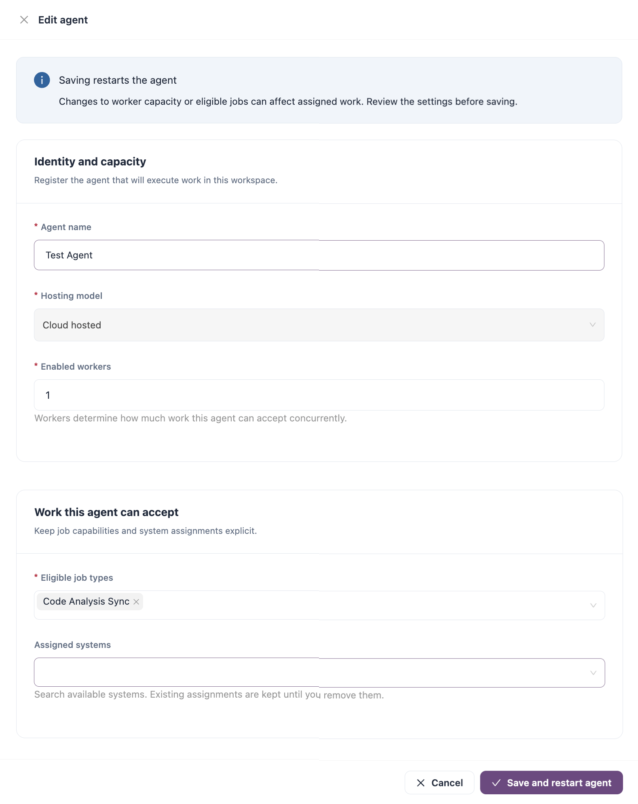

# Agents

An agent is the process that runs IZ Suite jobs, such as collection, analysis and health checks. Each agent has workers, and each worker runs one job at a time. Use this tab to check that agents are in contact, change what they run, and control them.

Open it from **Administration** → **Global Settings** → **Agents** in the sidebar.

<figure><figcaption></figcaption></figure>


You need a role that can view agents to open this tab. Editing and deleting agents, and starting, stopping or restarting them, each need their own agent permission.



This page covers agents inside IZ Suite. To install the agent software on a machine or container, see Agent Installation in the IZ Suite (Legacy) guide.


## Hosting Models

| Hosting model    | Use it when                                                                                                                                                                                      |
| ---------------- | ------------------------------------------------------------------------------------------------------------------------------------------------------------------------------------------------ |
| **Self hosted**  | The agent runs on your own machines, for example because you do not want to share your Anypoint connected app's client ID and secret, or have applications downloaded and analysed in the cloud. |
| **Cloud hosted** | You do not want to install the prerequisites (such as Java) or run the agent on your own servers.                                                                                                |

## Filters and Summary

| Filter            | Description                                                                    |
| ----------------- | ------------------------------------------------------------------------------ |
| **STATUS**        | **All recorded states**, **Heard from in 5 min**, or one recorded state.       |
| **HOSTING**       | **All hosting models**, **Self hosted** or **Cloud hosted**.                   |
| **CAN RUN**       | Agents that can run the job type you pick.                                     |
| **Saved filters** | Pick a saved filter combination, or **Save filters** to store the current one. |

The tiles above the table summarize the view. Click a tile with an arrow to filter by it.

| Tile                                       | Shows                                                                                                    |
| ------------------------------------------ | -------------------------------------------------------------------------------------------------------- |
| **Registered agents**                      | Agents matching the name and hosting filters.                                                            |
| **Heard from in 5 min**                    | Agents with a heartbeat in the last five minutes. A fresh heartbeat is not proof of health.              |
| **Free workers on live agents**            | Free workers on agents heard from in the last five minutes, with the number executing.                   |
| **Scan wait (from run creation, 30 days)** | How long scans waited for an agent over the last 30 days, as the median (p50) and 95th percentile (p95). |
| **Recorded stopped**                       | Agents whose last reported state is stopped. Review their setup or restart them.                         |
| **Recorded starting**                      | Agents waiting for a running state.                                                                      |

## Agent Inventory

Above the table: **Search agents**, the number of agents, **Refresh**, **Columns** (choose the columns to show) and **Export**. **Export this page** at the top of the tab downloads the agents on the current page as a CSV file.

| Column                 | Description                                                                                                         |
| ---------------------- | ------------------------------------------------------------------------------------------------------------------- |
| **Agent**              | The agent's name.                                                                                                   |
| **Recorded state**     | The last state the agent reported. An old heartbeat is shown separately and does not prove the process has stopped. |
| **Worker capacity**    | Enabled workers, with how many are executing and how many are free.                                                 |
| **Work coverage**      | How many job types are enabled for the agent, and how many systems are assigned to it.                              |
| **Agent last contact** | When the agent last sent a heartbeat.                                                                               |
| **Actions**            | See **Row Actions** below.                                                                                          |

### Row Actions

| Action                           | Description                                                                                                                                                                                                                                                                                                                                            |
| -------------------------------- | ------------------------------------------------------------------------------------------------------------------------------------------------------------------------------------------------------------------------------------------------------------------------------------------------------------------------------------------------------ |
| **Review agent**                 | Opens **Agent evidence**: hosting, recorded and wrapper state, last contact of the agent and its wrapper, registration date, the agent's identity, **Eligible work** (job types with their enabled and scheduler state, and whether the agent is the master) and **Assigned systems**. It also shows the agent log, which you can search and download. |
| **Edit agent**                   | Opens **Edit agent** (see **Edit an Agent** below). Saving restarts the agent.                                                                                                                                                                                                                                                                         |
| **View workers**                 | Opens the agent's workers with their recorded state, capacity and last contact. From there you can open a worker's assigned executions or restart a worker.                                                                                                                                                                                            |
| **Installation instructions**    | Opens **Connect this agent** with the commands that connect this agent (see **Connect an Agent** below).                                                                                                                                                                                                                                               |
| **Start agent** / **Stop agent** | Queues a start command (for a stopped agent) or a stop command.                                                                                                                                                                                                                                                                                        |
| **Restart agent**                | Queues a restart command.                                                                                                                                                                                                                                                                                                                              |
| **Delete agent**                 | Deletes the agent registration after you type its exact name.                                                                                                                                                                                                                                                                                          |

Start, stop and restart are queued for the agent's wrapper and are offered only while the wrapper is running. The inventory changes only when the agent reports its new state, so refresh to follow it.


Stopping or restarting an agent can interrupt the work assigned to it. Deleting an agent removes its registration and configuration: existing installations can no longer use it.


## Register an Agent

In a single-tenant installation you register your own agents. In a multi-tenant installation, agents are registered by your platform administrator and the **Register agent** button is not shown.

1. Click **Register agent**.
2. Fill in the fields as in [Edit an Agent](agents.md#edit-an-agent): **Agent name**, **Hosting model**, **Enabled workers**, **Eligible job types** and **Assigned systems**. The hosting model cannot be changed after registration.
3. Click **Register agent**.

Then install the agent with [Connect an Agent](agents.md#connect-an-agent).

## Edit an Agent

1. Find the agent and click the edit (pencil) icon.
2. Change the fields (see below).
3. Click **Save and restart agent**, or **Cancel** to close the form without changes.

<figure><figcaption></figcaption></figure>

| Field                  | Description                                                                                                              |
| ---------------------- | ------------------------------------------------------------------------------------------------------------------------ |
| **Agent name**         | **Required.** Up to 100 characters.                                                                                      |
| **Hosting model**      | **Self hosted** or **Cloud hosted**. Shown for reference: it cannot be changed after registration.                       |
| **Enabled workers**    | How many jobs the agent can run at the same time, from 1 to 1,000. **Required.**                                         |
| **Eligible job types** | The job types this agent accepts. Choose at least one. **Required.**                                                     |
| **Assigned systems**   | The connected systems this agent works for. Search to add a system; existing assignments are kept until you remove them. |


Saving restarts the agent. Changes to worker capacity or eligible job types can affect the work assigned to it.


## Connect an Agent

**Installation instructions** opens **Connect this agent**, with the commands that start the agent on a machine or container.

1. Click **Reveal installation credential** to put the agent's credential into the commands. **Hide installation credential** removes it from the screen.
2. Choose the **Java** or **Docker** tab and copy the command.
3. For Java, click **Download Java wrapper** and use a Java runtime compatible with the configured wrapper release.
4. Run the command on the machine or container that will run the jobs.
5. Refresh the agent and check its wrapper heartbeat, agent heartbeat and enabled workers.

For a self-hosted agent whose connected system needs Anypoint credentials, append `--anypointClientId 'YOUR_CLIENT_ID' --anypointClientSecret 'YOUR_CLIENT_SECRET'` to the Java command.


Once revealed, the commands contain the agent's credential. Do not share them.


## Change the Runtime Release

**Runtime release** sets the agent version and binary URL that every agent uses. It is shown in single-tenant installations; in a multi-tenant installation your platform administrator manages it.

1. Click **Runtime release**.
2. Enter the **Runtime version** and the **Runtime binary URL** (a complete HTTP or HTTPS URL). Both are required.
3. Click **Save release for all agents**.


Updating the runtime release restarts agents and can interrupt assigned work. It needs a role that can view and change global settings. If the **Agent Version** setting is missing or incomplete, the button is disabled.


## Next Steps

* [Connected Systems](connected-systems.md): register the systems you assign agents to.
* [Global Settings](./): the other configuration screens.
