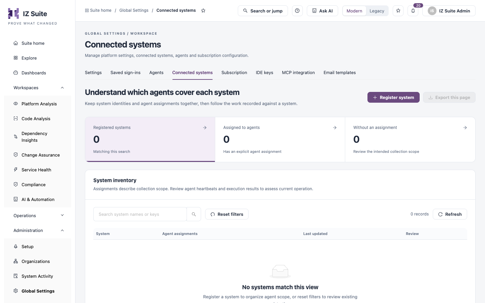
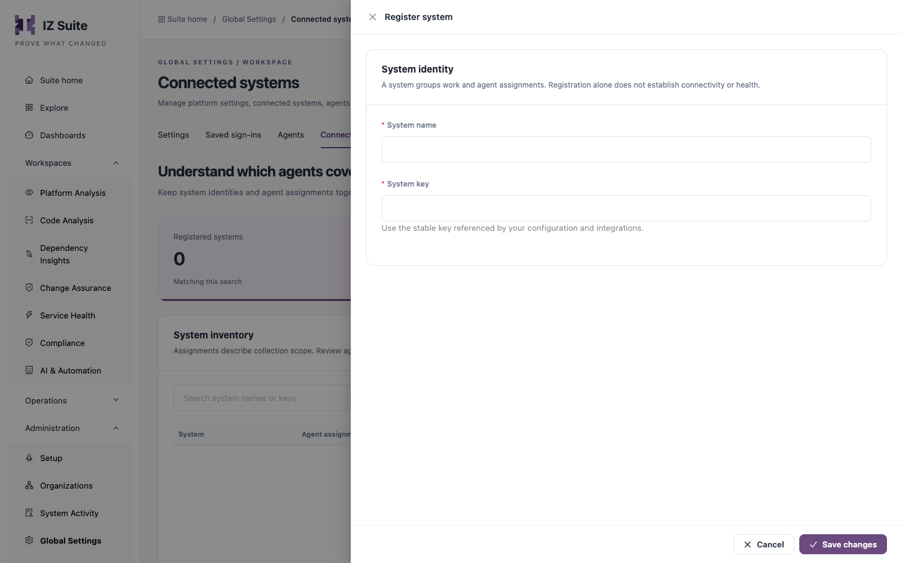

# Connected Systems

A connected system groups work and agent assignments. When a job has to run on a particular agent, for example one installed next to a specific platform, you assign that agent and the work to the same system. Use this tab to register systems and check their agent coverage.

Open it from **Administration** → **Global Settings** → **Connected systems** in the sidebar.

<figure><figcaption>
Connected systems
</figcaption></figure>


You need a role that can view systems to open this tab. Registering, editing and deleting systems each need their own system permission.



Registering a system does not connect to it or check its health. Assignments describe collection scope; check agent heartbeats and execution results to see whether work is actually running.


## Summary tiles

| Tile                      | Shows                                                                                  |
| ------------------------- | -------------------------------------------------------------------------------------- |
| **Registered systems**    | Systems matching the current search.                                                   |
| **Assigned to agents**    | Systems with at least one agent assigned.                                              |
| **Without an assignment** | Systems no agent is assigned to. Review whether that is the intended collection scope. |

## System inventory

Use **Search system names or keys** to filter the table. **Reset filters** clears the search, and **Refresh** reloads the list. **Export this page** at the top of the tab downloads the systems on the current page as a CSV file.

| Column                | Description                                                       |
| --------------------- | ----------------------------------------------------------------- |
| **System**            | The system's name (click it to open **System evidence**) and key. |
| **Agent assignments** | How many agents are assigned, or **No explicit assignment**.      |
| **Last updated**      | When the system last changed.                                     |
| **Review**            | **Review system** opens **System evidence**.                      |

**System evidence** shows the system's name, key, registration and update dates, number of agent assignments and identity, and the **Assigned agents** with their recorded state. From there you can:

* Edit the system.
* Click **System executions** to open the execution history filtered to this system.
* Click **Delete system** to delete the registration after typing its exact name.


Deleting a system also deletes its agent assignments and can affect configuration that uses it. Review the linked agents and executions first.


## Register a system

1. Click **Register system**.
2. Enter the **System name** and **System key**.
3. Click **Save changes**.

<figure><figcaption>
Register system
</figcaption></figure>

| Field           | Description                                                                         |
| --------------- | ----------------------------------------------------------------------------------- |
| **System name** | **Required.**                                                                       |
| **System key**  | **Required.** Use the stable key that your configuration and integrations refer to. |


Changing the key of an existing system can affect configuration that refers to it by key.


To assign an agent to a system, edit the agent and add the system under **Assigned systems**.

## Next steps

* [Agents](agents.md): assign agents to a system.
* Execution History: follow the work recorded against a system.
* [Global Settings](./): the other configuration screens.
