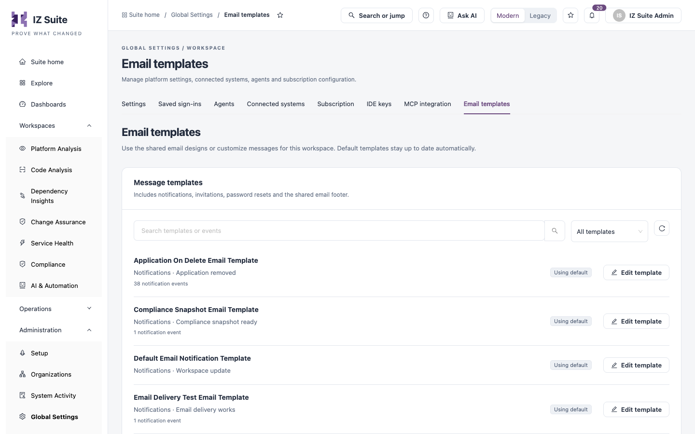
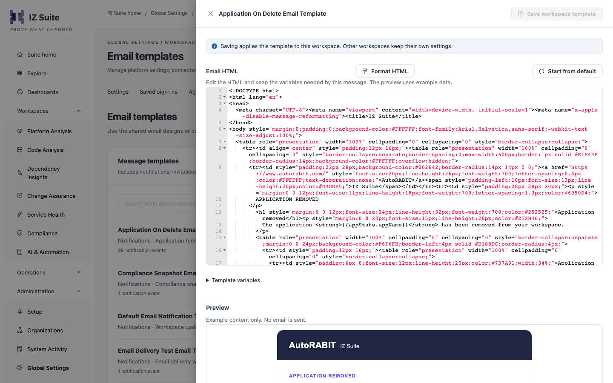

# Email Templates

IZ Suite sends emails from templates: notifications, invitations, password resets and a shared footer. Every workspace uses the shared default templates, which stay up to date automatically, until it customizes one. Use this tab to review the templates and edit their HTML.

Open it from **Administration** → **Global Settings** → **Email templates** in the sidebar.

<figure><figcaption>
Email templates
</figcaption></figure>


You need a role that can view global settings to open this tab, and a role that can edit global settings to change a template. Without it, each template opens read-only with **View template**.


## Message templates

Use **Search templates or events** to find a template by name, title or notification event. The source filter shows **All templates**, **Using default** or **Customized**, and the refresh button reloads the list.

Each template shows:

| Item               | Description                                                                                                                                     |
| ------------------ | ----------------------------------------------------------------------------------------------------------------------------------------------- |
| Name               | The template's name.                                                                                                                            |
| Category and title | For example **Notifications** · **Application removed**, **Account access** · **Reset your password**, or **Shared footer** · **Email footer**. |
| Events             | How many notification events use the template.                                                                                                  |
| Source             | **Using default** or **Customized**.                                                                                                            |
| **Edit template**  | Opens the template editor (**View template** for read-only roles).                                                                              |

## Edit a template

1. Click **Edit template** on the template.
2. Edit the HTML under **Email HTML**. Keep the variables the message needs.
3. Check the **Preview**.
4. Click **Save workspace template**.

<figure><figcaption>
Template editor
</figcaption></figure>

| Item                   | Description                                                                                                                        |
| ---------------------- | ---------------------------------------------------------------------------------------------------------------------------------- |
| **Email HTML**         | The template's HTML. Variables are written in double braces, for example `{{appStats.appName}}`.                                   |
| **Format HTML**        | Tidies the indentation of the HTML.                                                                                                |
| **Start from default** | Replaces the editor content with the shared default, so you can start over. Saved only when you click **Save workspace template**. |
| **Template variables** | Expand it to list the variables this template can use.                                                                             |
| **Preview**            | Renders the template with example data. No email is sent.                                                                          |

Saving applies the template to this workspace only. Other workspaces keep their own settings.

## Go back to the default

A customized template can switch back to the shared default and receive future default updates again.

1. Open the customized template.
2. Click **Use default template**.
3. Confirm with **Use default template**.


This replaces your workspace's customization. The template's email events switch back to the shared default.


## Next steps

* Organization Subscriptions: choose who receives the notification emails.
* [Settings](settings.md): review the other workspace settings.
* [Global Settings](./): the other configuration screens.
