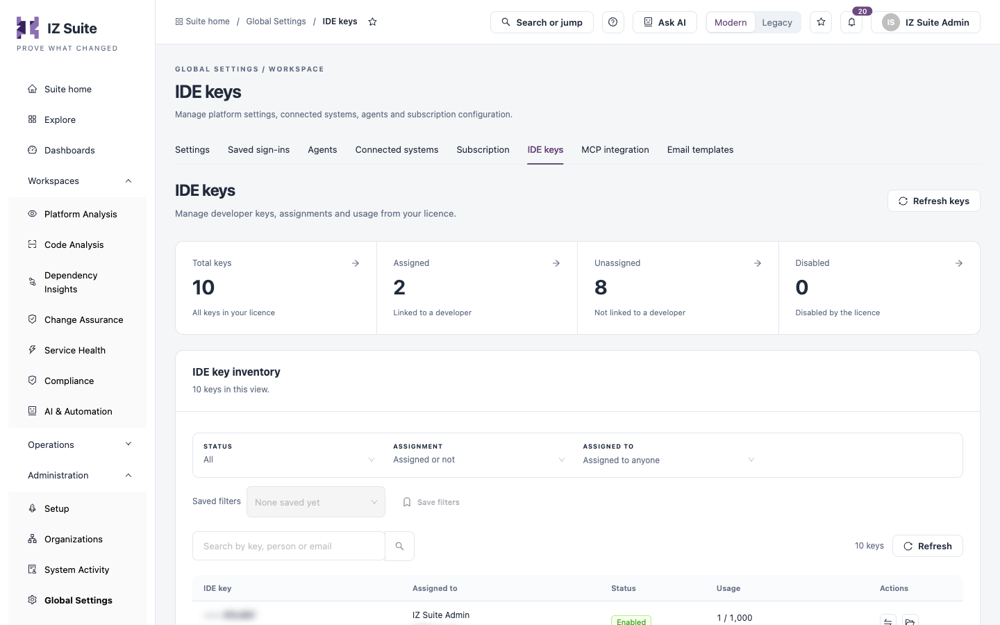
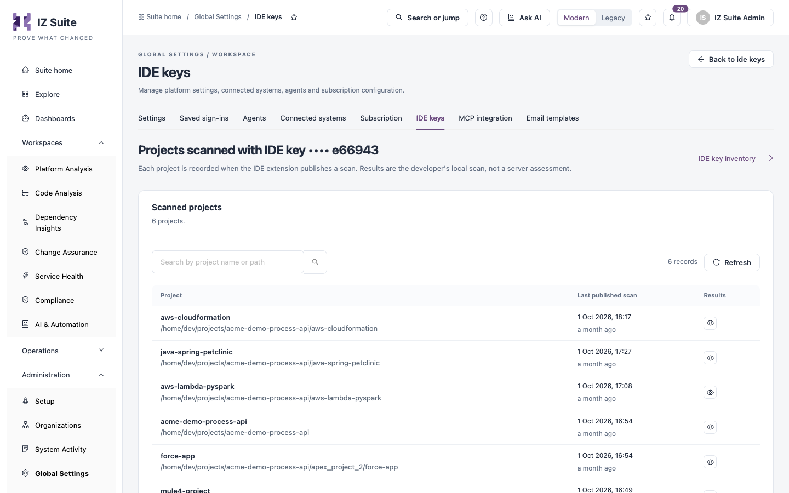
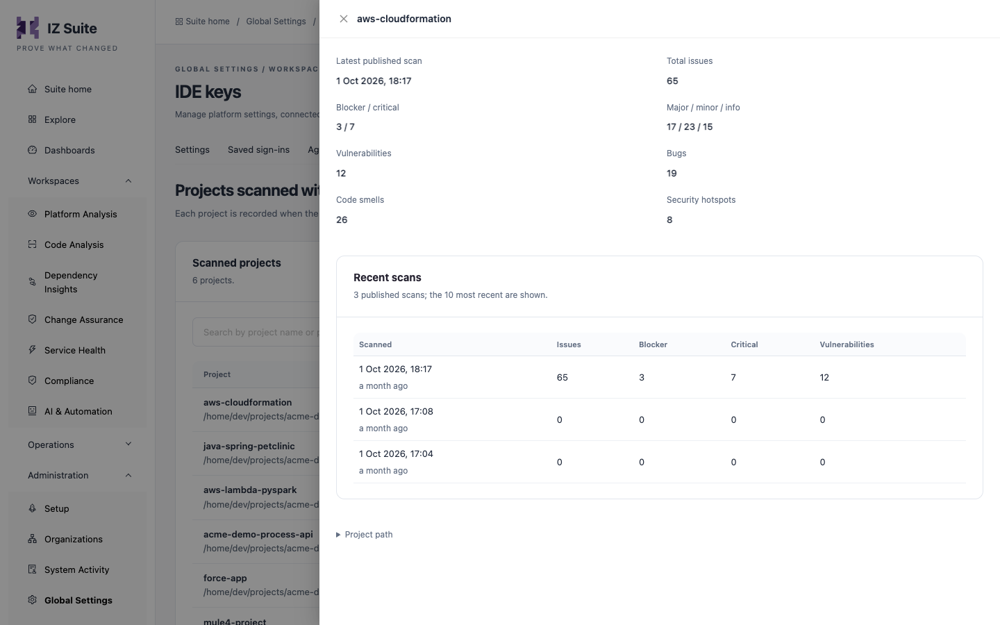

# IDE Keys

**IDE keys** lists the IDE (developer) keys assigned to your workspace's licence. Each key counts as one licence seat and is linked to one developer, who pastes it into the IZ IDE extension. A key's usage is how many projects that developer can scan from the IDE. Use this tab to assign keys, follow their usage and review the projects scanned with them.

Open it from **Administration** → **Global Settings** → **IDE keys** in the sidebar.

<figure><figcaption>
IDE keys
</figcaption></figure>


You need a role that can view global settings to open this tab, and a role that can invite users to assign keys.


## Summary tiles

Click a tile to filter the inventory.

| Tile           | Shows                         |
| -------------- | ----------------------------- |
| **Total keys** | All keys in your licence.     |
| **Assigned**   | Keys linked to a developer.   |
| **Unassigned** | Keys not linked to anyone.    |
| **Disabled**   | Keys disabled by the licence. |

**Refresh keys** reads the keys from the IZ licence service again. Use it when keys were added to your licence recently.

## Filters

| Filter            | Description                                                                    |
| ----------------- | ------------------------------------------------------------------------------ |
| **STATUS**        | **All**, **Enabled** or **Disabled**.                                          |
| **ASSIGNMENT**    | **Assigned** or **Unassigned**.                                                |
| **ASSIGNED TO**   | One or more people.                                                            |
| **Saved filters** | Pick a saved filter combination, or **Save filters** to store the current one. |

## IDE key inventory

Use **Search by key, person or email** to filter the table. The number of keys and **Refresh** sit beside it.

| Column          | Description                                                                                                                                                                            |
| --------------- | -------------------------------------------------------------------------------------------------------------------------------------------------------------------------------------- |
| **IDE key**     | The key, masked except for its last characters, and when it was added. Click it to open the key.                                                                                       |
| **Assigned to** | The person's name and email, or **Unassigned**.                                                                                                                                        |
| **Status**      | **Enabled** or **Disabled**.                                                                                                                                                           |
| **Usage**       | Projects scanned with the key out of the number of projects the developer can scan from the IDE, for example `6 / 1,000`, with a progress bar. **No allowance** when the key has none. |
| **Actions**     | **Assign key** or **Reassign key**, and **Scanned projects**, which opens the projects scanned with the key.                                                                           |

The key drawer shows the status, usage, assignee and date added, and the full key under **Key for the IDE extension** with a copy button.


Treat a key like a licence seat: share it only with its assignee.


## Assign a key

1. Click **Assign key** (or **Reassign key**) on the key's row.
2. In **Person**, search for an enabled person by name or email and select them.
3. Click **Assign key**.

The person then finds the key under **My account** → **IDE projects**, pastes it into the IZ IDE extension, and sees the projects it scans in their account.


When you reassign a key, the previous assignee loses access to its project history.


## Scanned projects

**Scanned projects** on a key's row opens **Projects scanned with IDE key** for that key. It lists the projects the developer scanned with the key. Each project is recorded when the IDE extension publishes a scan. Results are the developer's local scan, not a server assessment.

<figure><figcaption>
Projects scanned with an IDE key
</figcaption></figure>

Use **Search by project name or path** to find a project. The number of records and **Refresh** sit beside it.

| Column                  | Description                                                                 |
| ----------------------- | --------------------------------------------------------------------------- |
| **Project**             | The project name and its path on the developer's machine.                   |
| **Last published scan** | When the extension last published a scan of the project, with how long ago. |
| **Results**             | **Review results** opens the project's results.                             |

Click **Back to ide keys** or **IDE key inventory** to return to the key list.

## Review results

Click **Review results** on a project (or the project name) to open its results in a drawer. The drawer shows:

| Area                                                                  | Description                                                                                                              |
| --------------------------------------------------------------------- | ------------------------------------------------------------------------------------------------------------------------ |
| **Latest published scan**                                             | When the latest scan was published.                                                                                      |
| **Total issues**                                                      | All issues in the latest scan.                                                                                           |
| **Blocker / critical**                                                | Blocker and critical issues.                                                                                             |
| **Major / minor / info**                                              | Major, minor and info issues.                                                                                            |
| **Vulnerabilities**, **Bugs**, **Code smells**, **Security hotspots** | Issues by type.                                                                                                          |
| **Recent scans**                                                      | The 10 most recent published scans, by date: **Scanned**, **Issues**, **Blocker**, **Critical** and **Vulnerabilities**. |
| **Project path**                                                      | Expand it to see the project's full path.                                                                                |

<figure><figcaption>
Review results
</figcaption></figure>

## Next steps

* IDE Projects: what developers see for their assigned keys.
* [Subscription](subscription.md): review the rest of your licence.
* [Global Settings](./): the other configuration screens.
