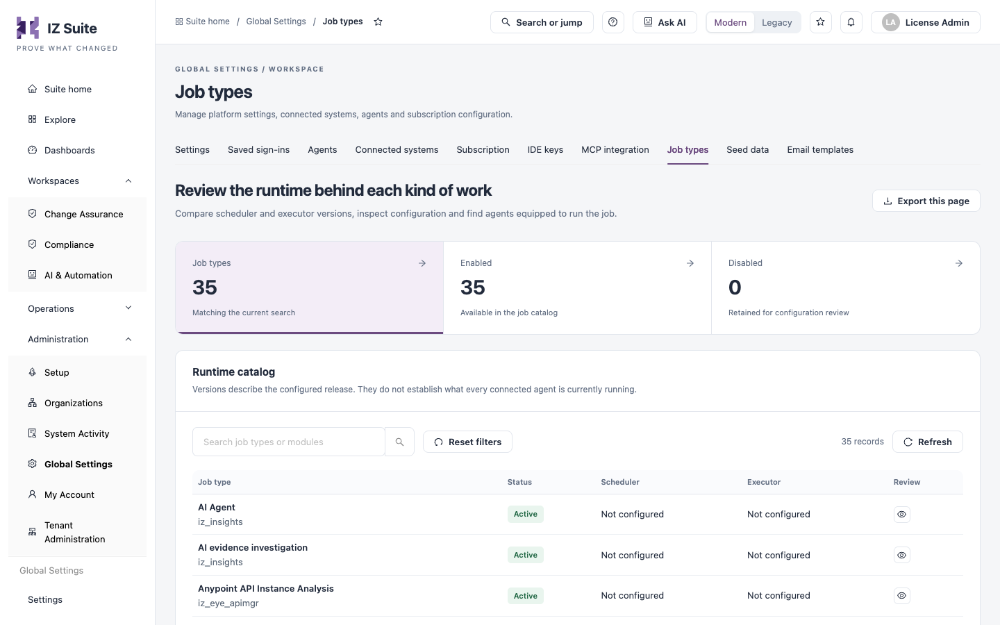

# Job Types

A job type is one kind of work an agent runs, for example a platform sync, an asset assessment, a health check or an AI evidence investigation. The **Job types** tab lists every job type with the scheduler and executor release behind it, and shows which agents are equipped to run it.

Open it from **Administration** → **Global Settings** → **Job types** in the sidebar.


In multi-tenant instances, this is managed by your platform administrator.


<figure><figcaption>
Job types
</figcaption></figure>


You need a role that can view job types to open this tab, and a role that can edit job types to change a runtime.


## How Job Types Fit Together

* **Agents**: each agent accepts only its **Eligible job types**, chosen when you register it. See [Agents](agents.md).
* **Schedules**: a schedule says when to run a job type and for which organizations or environments. When it is due, an agent that can run that job type picks it up. See [All Schedules](../../operations/schedules/all-schedules.md).
* **Runtime**: each job type has a scheduler, which creates the work, and an executor, which performs it. This tab holds their versions, artifact locations and configuration.

[How Assessments Run](../../supported-platforms/how-assessments-run.md) describes the job types each platform uses and what each one does.

## Counts and Search

| Tile          | Description                                                        |
| ------------- | ------------------------------------------------------------------ |
| **Job types** | Job types matching the current search. Click to list all of them.  |
| **Enabled**   | Job types available in the job catalog. Click to list only these.  |
| **Disabled**  | Job types kept for configuration review. Click to list only these. |

Use **Search job types or modules** to find a job type by name or module. **Reset filters** clears the search and the tile selection, and **Refresh** reloads the list. **Export this page** downloads the job types on the current page as CSV.

## Runtime Catalog

| Column        | Description                                                                   |
| ------------- | ----------------------------------------------------------------------------- |
| **Job type**  | The job type's name, with its module underneath. Click the name to review it. |
| **Status**    | **Active** or **Disabled**.                                                   |
| **Scheduler** | The configured scheduler version, or **Not configured**.                      |
| **Executor**  | The configured executor version, or **Not configured**.                       |
| **Review**    | **Review runtime** (eye icon) opens the job type's details.                   |

The versions describe the configured release. They do not prove what every connected agent is running at the moment.

## Review a Job Type

Click a job type to open **Job runtime evidence**:

| Item                            | Description                                                                                                                                                        |
| ------------------------------- | ------------------------------------------------------------------------------------------------------------------------------------------------------------------ |
| Facts                           | **Job type**, **Identity**, **Module**, **Status**, **Scheduler version**, **Executor version**, **Last updated** and **Origin** (**Built in** or **Custom**).     |
| **Edit runtime**                | Opens the runtime editor. Shown for enabled job types when your role can edit job types.                                                                           |
| **Execution history**           | Opens [Execution History](../../operations/schedules/execution-history.md) filtered to this job type.                                                              |
| **Runtime artifacts**           | **Scheduler binary** and **Executor binary**: where each artifact is taken from, or **Not configured**.                                                            |
| **Recorded configuration**      | The job type's configuration as stored. **Download configuration** saves it as a JSON file.                                                                        |
| **Agents with this capability** | The agents that have this job type enabled, with their recorded state. Click an agent to open it. Check each agent's heartbeat and workers before you count on it. |

## Edit a Job Runtime

There is no form to create a job type: job types are supplied with IZ Suite. You can change the runtime of an existing one.

1. Open the job type and click **Edit runtime**.
2. Change the fields in **Edit job runtime** (see below).
3. Click **Save runtime and restart agents**, or close the dialog to discard your changes.

| Field                         | Description                                                                                            |
| ----------------------------- | ------------------------------------------------------------------------------------------------------ |
| **Job type name**             | The name shown in lists and schedules. Up to 50 characters. **Required.**                              |
| **Scheduler version**         | The release of the scheduler component.                                                                |
| **Scheduler binary location** | The URL or path of the scheduler artifact your deployment expects.                                     |
| **Executor version**          | The release of the executor component.                                                                 |
| **Executor binary location**  | The URL or path of the executor artifact your deployment expects.                                      |
| **Configuration JSON**        | The job type's configuration. It must be valid JSON, or empty. **Format JSON** tidies the indentation. |

The job type's identity and module do not change, so existing schedules and results stay attached to it.


Saving asks the agents to restart, which can interrupt the work they are running. Check the versions, artifact locations and configuration before you save, then follow the agents' status on [Agents](agents.md).


## Next Steps

* [Agents](agents.md): choose the job types each agent can run.
* [All Schedules](../../operations/schedules/all-schedules.md): run a job type on a schedule.
* [How Assessments Run](../../supported-platforms/how-assessments-run.md): the job types each platform uses.
* [Global Settings](./): the other configuration screens.
