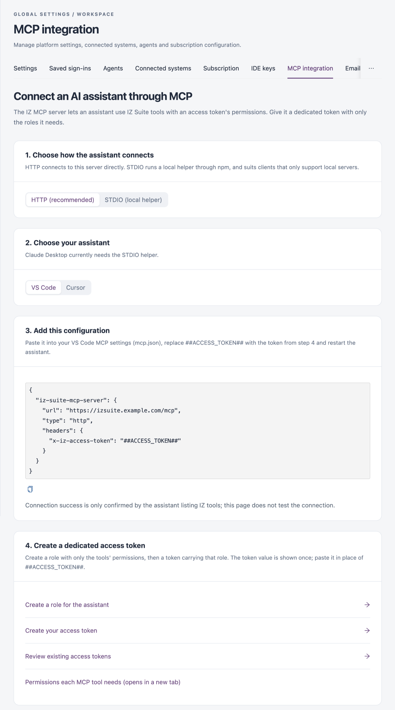

# MCP Integration

The IZ MCP server lets an AI assistant use IZ Suite tools with the permissions of an access token. The **MCP integration** tab builds the configuration for your assistant, with your server's address already filled in.

Open it from **Administration** → **Global Settings** → **MCP integration** in the sidebar.

<figure><figcaption><p>MCP integration</p></figcaption></figure>


You need a role that can view global settings to open this tab.


## Connect an Assistant



### Choose How the Assistant Connects

Under **1. Choose how the assistant connects**, pick:

* **HTTP (recommended)**: the assistant connects to your IZ Suite server directly.
* **STDIO (local helper)**: the assistant runs a local helper through npm. Use it for clients that only support local servers.



### Choose Your Assistant

Under **2. Choose your assistant**, pick **VS Code** or **Cursor**. **Claude Desktop** is available with **STDIO (local helper)** only.



### Add the Configuration

Under **3. Add this configuration**, copy the configuration and paste it:

| Assistant          | Where to paste it                                                                                         |
| ------------------ | --------------------------------------------------------------------------------------------------------- |
| **VS Code**        | Your VS Code MCP settings (`mcp.json`).                                                                   |
| **Cursor**         | Cursor → Settings → MCP.                                                                                  |
| **Claude Desktop** | Claude Desktop → Settings → Developer → Edit config (under `mcpServers` in `claude_desktop_config.json`). |

Replace `##ACCESS_TOKEN##` with the token from the next step, then restart the assistant.



### Create a Dedicated Access Token

Under **4. Create a dedicated access token**:

1. Click **Create a role for the assistant** and create a role with only the permissions the MCP tools need. **Permissions each MCP tool needs** lists them.
2. Click **Create your access token** and create a token that carries that role.
3. Copy the token. It is shown only once.

**Review existing access tokens** opens the list of tokens in the workspace.




This tab does not test the connection. The connection works when your assistant lists the IZ tools.



The access token gives the assistant the permissions of its role. Give the assistant a dedicated token with only the roles it needs, and never share the token.


## Configuration Samples

Replace `https://izsuite.example.com` with your IZ Suite address (in a multi-tenant installation, your tenant's address) and the token value with the token you created.




```json
{
  "iz-suite-mcp-server": {
    "url": "https://izsuite.example.com/mcp",
    "type": "http",
    "headers": {
      "x-iz-access-token": "<token generated in IZ Suite>"
    }
  }
}
```


Every request carries a header:  `x-iz-access-token` with your token.


Assistant configurations created before release 26.4.2 send the earlier header names. IZ Suite still accepts their token header and ignores the old service URL header, so they keep working; new configurations need only `x-iz-access-token`.





```json
{
  "iz-scan-mcp-server": {
    "command": "npx",
    "args": [
      "-y",
      "--registry=https://npm.integralzone.com",
      "iz-scan-mcp",
      "--accesstoken",
      "<token generated in IZ Suite>",
      "--serverurl",
      "https://izsuite.example.com"
    ],
    "type": "stdio"
  }
}
```


The helper runs through `npx`, so the machine that runs the assistant needs npm. `--serverurl` must be your IZ Suite address.



## Next Steps

* [Roles](../organizations/roles.md): create the role that limits what the assistant can do.
* [Access Tokens](../organizations/access-tokens.md): review the tokens in your workspace.
* [Security Credentials](../my-account/security-credentials.md): create your own access token.
* [Global Settings](./): the other configuration screens.
