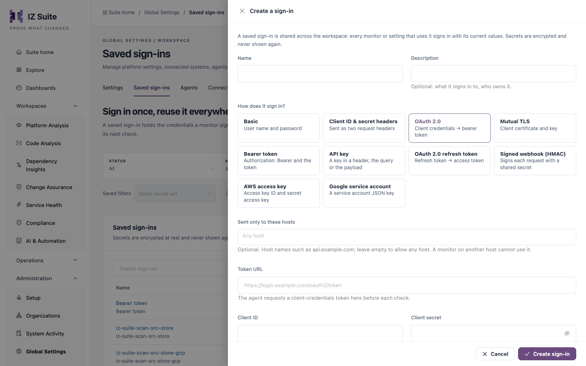

# Saved Sign-ins

A saved sign-in holds the credentials a monitor or setting signs in with. When you change a saved sign-in, every monitor that uses it picks up the change on its next check. Administrators and the people who manage monitors use this tab.

Open it from **Administration** → **Global Settings** → **Saved sign-ins** in the sidebar.

<figure><figcaption>
Saved sign-ins
</figcaption></figure>


You need a role that can edit global settings, or one that can view, create or edit monitors, to open this tab. Deleting a sign-in needs a role that can edit global settings.



Secrets are encrypted at rest and never shown again after you save them. Only the agent receives them when it runs a check.


## Filters

| Filter            | Description                                                                                   |
| ----------------- | --------------------------------------------------------------------------------------------- |
| **STATUS**        | **All**, **Used by monitors** or **Not used**.                                                |
| **KIND**          | One or more sign-in kinds.                                                                    |
| **Saved filters** | Pick a filter combination you saved earlier. **Save filters** stores the current combination. |

## Sign-ins Table

Above the table: **Search sign-ins** (name, kind or description), the number of sign-ins, **Refresh**, **Columns** (choose the columns to show) and **Export**.

| Column      | Description                                                                     |
| ----------- | ------------------------------------------------------------------------------- |
| **Name**    | The sign-in's name, with its description underneath. Click the name to edit it. |
| **Kind**    | How it signs in (see **Sign-in Kinds** below).                                  |
| **Used by** | How many monitors use it, or **Not used**.                                      |
| **Updated** | When it last changed.                                                           |
| **Actions** | **Edit** opens the sign-in. **Delete** deletes it after you confirm.            |


Deleting a sign-in permanently deletes it and its secrets. If monitors still use it, the confirmation tells you how many: switch them to another sign-in first.


## Create a Sign-in

1. Click **Create sign-in**.
2. Enter a **Name** and, optionally, a **Description**.
3. Under **How does it sign in?**, choose a kind.
4. Optionally, list the hosts in **Sent only to these hosts**.
5. Fill in the fields of the kind you chose.
6. Click **Create sign-in**.

<figure><figcaption>
Create a sign-in
</figcaption></figure>

| Field                        | Description                                                                                                                                                                                                    |
| ---------------------------- | -------------------------------------------------------------------------------------------------------------------------------------------------------------------------------------------------------------- |
| **Name**                     | **Required.** Up to 100 characters.                                                                                                                                                                            |
| **Description**              | Optional: what it signs in to and who owns it.                                                                                                                                                                 |
| **How does it sign in?**     | The sign-in kind. **Required.** You cannot change the kind of a saved sign-in later.                                                                                                                           |
| **Sent only to these hosts** | Optional. Host names such as `api.example.com`, up to 10. Leave it empty to allow any host. A monitor on another host cannot use the sign-in. Not shown for **AWS access key** and **Google service account**. |

To change a sign-in, click its name or **Edit**, change the fields and click **Save sign-in**. A secret that is already saved is not shown: leave its field blank to keep it, or type a new value to replace it.

## Sign-in Kinds

The first six kinds can be used by monitors. The others are for the calls IZ Suite makes itself, such as storing source code for AI reviews in a private bucket.

| Kind                           | Fields                                                                                                                                                                                                                                                                                                       |
| ------------------------------ | ------------------------------------------------------------------------------------------------------------------------------------------------------------------------------------------------------------------------------------------------------------------------------------------------------------ |
| **Basic**                      | **User name** and **Password**.                                                                                                                                                                                                                                                                              |
| **Client ID & secret headers** | **Client ID header** (for example `client_id`), **Client ID**, **Client secret header** (for example `client_secret`) and **Client secret**. Sent as two request headers.                                                                                                                                    |
| **OAuth 2.0**                  | **Token URL** (the agent requests a client-credentials token there before each check), **Client ID**, **Client secret**, optional **Scope** (space separated) and **Audience**, and **Send the client secret** **In the request body** or **As a Basic header**.                                             |
| **Mutual TLS**                 | **Client certificate** (with any intermediates), **Private key**, optional **Key passphrase** (only if the key is encrypted) and optional **Server CA bundle**. Each PEM field can be filled with **Load from a file**. With a CA bundle the agent verifies the server certificate; without one it does not. |
| **Bearer token**               | **Token**, sent as `Authorization: Bearer` followed by the token.                                                                                                                                                                                                                                            |
| **API key**                    | **Send the key in** **A header**, **The query string** or **The JSON payload**; **Name** of the header, parameter or field; optional one-word **Prefix**; and **Key**. Monitors cannot send the key in the JSON payload.                                                                                     |
| **OAuth 2.0 refresh token**    | **Token URL** where the refresh token is exchanged for an access token, **Client ID**, **Client secret**, **Refresh token**, optional **Token prefix** (`Bearer` when empty) and **Send the client secret**.                                                                                                 |
| **Signed webhook (HMAC)**      | **Signature**: **Standard Webhooks** or **One custom header** (with **Header** and **Algorithm** **SHA-256** or **SHA-512**), and the **Signing secret**. Standard Webhooks secrets start with `whsec_`.                                                                                                     |
| **AWS access key**             | **Access key ID** (upper-case letters and digits, for example `AKIA…`) and **Secret access key**.                                                                                                                                                                                                            |
| **Google service account**     | **Service account key (JSON)**: paste the service account's JSON key file. Only its email, project and private key are kept.                                                                                                                                                                                 |

## Next Steps

* [Settings](settings.md): review the other workspace settings.
* [Agents](agents.md): check the agents that run the checks using these sign-ins.
* [Global Settings](./): the other configuration screens.
