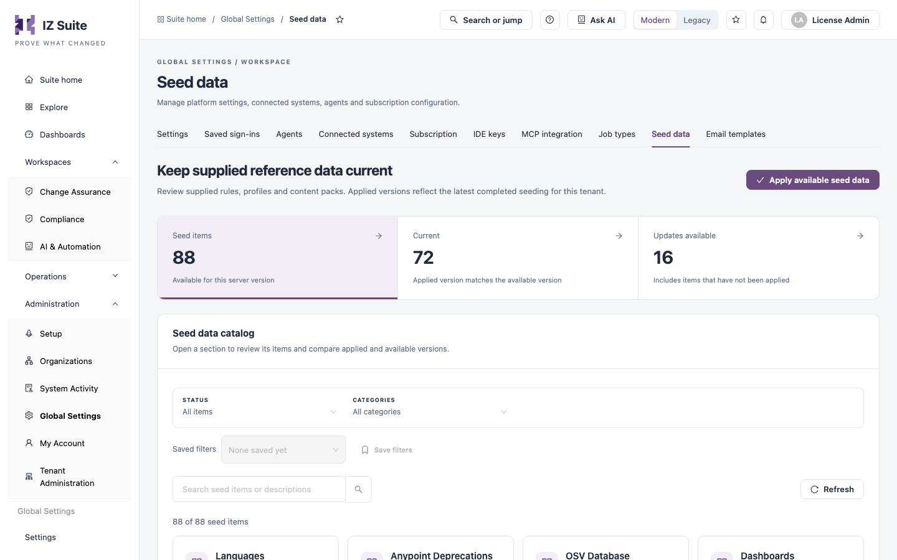

# Seed Data

Seed data is the reference content supplied with IZ Suite: languages, rules, rule profiles, security references, compliance standards, dashboards, default settings, MCP tools and other content packs. The **Seed data** tab compares the version of each item applied to your workspace with the version available for the running IZ Suite release, and applies the updates.

Open it from **Administration** → **Global Settings** → **Seed data** in the sidebar.


In multi-tenant instances, this is managed by your platform administrator.


<figure><figcaption>
Seed data
</figcaption></figure>


You need a role that can manage seed data to open this tab.


## How seeding works

* Seed data is grouped into categories, such as **Languages**, **Rules**, **Rule Profiles**, **Security References** and **Compliance Standards**. Each item has a version.
* Only the items that apply to the running IZ Suite version are listed.
* IZ Suite checks for pending seed data every time the server starts and applies it in the background. An item already applied at its available version is skipped.
* An item's **Applied version** is the latest version that completed seeding. An item is **Current** when that matches the available version.

## Counts and filters

| Tile                  | Description                                                          |
| --------------------- | -------------------------------------------------------------------- |
| **Seed items**        | Items available for this server version. Click to list all of them.  |
| **Current**           | Items whose applied version matches the available version.           |
| **Updates available** | Items with a newer version available, including items never applied. |

| Filter                                | Description                                                         |
| ------------------------------------- | ------------------------------------------------------------------- |
| **Status**                            | **All items**, **Current** or **Updates available**.                |
| **Categories**                        | One or more seed data categories.                                   |
| **Search seed items or descriptions** | Free-text search on the item name, its description or its category. |

**Saved filters** and **Save filters** keep a filter combination, and **Refresh** reloads the catalog.

## Seed data catalog

Each category is a card with its description, the number of seed items, how many are **Current**, and either **All current** or the number of updates available. Click a card to open its items:

| Column                | Description                                             |
| --------------------- | ------------------------------------------------------- |
| **Item**              | The item's name and description.                        |
| **Applied version**   | The version that completed seeding, or **Not applied**. |
| **Available version** | The version supplied with this release.                 |
| **State**             | **Current** or **Update available**.                    |

Categories with more than five items have a search box for their items.

## Apply available seed data

Use it when the catalog shows **Updates available**, for example after a seeding run did not complete and you do not want to wait for the next server start.

1. Click **Apply available seed data**.
2. In **Apply available seed data to every tenant?**, click **Queue seeding for all tenants**, or close it to cancel.
3. Click **Refresh** later to see the applied versions.

Seeding runs in the background for every tenant and covers all available items, including items hidden by your filters. Follow its progress in [Scheduler Audit Logs](https://knowledgebase.autorabit.com/product-guides/integral-zone/iz-suite/administration/system-activity/scheduler-audit-logs) (handler `Seed Metadata Handler`).

## Next steps

* [Job Types](job-types.md): review the runtime behind each kind of work.
* [Scheduler Audit Logs](https://knowledgebase.autorabit.com/product-guides/integral-zone/iz-suite/administration/system-activity/scheduler-audit-logs): follow the seeding work.
* [Global Settings](https://knowledgebase.autorabit.com/product-guides/integral-zone/iz-suite/administration/global-settings): the other configuration screens.
