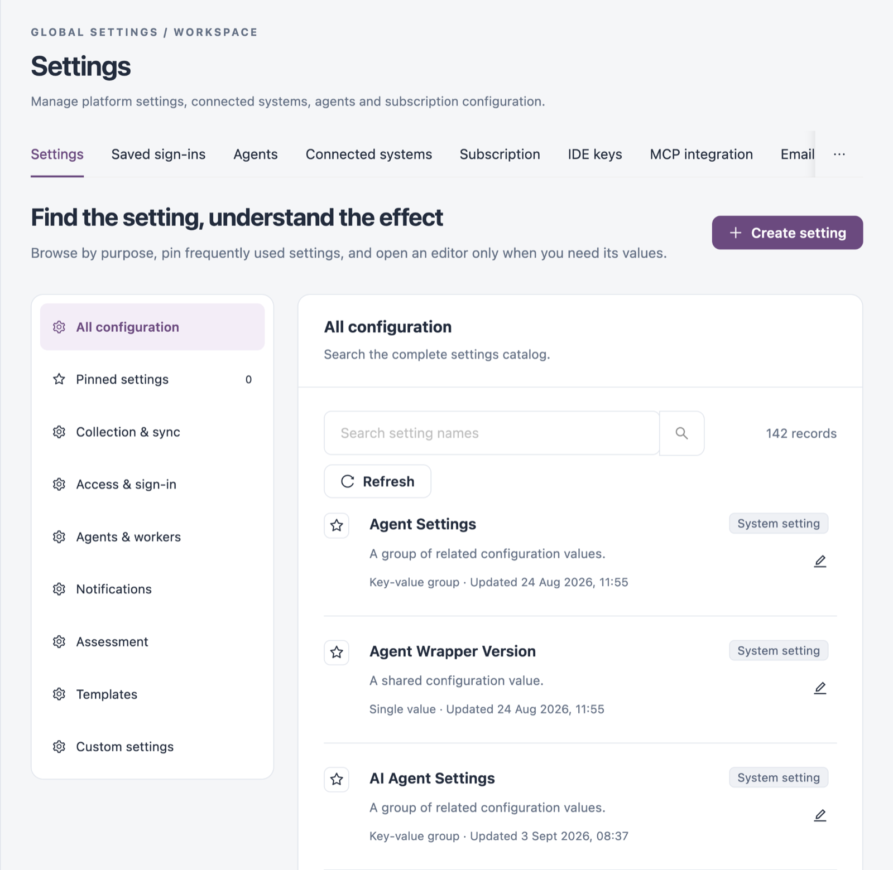
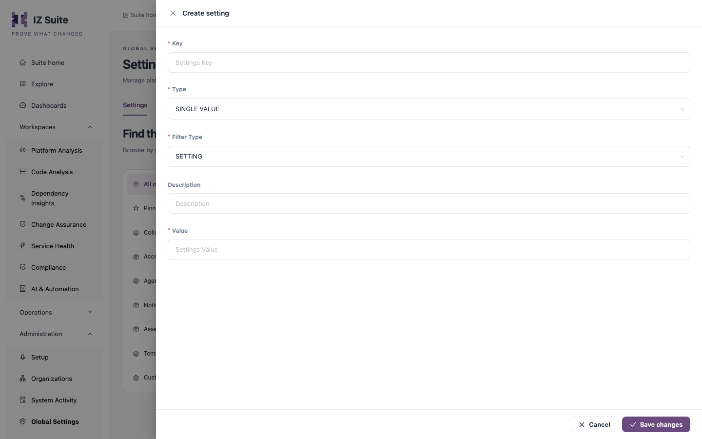

# Settings

The **Settings** tab is the catalog of every configuration value and template in the workspace. Administrators use it to find a setting, see what kind of value it holds, and change it.

Open it from **Administration** → **Global Settings** → **Settings** in the sidebar.

<figure><figcaption>
Settings catalog
</figcaption></figure>


You need a role that can view global settings to open this tab. Creating, editing and deleting settings each need their own global settings permission.


## Categories

The list on the left groups the catalog by purpose. Select a category to show only its settings.

| Category              | Shows                                                                                                                                                      |
| --------------------- | ---------------------------------------------------------------------------------------------------------------------------------------------------------- |
| **All configuration** | The complete settings catalog.                                                                                                                             |
| **Pinned settings**   | The settings you pinned. The number beside it is how many you have pinned. Pins belong to your account, so they follow you on every device you sign in on. |
| **Collection & sync** | Settings that control inventory discovery and collection (names containing "Sync").                                                                        |
| **Access & sign-in**  | Authentication and login settings (names containing "Auth" or "Login").                                                                                    |
| **Agents & workers**  | Settings for the processes that collect evidence (names containing "Agent" or "Worker").                                                                   |
| **Notifications**     | Notification delivery settings (names containing "Email", "Slack" or "Notification").                                                                      |
| **Assessment**        | Shared variables used during analysis, such as the rule settings of each language.                                                                         |
| **Templates**         | Reusable messages and matching definitions, such as email templates and pattern matchers.                                                                  |
| **Custom settings**   | Settings your team created. Settings supplied with IZ Suite are left out.                                                                                  |

## Settings List

Use **Search setting names** to filter the current category by name. The record count and **Refresh** sit beside the search box, and the pager under the list sets how many settings show per page.

Each setting shows:

| Item                 | Description                                                                                                                                                                                   |
| -------------------- | --------------------------------------------------------------------------------------------------------------------------------------------------------------------------------------------- |
| Star                 | Select it to pin or unpin the setting.                                                                                                                                                        |
| Name and description | The setting's name and what it is for.                                                                                                                                                        |
| Kind                 | **Single value** (one value), **Key-value group** (a set of named values) or **Template** (a reusable template or matching definition). Review where a template is used before you change it. |
| **Updated**          | When the setting last changed.                                                                                                                                                                |
| Tag                  | **System setting** for settings supplied with IZ Suite, **Custom** for settings your team created.                                                                                            |
| Edit (pencil)        | Opens **Edit setting**.                                                                                                                                                                       |
| Delete               | Deletes the setting. Only custom settings can be deleted.                                                                                                                                     |

## Create a Setting

1. Click **Create setting**.
2. Fill in the form (see the fields below).
3. Click **Save changes**.

<figure><figcaption>
Create setting
</figcaption></figure>

| Field               | Description                                                                                                                                                        |
| ------------------- | ------------------------------------------------------------------------------------------------------------------------------------------------------------------ |
| **Key**             | The setting's name. **Required.**                                                                                                                                  |
| **Type**            | **SINGLE VALUE** for one value, or **MULTI VALUE** for a group of key-value pairs. **Required.**                                                                   |
| **Filter Type**     | **SETTING** for a configuration value, or **TEMPLATE** for a reusable template. **Required.**                                                                      |
| **Description**     | What the setting is for. It shows in the settings list.                                                                                                            |
| **Value**           | Shown for **SINGLE VALUE**. The value of the setting. **Required.**                                                                                                |
| **Key Value Pairs** | Shown for **MULTI VALUE**. Click **Add Entry** to add a row with **Is Secure**, **Key** and **Value**. At least one entry is required, and each entry needs a key. |


Select **Is Secure** for an entry that holds a password, token or other secret. Once a secure entry is saved, its **Is Secure** box cannot be cleared.


## Edit a Setting

1. Find the setting and click the edit (pencil) icon.
2. Change the values in **Edit setting**.
3. Click **Save changes**.

The form has the same fields as **Create setting**. For a system setting, **Key**, **Type** and **Filter Type** cannot be changed, and the entries of a key-value group cannot be removed. A single value that holds long text, such as a template, opens in a code editor.

## Next Steps

* [Saved Sign-ins](saved-sign-ins.md): store credentials once instead of in each setting or monitor.
* [Email Templates](email-templates.md): edit email templates in a preview editor.
* [Agents](agents.md): check the agents that run your jobs.
* [Global Settings](./): the other configuration screens.
