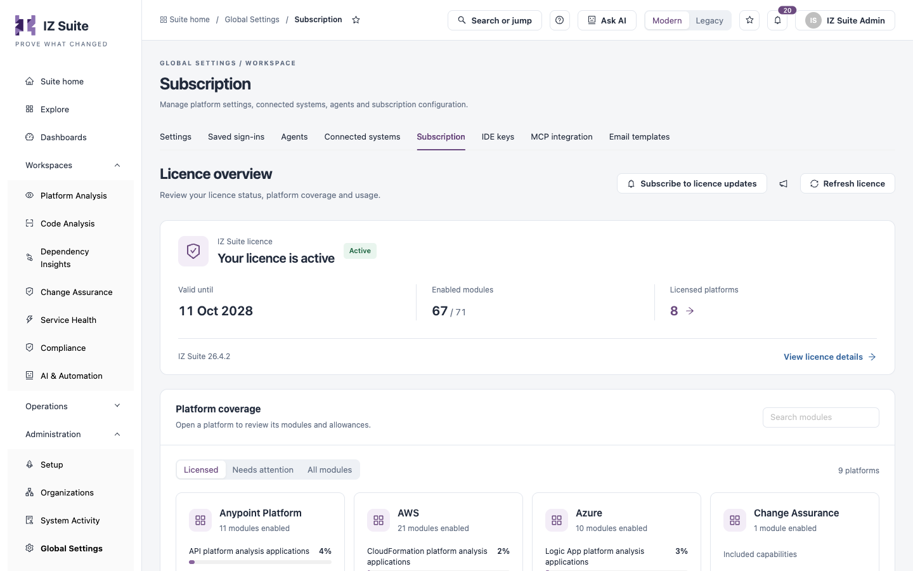
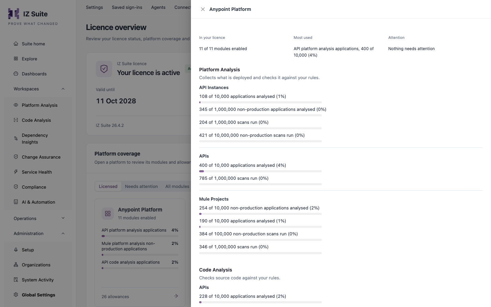

# Subscription

The **Subscription** tab shows your IZ Suite licence: whether it is active, until when it is valid, which platforms and modules it enables, and how much of each allowance you have used. Administrators use it to plan renewals and spot modules that are running out.

Open it from **Administration** → **Global Settings** → **Subscription** in the sidebar.

<figure><figcaption>
Licence overview
</figcaption></figure>


You need a role that can view global settings to open this tab.


## Licence summary

| Item                     | Description                                                                                                                                                                                             |
| ------------------------ | ------------------------------------------------------------------------------------------------------------------------------------------------------------------------------------------------------- |
| Status                   | **Your licence is active** with an **Active** tag, or the expired state.                                                                                                                                |
| **Valid until**          | The date the licence ends.                                                                                                                                                                              |
| **Enabled modules**      | Enabled modules out of all modules in the licence.                                                                                                                                                      |
| **Licensed platforms**   | How many platforms the licence covers. Click the number to list them and open one.                                                                                                                      |
| Version                  | The IZ Suite version the server runs.                                                                                                                                                                   |
| **View licence details** | Opens **Licence details**: status, validity, IZ Suite version, enabled modules, **Last licence check**, **Allowances near or at their limit**, **Modules without an allowance** and **Unused modules**. |

The summary also warns you when:

* the licence expires within 30 days, or has expired: contact Integral Zone to renew it;
* the required licence check is overdue: allowances may be set to 0 until a check succeeds;
* some modules need attention: click **Review usage** to show them.

## Actions

| Button                                    | Description                                                                                   |
| ----------------------------------------- | --------------------------------------------------------------------------------------------- |
| **Subscribe to licence updates**          | Subscribes you to notifications about licence changes.                                        |
| **Manage Subscriptions** (megaphone icon) | Manages who is subscribed to licence updates. Needs a role that can manage all subscriptions. |
| **Refresh licence**                       | Re-reads your entitlements from the IZ licence service after you confirm.                     |


When you refresh the licence, modules missing from the entitlement are disabled immediately, together with their scheduled work. If a module was added recently, check the licence contents with Integral Zone first.


## Platform coverage

Each card is a platform (for example Anypoint Platform, AWS, Azure, Salesforce or Service Health) with the number of enabled modules, its most used allowances as a percentage, and the total number of allowances.

* Use **Search modules** to find a module or allowance.
* Choose **Licensed** (platforms in your licence), **Needs attention** (modules near or at a limit, or without an allowance) or **All modules**.
* Click a card to open the platform.

<figure><figcaption>
A platform's modules and allowances
</figcaption></figure>

The platform drawer shows **In your licence** (enabled modules), **Most used** (the allowance closest to its limit) and **Attention**, then the modules grouped by product (for example Platform Analysis and Code Analysis). Each allowance shows how much is used out of how much is allowed, such as applications analysed or scans run.

A module carries a tag only when something is exceptional:

| Tag                              | Meaning                                                                                  |
| -------------------------------- | ---------------------------------------------------------------------------------------- |
| **Not in your licence**          | The module is not enabled.                                                               |
| **At its limit**                 | An allowance is fully used.                                                              |
| **Allowance is 0**               | The module is enabled but its allowance is 0.                                            |
| **No allowance in your licence** | The module is enabled but has no allowance, so the first application or scan is refused. |
| **Running out**                  | An allowance is close to its limit.                                                      |
| **Never used**                   | Nothing has been used yet.                                                               |

**IDE keys from this licence** at the bottom of the tab opens [IDE Keys](ide-keys.md).

## Next steps

* [IDE Keys](ide-keys.md): assign the IDE keys that come with your licence.
* Organization Subscriptions: manage who receives notifications.
* [Global Settings](./): the other configuration screens.
