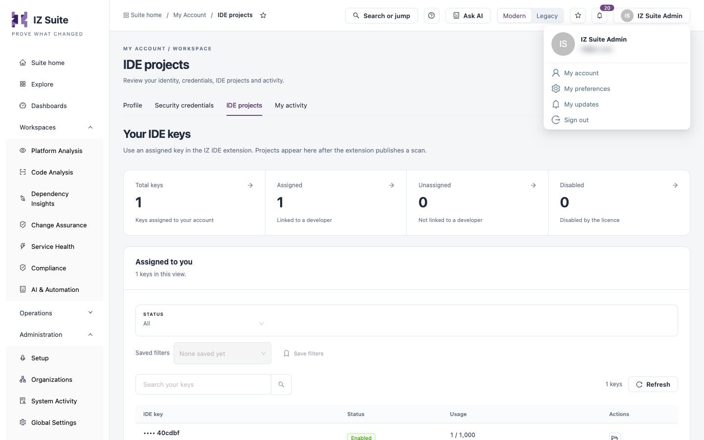

# My Account

My Account brings together everything about you as a user: your sign-in identity, the credentials your own integrations use, your IDE keys and projects, the activity recorded for your account, and your personal preferences.

Open it from the account menu: click your name in the top bar, then **My account** or **My preferences**. **My Account** is also under **Administration** in the sidebar.

<figure><figcaption>
Opening My Account from the account menu
</figcaption></figure>

| Page                                            | What it covers                                                                 |
| ----------------------------------------------- | ------------------------------------------------------------------------------ |
| [Profile](profile.md)                           | Your signed-in identity and shortcuts to your own work.                        |
| [Security Credentials](security-credentials.md) | Generate, review, disable and enable the tokens your integrations use.         |
| [IDE Projects](ide-projects.md)                 | Your IDE keys and the projects scanned with them in the IDE extension.         |
| [My Activity](my-activity.md)                   | Every operation recorded for your account, with its request and response.      |
| [My Preferences](my-preferences.md)             | Your picture, availability and delegate, home page, favourites and appearance. |

## Next Steps

* [Profile](profile.md): check how you are signed in.
* [Security Credentials](security-credentials.md): give an integration its own token.
* [My Preferences](my-preferences.md): choose where IZ Suite opens for you.
