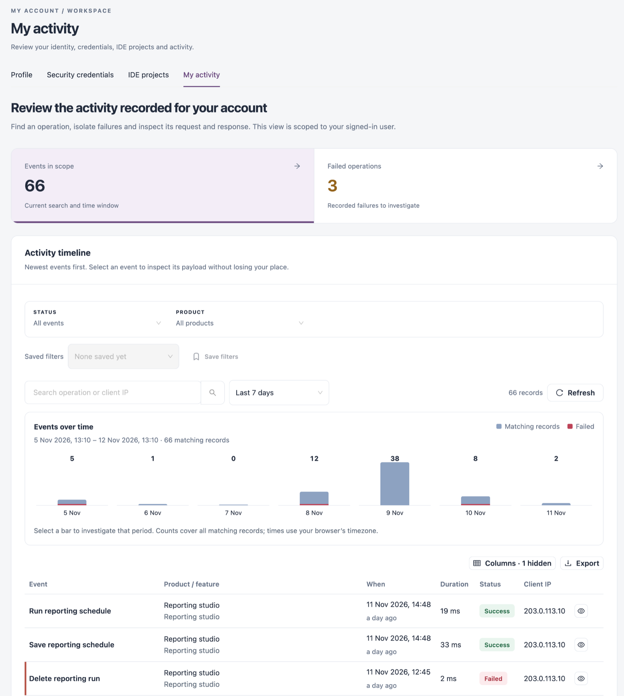

# My Activity

**My activity** is the audit trail of your own account. Find an operation, isolate failures and inspect its request and response. The view only ever shows events of your signed-in user.

Open it from **Administration** → **My Account** → **My activity** in the sidebar, or from the **My activity** tab of My Account.

<figure><figcaption>
Your activity
</figcaption></figure>

## Summary

| Tile                  | What it shows                                       |
| --------------------- | --------------------------------------------------- |
| **Events in scope**   | Events matching the current search and time window. |
| **Failed operations** | Recorded failures to investigate.                   |

**Export this page** downloads the events on the current page as a CSV file (timestamp, operation, actor, product, status, duration and record ID).

## Filters

| Control                              | What it does                                                                                        |
| ------------------------------------ | --------------------------------------------------------------------------------------------------- |
| **Status**                           | **All events**, **Failures** or **Successful**.                                                     |
| **Product**                          | **All products**, or one product area.                                                              |
| **Saved filters** / **Save filters** | Re-apply or save the current filters.                                                               |
| Time window                          | **Last 24 hours**, **Last 7 days**, **Last 30 days**, **Custom range** or **All retained history**. |
| **Search operation or client IP**    | Finds events by operation name or client IP address.                                                |
| **Refresh**                          | Reloads the events.                                                                                 |

**Events over time** charts matching events and failures per period. Select a bar to narrow the list to that period. Times use your browser's time zone.

## Activity Timeline

Events are listed newest first.

| Column                | Description                                                                      |
| --------------------- | -------------------------------------------------------------------------------- |
| **Event**             | The operation performed.                                                         |
| **Product / feature** | The product area and feature the operation belongs to.                           |
| **When**              | When it started, and how long ago.                                               |
| **Duration**          | How long the operation took.                                                     |
| **Status**            | **Success** or **Failed**.                                                       |
| **Client IP**         | The address the request came from, or **Not recorded**.                          |
| **Page**              | The page the action was taken from. Hidden by default; show it with **Columns**. |
| **Inspect event**     | Opens the event.                                                                 |

Use **Columns** to show or hide columns and **Export** to download the list.

## Inspect an Event

1. Click **Inspect event** on a row.
2. Read **Actor**, **Recorded at**, **Result**, **Duration**, **Client IP** and **Event identity**.
3. Switch between the **Request**, **Response** and **Variables** tabs to see what was sent and returned.
4. Click **Download this event** to save it as a JSON file.
5. Close the drawer to return to the list where you left it.

If an event has expired or is outside your access, the drawer says **Event is unavailable**.

When nothing matches, the page says **No activity matches this investigation**. Click **Reset investigation**, or widen the time window. An empty view does not mean that no activity occurred.

## Next Steps

* [Security Credentials](security-credentials.md): disable a token you did not expect to see used.
* [System Audit Logs](../../../iz-suite-legacy/iz-core/system-audit-logs.md): the same view for every user, for administrators.
* [My Account](./): back to the overview.
