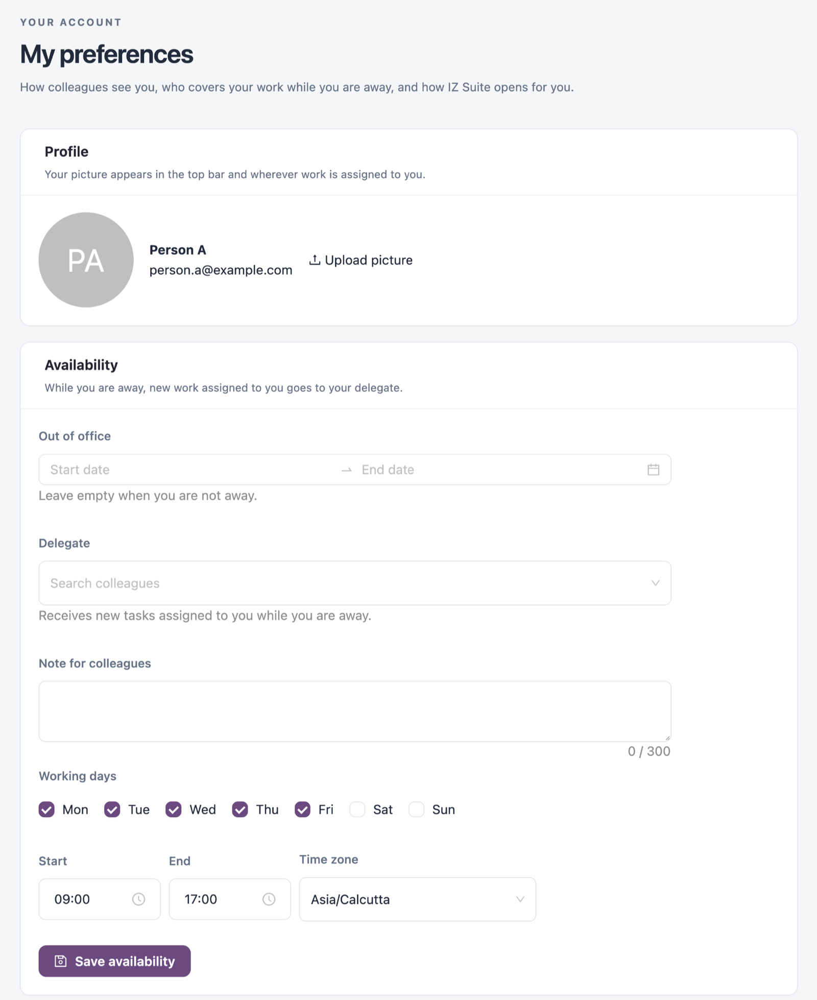

# My Preferences

**My preferences** sets how colleagues see you, who covers your work while you are away, and how IZ Suite opens for you.

Open it from the account menu: click your name in the top bar, then **My preferences**.

<figure><figcaption>
My preferences
</figcaption></figure>

When you are out of office, the page header shows **Away until** with your return date.

## Profile

Your picture appears in the top bar and wherever work is assigned to you. Until you add one, IZ Suite shows your initials.

1. Click **Upload picture**.
2. Choose a PNG, JPEG or WebP image.

Click **Remove** to go back to your initials.

## Availability

While you are away, new work assigned to you goes to your delegate.

| Field                   | Description                                                                                                                                          |
| ----------------------- | ---------------------------------------------------------------------------------------------------------------------------------------------------- |
| **Out of office**       | The first and last day you are away. Leave it empty when you are not away.                                                                           |
| **Delegate**            | The colleague who receives new tasks assigned to you while you are away. Type to search colleagues; a colleague who is away shows their return date. |
| **Note for colleagues** | Up to 300 characters.                                                                                                                                |
| **Working days**        | The days you work, **Mon** to **Sun**. Monday to Friday by default.                                                                                  |
| **Start** / **End**     | Your working hours. 09:00 to 17:00 by default.                                                                                                       |
| **Time zone**           | The time zone of your working hours. Your browser's time zone by default.                                                                            |

Click **Save availability** to save these fields. The other sections save as soon as you change them.

## Navigation

### Home Page

**Home page** sets where IZ Suite opens after you sign in, when sign-in has no other destination. Choose **Suite home**, **Explore**, or any workspace or section you can open. Clear the field to use the default, Suite home.

### Favourites

A favourite keeps the page's filters. Add one with the star next to the breadcrumb on any page (see [Navigating IZ Suite](../../getting-started/navigating-iz-suite.md)); you can keep up to 20. Each favourite here shows its name and address, with these actions:

| Action                      | What it does                                                         |
| --------------------------- | -------------------------------------------------------------------- |
| Pencil (**Rename**)         | Renames the favourite (up to 80 characters).                         |
| **Use as home page**        | Makes the favourite your home page. It is then tagged **Home page**. |
| **Move up** / **Move down** | Changes the order in the **Favourites** drawer.                      |
| **Remove favourite**        | Removes it from your favourites.                                     |

## Appearance

Appearance applies on this device immediately and is remembered on every device you sign in on.

| Setting      | Options                               |
| ------------ | ------------------------------------- |
| Colour theme | **Original**, **Purple** or **Dark**. |
| Density      | **Compact** or **Comfortable**.       |

## Next Steps

* [Navigating IZ Suite](../../getting-started/navigating-iz-suite.md): add favourites and find pages.
* [Profile](profile.md): check the account you are signed in with.
* [My Account](./): back to the overview.
