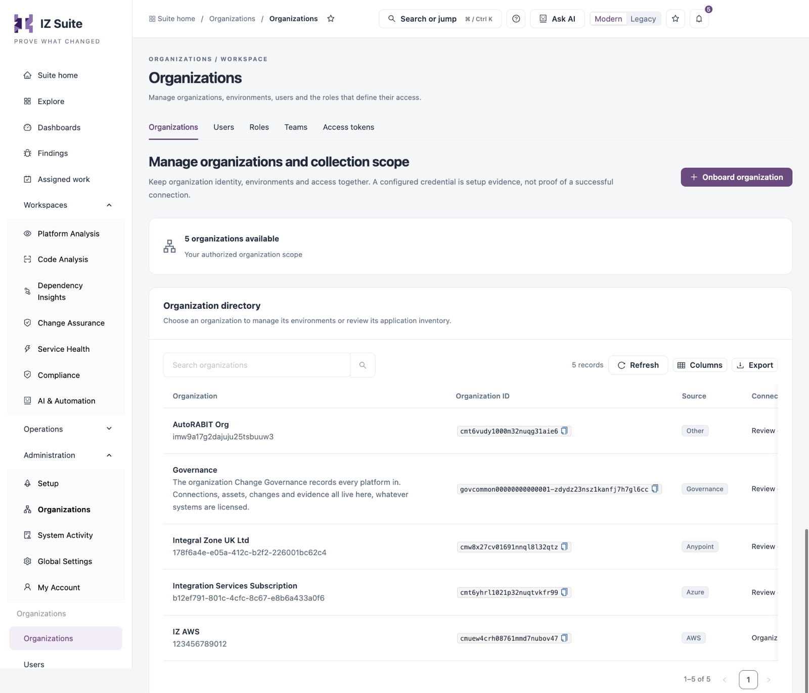
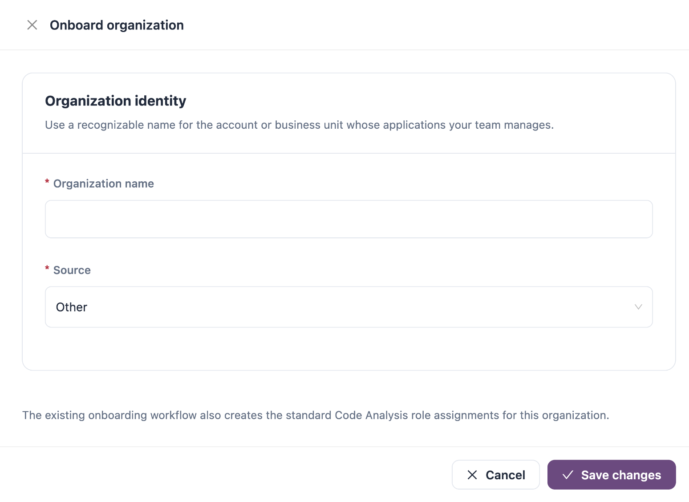

# Organizations

An organization is the account or business unit whose applications your team manages, for example an AWS account, a MuleSoft Anypoint business group or an Azure subscription. Its environments (for example production and test, or one per AWS region) hold the applications IZ Suite collects and assesses. This tab lists the organizations within your access.

Open it from **Administration** → **Organizations** in the sidebar. The screen has five tabs; this page covers the **Organizations** tab.

| Tab                               | What it is for                                                                     |
| --------------------------------- | ---------------------------------------------------------------------------------- |
| [Users](users.md)                 | Invite people, give them roles and direct permissions, and disable access.         |
| [Roles](roles.md)                 | Create roles, choose their permissions and scopes, and assign them to people.      |
| [Teams](teams.md)                 | Group people into teams that share roles and permissions and can be assigned work. |
| [Access Tokens](access-tokens.md) | Review and create the tokens integrations use to act as a person.                  |


Each tab appears only when your role can view it: organizations, people (Users and Access tokens) or roles (Roles and Teams).


<figure><figcaption></figcaption></figure>

The banner shows how many organizations are available in your authorized organization scope. Organizations brought in by a sync (Anypoint, AWS, Azure) appear here as well as the ones you onboard by hand.

## Organization Directory

Use **Search organizations** to filter the list, **Refresh** to reload it, **Columns** to choose columns and **Export** to download the list.

| Column               | Description                                                                                                                                                                                                         |
| -------------------- | ------------------------------------------------------------------------------------------------------------------------------------------------------------------------------------------------------------------- |
| **Organization**     | The organization name, with its description or external account ID below. Click the name to open its details.                                                                                                       |
| **Organization ID**  | The IZ Suite identifier. Click the copy icon to copy it, for example to pass it to the scanner in a CI/CD pipeline.                                                                                                 |
| **Source**           | Where the organization comes from: for example **AWS**, **Anypoint**, **Azure**, **Salesforce**, **Governance** or **Other**.                                                                                       |
| **Connection setup** | **Organization credential configured**, **Organization credential not configured** (AWS) or **Review environment / source setup**. A configured credential is setup evidence, not proof of a successful connection. |
| **Manage**           | Row actions, below.                                                                                                                                                                                                 |

### Row Actions

| Action                     | Description                                                                               |
| -------------------------- | ----------------------------------------------------------------------------------------- |
| **Manage organization**    | Opens the organization drawer.                                                            |
| **Manage environments**    | Opens the organization's environments. See **Environments** below.                        |
| **Edit organization**      | Changes the name and description. See **Edit an Organization** below.                     |
| **Subscribe to updates**   | Follow this organization by email, Slack or in-app notification.                          |
| **Manage Subscriptions**   | Review everyone's subscriptions to this organization.                                     |
| **Schedule platform scan** | AWS, Anypoint and Azure organizations: opens **Schedules** filtered to this organization. |

Actions that do not fit the row are under **More actions** (**...**).

### Organization Drawer

The drawer shows **Platform / source**, **External account ID**, **Organization credential** and **Last updated**. Under **Manage this organization** it links to:

* **Schedule scans across this platform** (AWS, Anypoint and Azure).
* **Configure environments and collection scope**.
* **Review deployed application evidence** (Platform Analysis).
* **Review source application evidence** (Code Analysis).

**Record identity** shows the organization ID.

## Onboard an Organization

<figure><figcaption></figcaption></figure>

1. Click **Onboard organization**.
2. Enter the **Organization name**.
3. Choose the **Source**.
4. For an AWS organization, fill in the **AWS account connection** fields.
5. Click **Save changes**.

| Field                 | Description                                                                                                                  |
| --------------------- | ---------------------------------------------------------------------------------------------------------------------------- |
| **Organization name** | A recognizable name for the account or business unit. Required. Up to 100 characters.                                        |
| **Source**            | **Other**, **Salesforce** or **AWS**. Required. The source cannot be changed later.                                          |
| **AWS account ID**    | AWS only. The 12-digit AWS account ID. Required.                                                                             |
| **Access key ID**     | AWS only. Access key of an IAM principal with read access to the services you govern. Required.                              |
| **Secret access key** | AWS only. Required. Stored encrypted.                                                                                        |
| **Regions**           | AWS only. Comma-separated regions, for example `eu-west-2,us-east-1`. Collection also includes region-independent resources. |

For a Salesforce organization, configure authentication per environment after onboarding. Onboarding also creates the standard Code Analysis role assignments for the organization.


You need a role that can onboard organizations to see **Onboard organization**, **Edit organization**, **Create environment** and **Edit environment**.


## Edit an Organization

1. Click **Edit organization** on the row (under **More actions**).
2. Change the **Organization name** or **Description**.
3. For an AWS organization, change the account ID, access key or regions. Leave the secret access key as shown to keep the saved one.
4. Click **Save changes**.

Identity edits keep the provider account, environments, credentials and assigned access.

## Environments

**Manage environments** opens _Organization_ **· environments**. Tiles count **Environments**, **Production** and **Non-production**; click one to filter. **Organization details** goes back to the organization drawer.

| Column             | Description                                                                                                                                                                         |
| ------------------ | ----------------------------------------------------------------------------------------------------------------------------------------------------------------------------------- |
| **Environment**    | Name of the environment.                                                                                                                                                            |
| **Environment ID** | The IZ Suite identifier.                                                                                                                                                            |
| **Classification** | **Production** or **Non-production**.                                                                                                                                               |
| **Last updated**   | When the environment last changed.                                                                                                                                                  |
| **Manage**         | **Review environment**, **Edit environment**, **Subscribe to updates**, **Manage Subscriptions** and **Environment executions** (opens **Execution history** for this environment). |

**Review environment** opens **Environment evidence**: environment, organization, provider environment ID, classification, description and last update.

### Create an Environment

1. Click **Create environment**.
2. Fill in the fields below.
3. Click **Save changes**.

| Field                                                           | Description                                                                                                                                                                                                                         |
| --------------------------------------------------------------- | ----------------------------------------------------------------------------------------------------------------------------------------------------------------------------------------------------------------------------------- |
| **Environment name**                                            | Required.                                                                                                                                                                                                                           |
| **Description**                                                 | Optional.                                                                                                                                                                                                                           |
| **Production environment**                                      | Switch on for production environments.                                                                                                                                                                                              |
| **Provider environment ID** / **AWS region**                    | The provider's identifier. For AWS, the region identifier (required), or `global` for region-independent resources. For other sources it is optional; an identifier is created when you leave it empty. It cannot be changed later. |
| **Instance URL**, **Client ID**, **User name**, **Private key** | Salesforce organizations only, under **Salesforce connection**. Saved credentials are kept unless you switch on **Replace private key**. The connection is verified when the collector runs.                                        |

## Next Steps

* [Users](users.md): invite the people who work with these organizations.
* [Roles](roles.md): scope permissions to organizations and environments.
* [Teams](teams.md): group people and share access and work.
