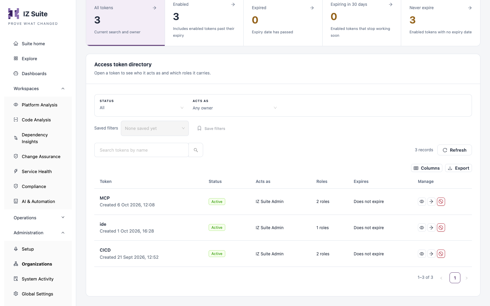
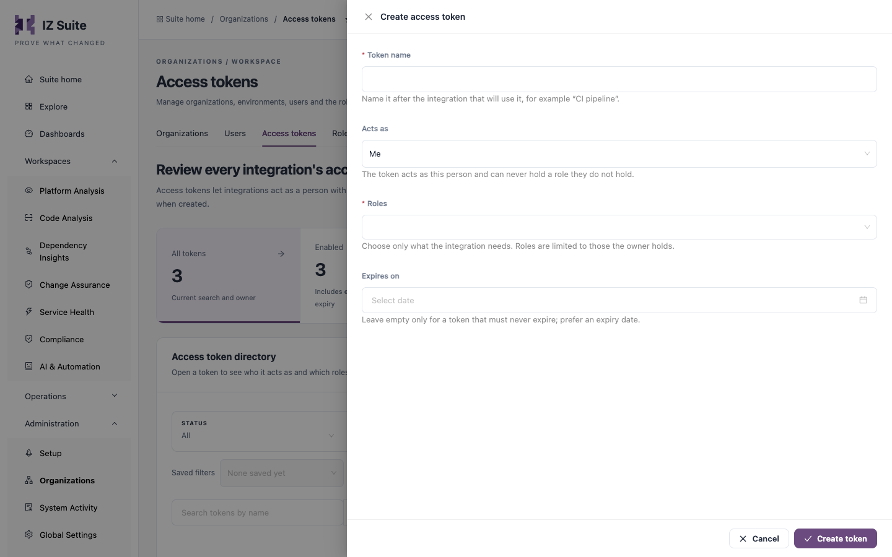

# Access Tokens

Access tokens let integrations, such as CI/CD pipelines, AI assistants and scripts, act as a person with a subset of that person's roles. This tab lists the tokens across your workspace. Only metadata is listed; a token's value is shown once, when it is created.

Open it from **Administration** → **Organizations** → **Access tokens** in the sidebar.

<figure><figcaption>
Access tokens
</figcaption></figure>

## Counts and filters

| Tile                    | Description                                                 |
| ----------------------- | ----------------------------------------------------------- |
| **All tokens**          | Every token matching the current search and owner.          |
| **Enabled**             | Enabled tokens, including enabled tokens past their expiry. |
| **Expired**             | Tokens whose expiry date has passed.                        |
| **Expiring in 30 days** | Enabled tokens that stop working soon.                      |
| **Never expire**        | Enabled tokens with no expiry date.                         |

Click a tile to list those tokens.

| Filter      | Description                                                                                                                                                                   |
| ----------- | ----------------------------------------------------------------------------------------------------------------------------------------------------------------------------- |
| **Status**  | **All**, **Enabled**, **Expired**, **Expiring in 30 days**, **Never expire**, **Disabled**, or **Holds access-admin permissions** (tokens that can administer access itself). |
| **Acts as** | One or more token owners.                                                                                                                                                     |
| Search      | Finds tokens by name.                                                                                                                                                         |

**Saved filters** and **Save filters** keep a filter combination. **Refresh**, **Columns** and **Export** work as on other lists.

## Access token directory

| Column      | Description                                                                                             |
| ----------- | ------------------------------------------------------------------------------------------------------- |
| **Token**   | The token name and when it was created.                                                                 |
| **Status**  | **Active**, **Expired** or **Disabled**.                                                                |
| **Acts as** | The person the token acts as.                                                                           |
| **Roles**   | How many roles the token carries.                                                                       |
| **Expires** | The expiry date, or **Does not expire**.                                                                |
| **Manage**  | **Review token**, **Open owner** (opens the owner's details) and **Disable token** or **Enable token**. |

**Review token** opens the token drawer: status, **Acts as**, **Expires**, **Created**, **Token value** (**Not retrievable; only a digest is stored**) and **Roles carried by this token**. The token can never exceed the roles its owner holds.

## Create an access token

<figure><figcaption>
Create access token
</figcaption></figure>

1. Click **Create access token**.
2. Enter a **Token name**.
3. Choose who the token **Acts as**.
4. Choose the **Roles** the integration needs.
5. Optionally set **Expires on**.
6. Click **Create token**.
7. Copy the token value and keep it in a secret store.

| Field          | Description                                                                                                                                                                    |
| -------------- | ------------------------------------------------------------------------------------------------------------------------------------------------------------------------------ |
| **Token name** | Required. Name it after the integration that will use it, for example "CI pipeline".                                                                                           |
| **Acts as**    | **Me**, or another person when your role can create tokens for others. The token acts as this person and can never hold a role they do not hold. Changing it clears the roles. |
| **Roles**      | Required; choose at least one. Choose only what the integration needs. Only roles the owner holds are offered.                                                                 |
| **Expires on** | Leave empty only for a token that must never expire; prefer an expiry date.                                                                                                    |


The token value is shown only once, under **Copy this token now**. Only a digest is stored, so the value cannot be shown again. If it is lost, create a new token. Keep tokens in a masked secret store and never paste them into files you commit.


## Disable or enable a token

1. Click **Disable token** (or **Enable token**) on the row.
2. Confirm in the drawer that opens.

Integrations using a disabled token lose access on their next request. You can enable it again later; it regains its roles until its expiry date.


You need a role that can generate access tokens to create one. You can disable or enable your own tokens; disabling other people's tokens needs a role that can manage people.


## Next steps

* [Roles](roles.md): create narrow roles for pipelines and AI assistants.
* Setup: create a token and copy a ready-made pipeline or AI assistant configuration.
* [Users](users.md): disabling a person also disables their tokens.
