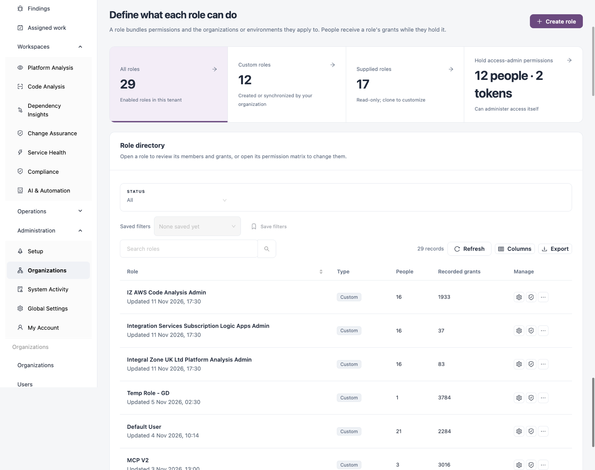
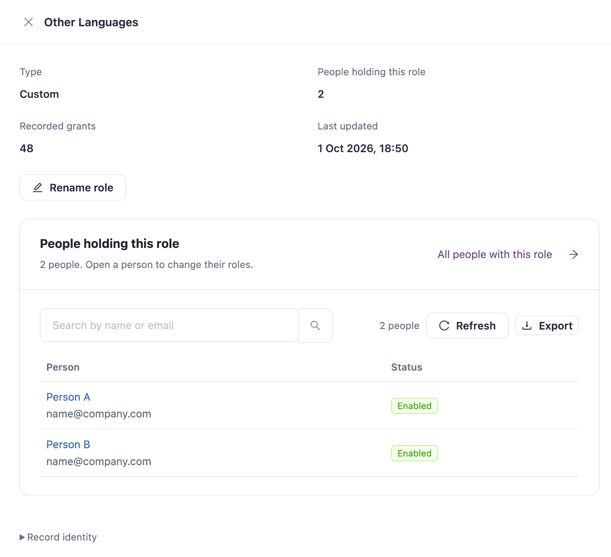

# Roles

A role bundles permissions and the organizations or environments they apply to. People receive a role's grants while they hold it, and access tokens can carry roles their owner holds. Administrators use this tab to create and change roles and to see who holds them.

Open it from **Administration** → **Organizations** → **Roles** in the sidebar.

<figure><figcaption></figcaption></figure>

## Counts and Filters

| Tile                              | Description                                                                   |
| --------------------------------- | ----------------------------------------------------------------------------- |
| **All roles**                     | Enabled roles in this tenant.                                                 |
| **Custom roles**                  | Roles created or synchronized by your organization.                           |
| **Supplied roles**                | Roles that come with IZ Suite. They are read-only; clone one to customize it. |
| **Hold access-admin permissions** | How many people and tokens can administer access itself. Click to see who.    |

Filter with **Status** (**All**, **Custom**, **Supplied**) and **Search roles**. **Saved filters**, **Save filters**, **Refresh**, **Columns** and **Export** work as on other lists. **Export roles on this page** downloads the roles on the current page.

## Role Directory

| Column              | Description                                                      |
| ------------------- | ---------------------------------------------------------------- |
| **Role**            | The role name and when it was last updated.                      |
| **Type**            | **Custom**, **Supplied**, or **Synced from** a team sync source. |
| **People**          | How many people hold the role.                                   |
| **Recorded grants** | How many permission grants the role has, across its scopes.      |
| **Manage**          | Row actions, below.                                              |

| Action                | Description                                                                                                                                     |
| --------------------- | ----------------------------------------------------------------------------------------------------------------------------------------------- |
| **Manage role**       | Opens the role drawer.                                                                                                                          |
| **Permission matrix** | Opens the role's permission matrix. See **Permission Matrix** below.                                                                            |
| **Assign people**     | Gives the role to people. See **Assign People** below. Not offered for synced roles.                                                            |
| **Clone role**        | Creates a copy with a **New role name**. The copy gets exactly the same permissions in the same organizations and environments, and no members. |
| **Delete role**       | Deletes a custom role. See **Delete a Role** below.                                                                                             |

**Assign people**, **Clone role** and **Delete role** are under **More actions** (**...**).

## Role Drawer

<figure><figcaption></figcaption></figure>

The drawer shows **Type**, **People holding this role**, **Recorded grants** and **Last updated**, a **Rename role** button for custom roles, and the people who hold the role. Open a person to change their roles. Supplied roles say **Supplied roles are read-only. Clone this role to customize it.**; synced roles say they are managed by their team sync and that local changes would be overridden.

## Create a Role

1. Click **Create role**.
2. Enter the **Role name**.
3. Under **What can they do?**, tick the permissions the role needs. Use **Search permissions or categories** to find them.
4. When a permission applies per organization or per environment, click **Next: where it applies**.
5. Under **Where does it apply?**, tick the organizations or environments.
6. Click **Create role**.

| Field                    | Description                                                                                                                                                                                                                         |
| ------------------------ | ----------------------------------------------------------------------------------------------------------------------------------------------------------------------------------------------------------------------------------- |
| **Role name**            | Required. Use a name that describes the job, for example "Release approver".                                                                                                                                                        |
| **What can they do?**    | The permissions, grouped by product area. Select at least one permission.                                                                                                                                                           |
| **Where does it apply?** | Organizations for organization-scoped permissions, environments for environment-scoped permissions. Choosing an environment also grants organization-scoped permissions in its organization. Tenant-wide permissions need no scope. |


To create a role like a supplied one, use **Clone role** on the supplied role and change the copy.


## Assign People

1. Click **Assign people** on the role's row.
2. Choose the assignment method:
   * **Choose people**: pick **People to assign**. Only enabled people are listed.
   * **Everyone in another role**: under **Give this role to everyone who holds**, pick a role. This is a one-time copy of that role's current members; people who receive that role later are not added.
3. Click **Assign role**.

People who already held the role are unchanged, and their other roles are kept.

## Permission Matrix

**Permission matrix** opens the role on its own page with a **Role summary** (**Role type**, **Recorded grants**, **Scopes**, **People holding this role**, **Last updated**) and a matrix of permissions against scopes. **Granted** marks each scope a permission is recorded in.

* Filter by **Category** and scope, or search.
* Click **Add permissions** to add permissions and scopes.
* Click **Export all grants** to download every grant.
* Click **Back to roles** to return to the list.

## Delete a Role

1. Click **Delete role** on the row (under **More actions**).
2. Type the exact role name to confirm.
3. Click **Delete role**.


Everyone who holds the role loses its grants immediately, unless another role or direct grant provides them. The role and its assignments cannot be restored. Supplied and synced roles cannot be deleted.



You need a role that can create roles to create or clone them, one that can update roles to rename them, change their permissions or assign people, and one that can delete roles to delete them.


## Next Steps

* [Users](users.md): give roles to people and add direct permissions.
* [Access Tokens](access-tokens.md): tokens carry a subset of their owner's roles.
* [Setup](../setup.md): create ready-made roles for pipelines and AI assistants.
