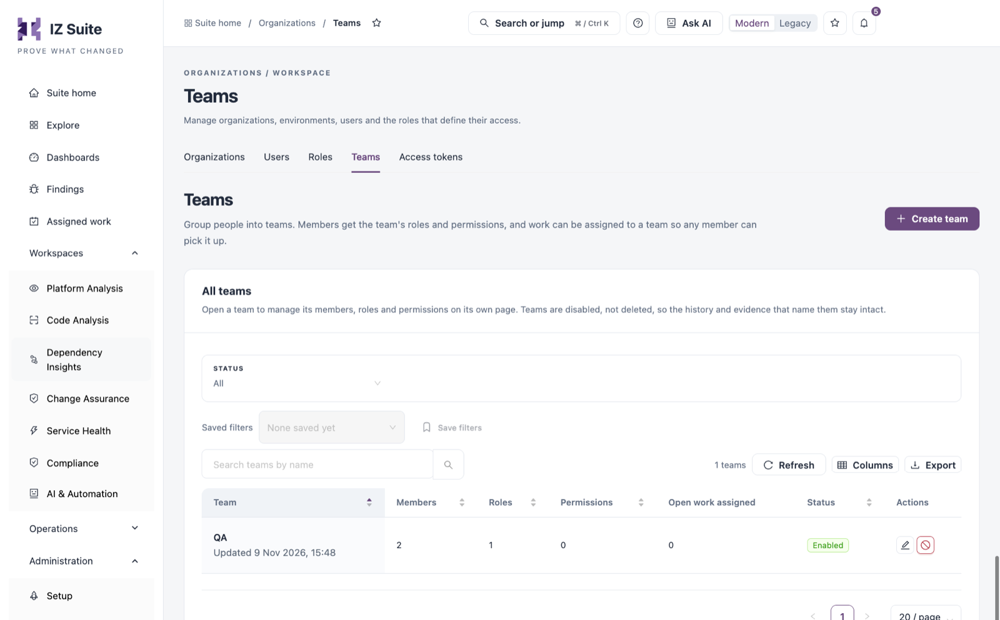

# Teams

A team groups people. While a team is enabled, every member holds the team's roles and permissions on top of their own, and work can be assigned to the team, for example a change approval or a remediation task, so any member can pick it up. Use this tab to create teams and manage their members, roles and permissions.

Open it from **Administration** → **Organizations** → **Teams** in the sidebar.

<figure><figcaption>
Teams
</figcaption></figure>


You need a role that can view roles to see Teams, and one that can create roles to create a team. Adding or removing members and roles needs a role that can assign roles; adding permissions needs one that can assign permissions.


## All Teams

Filter with **Status** (**All**, **Enabled** or **Disabled**) and **Search teams by name**. **Saved filters** and **Save filters** keep a filter combination; **Refresh**, **Columns** and **Export** work as on other lists.

| Column                 | Description                                                                                                                                             |
| ---------------------- | ------------------------------------------------------------------------------------------------------------------------------------------------------- |
| **Team**               | The team name and when it was last updated. Click the name to open the team.                                                                            |
| **Members**            | How many people are in the team.                                                                                                                        |
| **Roles**              | How many roles every member holds through the team.                                                                                                     |
| **Permissions**        | How many permission grants every member holds through the team.                                                                                         |
| **Open work assigned** | How much open work is assigned to the team: change approvals, maintenance or review items, upgrade items, release sign-off steps and remediation tasks. |
| **Status**             | **Enabled** or **Disabled**.                                                                                                                            |
| **Actions**            | **Edit team** (or **View team**) opens the team; **Disable team** or **Enable team**.                                                                   |


Teams are disabled, not deleted, so the history and evidence that name them stay intact.


## Create a Team

1. Click **Create team**.
2. Enter the **Team name**, for example "Platform operations". Use a name people recognise when work is assigned to it.
3. Click **Next: members** and tick the people to add. Only enabled people are listed; your ticks are kept across pages and searches.
4. Click **Next: roles** and tick the roles every member should hold.
5. Click **Next: permissions** and choose permissions, and where they apply, that every member should hold.
6. Click **Create team**.

Members, roles and permissions are optional; you can add them later from the team's page. A team can have up to 500 members. The steps you cannot use without the right permission are left out, and the form says so. If the team is created but something could not be added, a message says what to add from the team's tabs.

## Manage a Team

Open a team to manage it on its own page. **Teams** in the breadcrumb returns to the list.

| Tile                   | Description                                        |
| ---------------------- | -------------------------------------------------- |
| **Members**            | People in the team.                                |
| **Roles**              | Roles held by every member.                        |
| **Permission grants**  | Permissions held by every member, in their scopes. |
| **Open work assigned** | The open work assigned to the team, by kind.       |

The tabs list the team's contents:

| Tab                           | Description                                                                                                                                                                                                  |
| ----------------------------- | ------------------------------------------------------------------------------------------------------------------------------------------------------------------------------------------------------------ |
| **Members (**_**N**_**)**     | Each member with **Email**, **Account**, **Sign-in method** and **Last sign-in**. Filter by **Account** and **Sign-in method**. **Remove from team** removes a member; their own roles and permissions stay. |
| **Roles (**_**N**_**)**       | The roles every member holds through the team, with **Type** and **Role status**. A disabled role gives nothing. **Remove from team** removes a role; anyone who holds it directly keeps it.                 |
| **Permissions (**_**N**_**)** | The permissions every member holds through the team, with their **Module** and where they apply (**Across the tenant**, an organization or an environment). **Remove from team** removes a grant.            |

**Rename team** changes the name. **Record identity** shows the team's identifier.

Changes take effect from each member's next request. To see everything a person holds through their teams, open the person in [Users](users.md) and go to **Through teams**.

## Disable or Enable a Team

1. Click **Disable team** (or **Enable team**) on the row or on the team's page.
2. Review what changes, including the open work assigned to the team.
3. Confirm with **Disable team** (or **Enable team**).


While a team is disabled, its members stop holding its roles and permissions (unless they hold them another way), nobody can work what is assigned to it, and it cannot be given new work. Members, roles and permissions are kept, so enabling the team restores them. Reassign urgent work in **Assigned work** first.


## Next Steps

* [Roles](roles.md): create the roles a team gives its members.
* [Users](users.md): see what a person holds through their teams.
* [Organizations](./): the other tabs.
