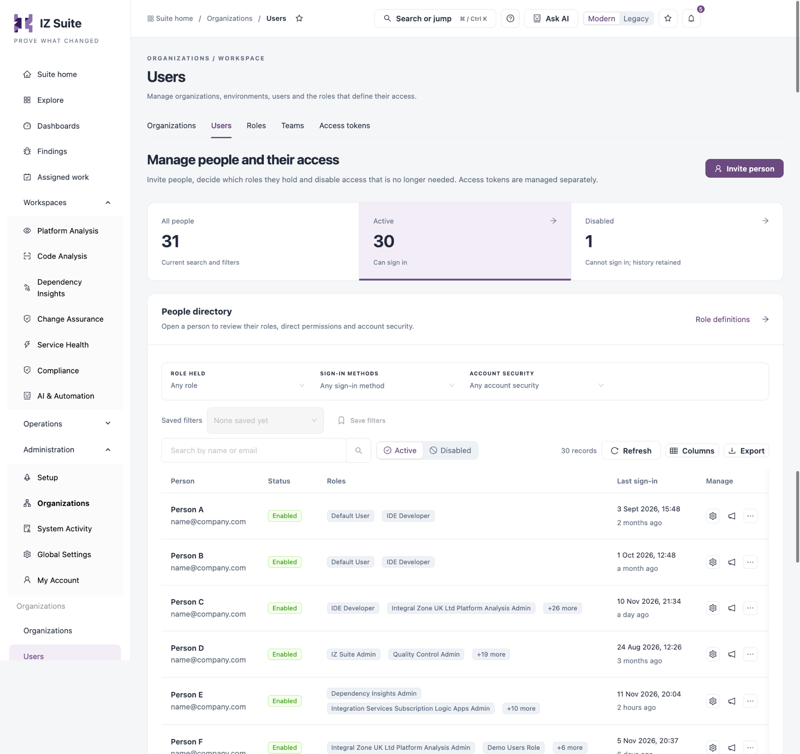
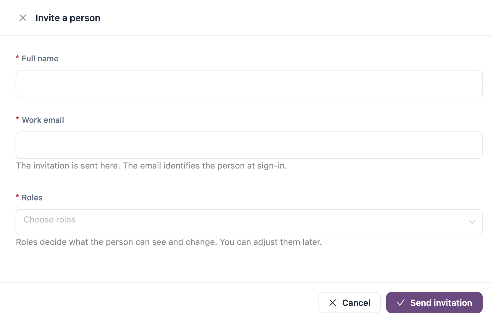

# Users

**Users** lists everyone who can sign in to IZ Suite. Administrators use it to invite people, give them roles and direct permissions, reset their sign-in, and disable access that is no longer needed. Access tokens are managed on their own tab.

Open it from **Administration** → **Organizations** → **Users** in the sidebar.

<figure><figcaption></figcaption></figure>

## Counts and Filters

| Tile           | Description                                                           |
| -------------- | --------------------------------------------------------------------- |
| **All people** | Everyone matching the current search and filters.                     |
| **Active**     | People who can sign in. Click to list them.                           |
| **Disabled**   | People who cannot sign in; their history is kept. Click to list them. |

| Filter                      | Description                                                                                   |
| --------------------------- | --------------------------------------------------------------------------------------------- |
| **Role held**               | People who hold the chosen role.                                                              |
| **Sign-in methods**         | One or more of **Internal password**, **Integral Zone**, **Google**, **Azure**, **Anypoint**. |
| **Account security**        | **Sign-in locked now** or **Access expired**.                                                 |
| **Search by name or email** | Finds people by name or email.                                                                |
| **Active** / **Disabled**   | Switches between enabled and disabled people.                                                 |

**Saved filters** and **Save filters** keep a filter combination for later. **Role definitions** opens the [Roles](roles.md) tab. **Export people on this page** downloads the people on the current page.

## People Directory

| Column           | Description                                                                                         |
| ---------------- | --------------------------------------------------------------------------------------------------- |
| **Person**       | Name and email. Click to open the person.                                                           |
| **Status**       | **Enabled** or **Disabled**, with a **Sign-in locked** or **Access expired** tag when that applies. |
| **Roles**        | The first roles the person holds, with **+N more**.                                                 |
| **Last sign-in** | Date and how long ago.                                                                              |
| **Manage**       | Row actions, below.                                                                                 |

| Action                     | Description                                                                                 |
| -------------------------- | ------------------------------------------------------------------------------------------- |
| **Manage access**          | Opens the person on their **Roles** tab.                                                    |
| **Manage Subscriptions**   | Review and change the person's subscriptions.                                               |
| **Set temporary password** | Sets a **Temporary password** for the person. The password rules are shown under the field. |
| **Reset MFA**              | Resets the person's multi-factor authentication.                                            |

**Set temporary password** and **Reset MFA** are under **More actions** (**...**).

## Invite a Person

<figure><figcaption></figcaption></figure>

1. Click **Invite person**.
2. Enter the **Full name** and **Work email**.
3. Choose one or more **Roles**.
4. Click **Send invitation**.

| Field          | Description                                                                                                           |
| -------------- | --------------------------------------------------------------------------------------------------------------------- |
| **Full name**  | Required.                                                                                                             |
| **Work email** | Required; must be a valid email address. The invitation is sent here, and the email identifies the person at sign-in. |
| **Roles**      | Required; choose at least one. Roles decide what the person can see and change. You can adjust them later.            |

The account and its roles are saved and an invitation email is requested. Delivery is not confirmed on this screen; the email step in [Setup](../setup.md) links to the delivery logs.


If an account already uses the email, nothing is saved. The form says the person already has an account and offers **Open account**, so you change that person's roles instead.



The invitation links to the server address set in [Setup](../setup.md). Set up email delivery before you invite people.


## Person Drawer

Click a person's name or **Manage access** to open their drawer.

| Tab                     | Description                                                                                                                                                                                                                                                              |
| ----------------------- | ------------------------------------------------------------------------------------------------------------------------------------------------------------------------------------------------------------------------------------------------------------------------ |
| **Details**             | **Status**, **Email**, **Sign-in method**, **Last sign-in**, **Password changed**, **Sign-in locked until**, **Access valid until** and **Account created**. **Sign-in access** holds **Disable person** or **Enable person**. **Record identity** shows the account ID. |
| **Roles (**_**N**_**)** | The roles the person holds. Choose roles and click **Add roles**, or remove a role from its row. A person keeps at least one role; to remove all access, disable the person instead.                                                                                     |
| **Direct permissions**  | A permission matrix of grants given to this person on top of their roles. Use **Add direct permissions** to add some and **Export all grants** to download them. Filter by **Category** and scope.                                                                       |
| **Through teams**       | The roles and permissions the person holds through their [teams](teams.md), with the scope of each and whether it is held now. A disabled team, or a disabled role, gives nothing.                                                                                       |

### Disable or Enable a Person

1. Open the person and go to **Details**.
2. Click **Disable person** (or **Enable person**).
3. Confirm in the drawer that opens.


Disabling a person stops them signing in and disables every access token they created. Their roles, permissions and history are kept. Enabling them again restores sign-in, but access tokens disabled earlier stay disabled. You cannot disable your own account.



You need a role that can invite people to invite, disable or enable people; a role that can assign roles to change roles; and a role that can assign permissions to see **Direct permissions**. **Set temporary password** and **Reset MFA** need a role that can generate credentials for other people.


## Next Steps

* [Roles](roles.md): create the roles you give to people.
* [Access Tokens](access-tokens.md): review the tokens people created for integrations.
* [Organizations](./): the other tabs.
