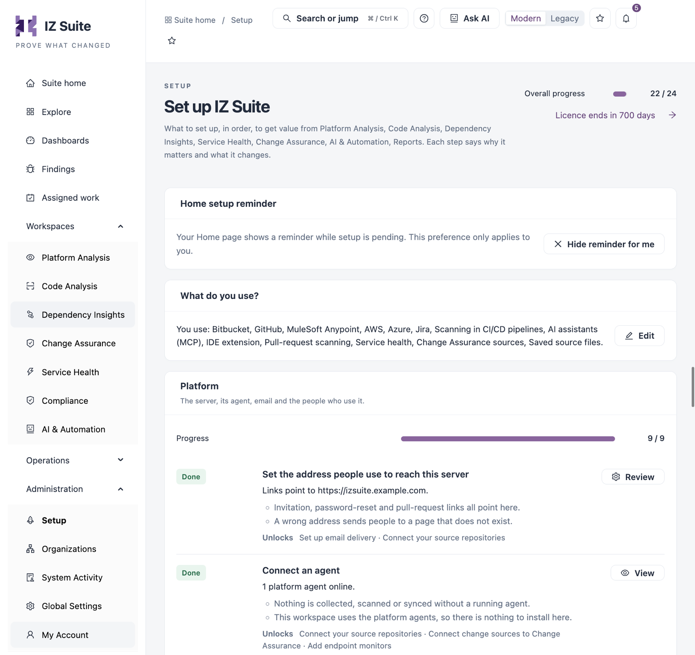
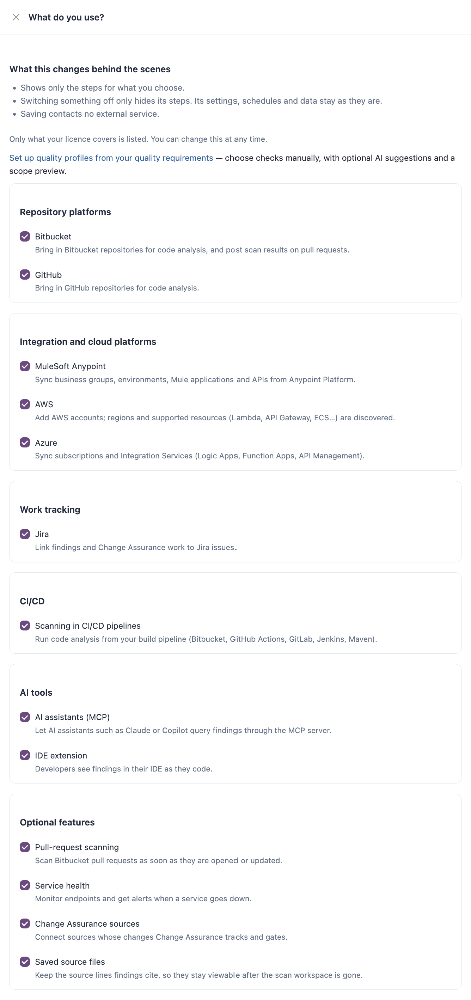
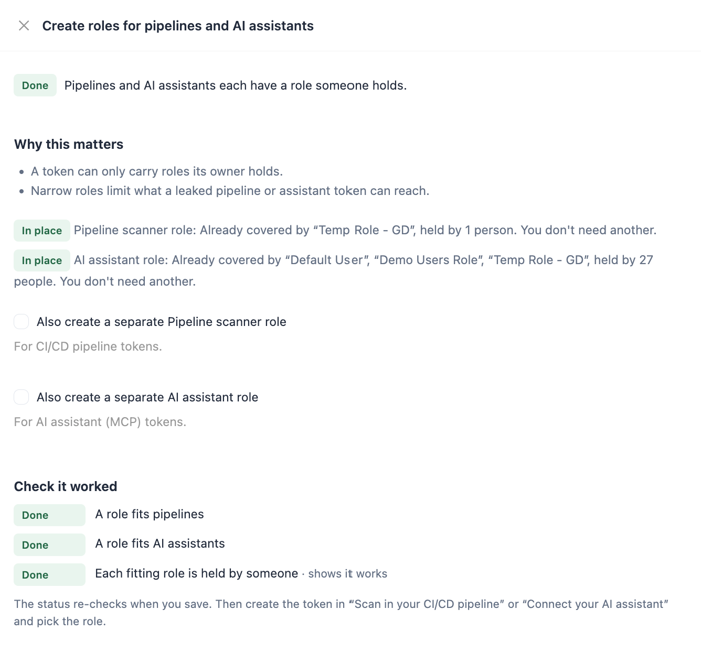
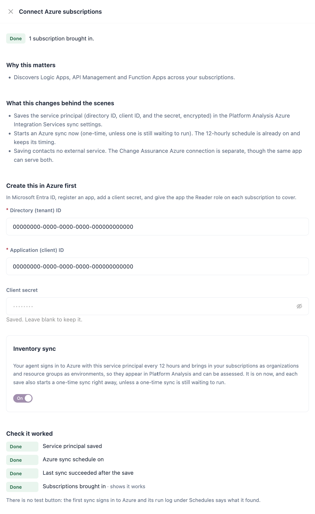

# Setup

**Setup** is the get-started checklist for IZ Suite. It lists, in order, what to set up to get value from what your organization licensed. Each step says why it matters, checks whether it works, and opens a drawer where you set it up or review it. Administrators see every step their roles allow; other people see only their own tools.

Open it from **Administration** → **Setup** in the sidebar.

<figure><figcaption><p>Setup</p></figcaption></figure>


IZ Suite decides which steps you see from your licence, your roles and what your organization uses. When a step is outside your access, it is not listed. When nothing applies to you, the page shows **Nothing to set up**.


## Page Layout

| Area                                           | Description                                                                                                                                                                                             |
| ---------------------------------------------- | ------------------------------------------------------------------------------------------------------------------------------------------------------------------------------------------------------- |
| **Overall progress**                           | How many visible steps work, out of all visible steps (optional steps included). Skipped steps leave the total and show as **· N skipped**.                                                             |
| **Home setup reminder**                        | Whether your **Suite home** page shows a reminder while setup is pending. See **Home Setup Reminder** below.                                                                                            |
| **Licence ends in&#x20;**_**N**_**&#x20;days** | How long your licence has left. It opens the licence details. Administrators only; the description above names the products your licence covers. Below 30 days, a warning links to **Licence details**. |
| **What do you use?**                           | The platforms and features your organization uses. The checklist shows only their steps. See **What Do You Use?** below.                                                                                |
| Step groups                                    | **Platform**, **Connections**, **Automation** and **Your tools**, each with its own **Progress** bar.                                                                                                   |
| **Not in use**                                 | A collapsed list of platforms and features your organization does not use yet. See **Not in Use** below.                                                                                                |

The page title is **Set up IZ Suite** for administrators. When you only see your own tools, it reads **Set up your tools**.

## Home Setup Reminder

While setup is pending, **Suite home** shows a **Finish setting up IZ Suite** reminder with "N of M steps are working" and a **Continue in Setup** link. The setting only applies to you.

* Click **Hide reminder for me** to stop showing it on your Home page.
* Click **Show reminder on Home** to show it again.

You can also close the reminder on **Suite home** with its close button. The reminder disappears on its own once every step works.

## What Do You Use?

Choose the platforms and features your organization uses, so the checklist only shows their steps. Before anything is chosen, the card says so and the button reads **Choose what you use**. Afterwards it lists what you use and the button reads **Edit**.

<figure><figcaption><p>What do you use?</p></figcaption></figure>

Only what your licence covers is listed. Switching something off only hides its steps; its settings, schedules and data stay as they are. Saving contacts no external service.

| Group                               | Choices                                                                                                               |
| ----------------------------------- | --------------------------------------------------------------------------------------------------------------------- |
| **Repository platforms**            | **Bitbucket**, **GitHub**                                                                                             |
| **Integration and cloud platforms** | **MuleSoft Anypoint**, **AWS**, **Azure**                                                                             |
| **Work tracking**                   | **Jira** (links findings and Change Assurance work to Jira issues)                                                    |
| **CI/CD**                           | **Scanning in CI/CD pipelines**                                                                                       |
| **AI tools**                        | **AI assistants (MCP)**, **IDE extension**                                                                            |
| **Optional features**               | **Pull-request scanning** (needs Bitbucket), **Service health**, **Change Assurance sources**, **Saved source files** |


You need a role that can change global settings to edit **What do you use?**.


## Step Rows

Each step shows its status, an **Optional** tag when it does not have to be done, a one-line detail of where it stands, and why it matters.

| Status          | Meaning                                                                                |
| --------------- | -------------------------------------------------------------------------------------- |
| **Done**        | The server's checks for this step all pass. Only the server's checks mark a step done. |
| **In progress** | Some checks pass. The detail line says what is next.                                   |
| **To do**       | Nothing is set up yet.                                                                 |
| **Can't check** | The server cannot check this step.                                                     |
| **Skipped**     | You chose **Skip for now**. A step that later passes its checks shows **Done** again.  |

| Item                               | Description                                                                                                                      |
| ---------------------------------- | -------------------------------------------------------------------------------------------------------------------------------- |
| **Needs**                          | Steps this one depends on that are not done yet. Click one to open its drawer. The order is a guide only; it never blocks you.   |
| **Unlocks**                        | Steps that depend on this one.                                                                                                   |
| **Set up** / **Review** / **View** | Opens the step's drawer. **Review** appears once the step is done; **View** appears when you can see the step but not change it. |
| **Skip for now**                   | Removes the step from the progress count. A skipped step shows **Undo skip** to bring it back.                                   |

### Step Drawers

Every step drawer follows the same order:

1. The status and detail line.
2. **Why this matters**.
3. **What this changes behind the scenes**, for steps that save something.
4. The form or the links for the step.
5. **Check it worked**: the server's checks, each marked **Done** or **Not yet**. The check marked **· shows it works** is the proof the step works end to end. The first failing check says what to do next. When a step offers alternatives (for example Bitbucket or GitHub), **Any one of these makes this step done.**

After you save a guided step, the drawer shows what changed (or **Already set up. Nothing changed.**) and any notes. When you can only view a step, the drawer says **You can see this step but not change it. Ask an administrator who manages it.**

<figure><figcaption><p>A step drawer</p></figcaption></figure>

## Platform

The server, its agent, email and the people who use it.

| Step                                                  | What its drawer asks for                                                                                                                                                                                                                                                                                                                                                                                                                                                                                                                               |
| ----------------------------------------------------- | ------------------------------------------------------------------------------------------------------------------------------------------------------------------------------------------------------------------------------------------------------------------------------------------------------------------------------------------------------------------------------------------------------------------------------------------------------------------------------------------------------------------------------------------------------ |
| **Set the address people use to reach this server**   | **Server address**: the address people type to reach the server, for example `https://suite.example.com`. Invitation, password-reset and pull-request links use it. Click **Save address**.                                                                                                                                                                                                                                                                                                                                                            |
| **Connect an agent**                                  | Nothing is collected, scanned or synced without a running agent. For your own agent: **1. Register the agent** with the job types you choose, then **2. Start it on your host** with the start command shown. When your workspace uses the platform agents, there is nothing to install. The drawer re-checks every 10 seconds and turns done when an agent sends its first heartbeat.                                                                                                                                                                 |
| **Set up email delivery**                             | **Email delivery** switch (**On**/**Off**; off stops all email, including invitations and password resets), **Send a test email** to a **Recipient email address**, **View delivery logs**, **Manage email templates** and **Configure SMTP server**. When your platform administrator manages email, the workspace sends through the platform's mail server.                                                                                                                                                                                          |
| **Invite your team**                                  | Links to **Open People** to invite people and **Open Roles** to review roles first. Done when at least two people can sign in, someone can assign roles and someone other than you has signed in.                                                                                                                                                                                                                                                                                                                                                      |
| **Let people sign in with single sign-on** (optional) | Per sign-in app (for example **MuleSoft Anypoint**): the redirect URL to register, **Sign in with ...** switch, **Client ID** and **Client secret**. **Create people on first sign-in** with **Roles for new people**. **Password sign-in** switch; to turn it off, first sign in with single sign-on yourself so you cannot be locked out.                                                                                                                                                                                                            |
| **Create roles for pipelines and AI assistants**      | Each purpose shows **In place** (an existing role already covers it, with who holds it) or **Missing**. **Create a Pipeline scanner role** (for CI/CD pipeline tokens) and **Create an AI assistant role** (for AI assistant tokens), or **Also create a separate ...** role when one is already in place, and **Also give me these roles so my tokens can carry them**. Nothing already in a role is removed. Click **Create roles**.                                                                                                                 |
| **Assign IDE keys to developers**                     | Each key is one licence seat for the IZ IDE extension. Click **Assign IDE keys** to open the IDE keys screen. **IDE security token**: the extension also signs in with an access token each developer creates (named "IDE", **Act as me** off, the **IDE Developer** role); **Open security credentials** opens that screen.                                                                                                                                                                                                                           |
| **Turn on AI** (optional)                             | Shows whether AI is on, the provider, the model and when pricing review is due. **Open Usage & budgets** to choose one provider, model and monthly budget for every AI feature.                                                                                                                                                                                                                                                                                                                                                                        |
| **Choose where saved source files are stored**        | **What to store** (**Do not store source**, **Only excerpts**, **Complete source code**) and **Storage** (**Encrypted in IZ Suite DB**, **AWS private object store**, **Google Cloud bucket**). For a bucket, the drawer says what to create first and asks for the **Private bucket**, the **AWS region** and the **Credentials** (a **Saved sign-in**, or keys entered here). Excerpts keep files under 24 KB in full and 20 lines above and below a finding for larger files. Saved source is deleted with its scan. Click **Save source storage**. |


The secrets you enter in setup drawers (client secrets, secret access keys, webhook secrets) are stored encrypted and never shown again. A saved secret shows **Saved. Leave blank to keep it.**


## Connections

The systems your licence covers. Each one brings in inventory and change.

| Step                                             | What its drawer asks for                                                                                                                                                                                                                                                                                                                                                                                                                                                                         |
| ------------------------------------------------ | ------------------------------------------------------------------------------------------------------------------------------------------------------------------------------------------------------------------------------------------------------------------------------------------------------------------------------------------------------------------------------------------------------------------------------------------------------------------------------------------------ |
| **Connect Anypoint Platform**                    | **Create this in Anypoint first**: a connected app of type "App acts on its own behalf (client credentials)" in the root organization, granted to every business group and environment. A link opens the step-by-step guide for the connected app. Then **Client ID**, **Client secret** and the **Inventory sync** switch (every 12 hours). Saving starts a one-time sync. To turn the sync off, switch it off and save: you are taken to **Schedules** to disable the recurring Anypoint Sync. |
| **Connect your source repositories**             | **Where your repositories live** (**Bitbucket** or **GitHub**). **1. Register an OAuth app** with the callback URL shown. **2. Enter the app's details**: **Key**, **Secret**, **Default organization**, **Scan every discovered repository**, **Scan every discovered branch**. **3.** After saving, click **Authorize again** (or authorize) under **Check it worked** and choose workspaces; the first repository sync then starts.                                                           |
| **Scan pull requests from Bitbucket** (optional) | **Scan pull requests** switch, **Webhook secret** (or **Generate a secret**), then add the webhook in Bitbucket with the URL shown, the secret, and the triggers Pull request created, updated, merged and declined. A 401 answer in Bitbucket means the secrets differ; a 403 means no secret is saved.                                                                                                                                                                                         |
| **Connect AWS accounts**                         | **Accounts already added**, with **Change credential**. **Account name**, **AWS account ID** (12 digits), **Access key ID**, **Secret access key**, **Regions** (comma-separated; leave blank to find every enabled region) and the **Inventory sync** switch. The IAM principal needs read-only access.                                                                                                                                                                                         |
| **Connect Azure subscriptions**                  | See **Connect Azure Subscriptions** below.                                                                                                                                                                                                                                                                                                                                                                                                                                                       |
| **Connect change sources to Change Assurance**   | Each connector with its state (**Working**, **Failing**, **Not connected**) and **Open**, **Connect**, **Reconnect** or **Add another**. A connection is stale after a day without a sync. Everything a connector can be set to is under **All settings** in its drawer. **Open Change Assurance connections** for the full screen.                                                                                                                                                              |
| **Add endpoint monitors** (optional)             | **Where monitoring stands** (enabled monitors and the health check schedule, with **Edit schedule**) and **When should this work run?** (**One time** or **Recurring**). Click **Run health checks now**, **Turn on health checks** or **Save schedule**.                                                                                                                                                                                                                                        |

### Connect Azure Subscriptions

The step discovers Logic Apps, API Management and Function Apps across your Azure subscriptions. Its row shows how many subscriptions were brought in (for example "1 subscription brought in."), and it unlocks **Turn on Azure assessments**.

<figure><figcaption><p>Connect Azure subscriptions</p></figcaption></figure>

1. Under **Create this in Azure first**, follow the instructions: in Microsoft Entra ID, register an app, add a client secret, and give the app the Reader role on each subscription to cover.
2.  Enter the app's details:

    | Field                       | Description                                                                                                                                                                                                                                         |
    | --------------------------- | --------------------------------------------------------------------------------------------------------------------------------------------------------------------------------------------------------------------------------------------------- |
    | **Directory (tenant) ID**   | Your Microsoft Entra ID directory. Required.                                                                                                                                                                                                        |
    | **Application (client) ID** | The app you registered. Required.                                                                                                                                                                                                                   |
    | **Client secret**           | The app's client secret. Once saved, it shows **Saved. Leave blank to keep it.**                                                                                                                                                                    |
    | **Inventory sync**          | **On** or **Off**. When on, your agent signs in to Azure with this service principal every 12 hours and brings in your subscriptions as organizations and resource groups as environments, so they appear in Platform Analysis and can be assessed. |
3. Click **Save**.

Saving stores the service principal (the secret encrypted) and starts a one-time Azure sync, unless one is still waiting to run. The 12-hourly schedule keeps its timing. Saving contacts no external service. The Change Assurance Azure connection is separate, though the same app can serve both.

There is no test button. **Check it worked** lists **Service principal saved**, **Azure sync schedule on**, **Last sync succeeded after the save** and **Subscriptions brought in**, the proof that the step works. The first sync's run log under **Schedules** says what it found.

## Automation

Schedules that turn what was discovered into findings and gate results. There is one step per source: **Turn on Anypoint assessments**, **Turn on AWS assessments**, **Turn on Azure assessments** and **Turn on repository assessments**. Each row shows how many assessment types are scheduled and running (for example "3 of 3 assessment types scheduled and running.").

Each drawer shows:

* **What to assess**: every assessment type for that source, with its current schedule (for example **No recurring schedule** or **On · Every hour**, with **Edit schedule**).
* **When should this work run?**: **One time** or **Recurring**.
* **Which applications?** (Anypoint only): **Assess every discovered Anypoint application**. Otherwise only applications someone marked eligible are assessed. For AWS and Azure, choose applications under **Scan sources** after the first run.

Click **Turn on assessments**. It creates a one-time run per environment (or organization) for the selected assessment types, and your agent picks the runs up as soon as it can. Existing schedules are left as they are. **Schedules** opens the schedules list.

**Check it worked** lists **Something discovered to assess**, **Every discovered source is assessed or scheduled** and **Every scheduled type has run**. Each schedule's last run shows in **Schedules** after its first run.

### Turn On Azure Assessments

**What to assess** lists the three Azure assessment types: **Azure Logic App Analysis**, **Azure API Management Analysis** and **Azure Function App Analysis**. **Connect Azure subscriptions** unlocks this step: the assessments run on the subscriptions it brings in.

## Your Tools

Your own pipeline, AI assistant, IDE and alerts. Everyone who has these licences sees this group.

### Scan in Your CI/CD Pipeline

1. **Create an access token**: click **Create access token**, name it "CI pipeline" and pick the **Pipeline scanner** role. The value is shown once.
2. **Describe your pipeline**: choose the **CI/CD platform**, an optional **Application key** (blank uses the repository name), **Scan pull requests instead of branches** and **Fail the build when the quality gate fails**.
3. **Add the step**: copy the snippet into your pipeline file. Store your token as a masked secret named `IZ_ACCESS_TOKEN`; never paste it into the file.

The drawer re-checks every 15 seconds and turns done when your token has run a pipeline scan. The scanner always exits 0, so the last line of the snippet fails the build by looking for the PASSED result.

The drawer writes the snippet with your server address and the current scanner version. For example:




```yaml
image: atlassian/default-image:4
pipelines:
  default:
    - step:
        name: IZ Scan
        script:
          - export IZ_CLI_VERSION=26.4.1
          - export IZ_SERVER_URL="https://izsuite.example.com"
          - export IZ_APP_KEY="$BITBUCKET_REPO_SLUG"
          - curl -fsSLo iz.zip "https://iz-releases.s3.amazonaws.com/iz-scan-cli/$IZ_CLI_VERSION/iz-scan-cli-$IZ_CLI_VERSION-linux.zip" && unzip -oq iz.zip
          - ./iz-scan-cli-$IZ_CLI_VERSION-linux/bin/iz-scan-cli -serviceHost "$IZ_SERVER_URL" -authToken "$IZ_ACCESS_TOKEN" -applicationKey "$IZ_APP_KEY" -source . -scmBranchName "$BITBUCKET_BRANCH" -extId "$BITBUCKET_BUILD_NUMBER" > iz-scan.log 2>&1 || true
          - cat iz-scan.log
          - grep -q "QUALITY GATE STATUS:: PASSED" iz-scan.log
```





```yaml
name: IZ Scan
on:
  push:
  pull_request:
jobs:
  iz-scan:
    runs-on: ubuntu-latest
    permissions: { contents: read, security-events: write }
    env:
      IZ_CLI_VERSION: 26.4.1
      IZ_SERVER_URL: https://izsuite.example.com
      IZ_ACCESS_TOKEN: ${{ secrets.IZ_ACCESS_TOKEN }}
      IZ_APP_KEY: ${{ github.event.repository.name }}
      IZ_BRANCH: ${{ github.head_ref || github.ref_name }}
      IZ_PR: ${{ github.event.pull_request.number }}
    steps:
      - uses: actions/checkout@v4
      - name: IZ Scan
        run: |
          curl -fsSLo iz.zip "https://iz-releases.s3.amazonaws.com/iz-scan-cli/$IZ_CLI_VERSION/iz-scan-cli-$IZ_CLI_VERSION-linux.zip" && unzip -oq iz.zip
          if [ -n "$IZ_PR" ]; then SCM="-pullRequestId $IZ_PR"; else SCM="-scmBranchName $IZ_BRANCH"; fi
          ./iz-scan-cli-$IZ_CLI_VERSION-linux/bin/iz-scan-cli -serviceHost "$IZ_SERVER_URL" -authToken "$IZ_ACCESS_TOKEN" -applicationKey "$IZ_APP_KEY" -source . $SCM -extId "$GITHUB_RUN_ID" -sarifReport iz-scan.sarif > iz-scan.log 2>&1 || true
          cat iz-scan.log
          grep -q "QUALITY GATE STATUS:: PASSED" iz-scan.log
      # needs GitHub code scanning; without it (or on a fork's pull request) the upload fails, never the job
      - uses: github/codeql-action/upload-sarif@v3
        if: always() && hashFiles('iz-scan.sarif') != ''
        continue-on-error: true
        with: { sarif_file: iz-scan.sarif }
```





```yaml
iz-scan:
  image: ubuntu:24.04
  variables:
    IZ_CLI_VERSION: "26.4.1"
    IZ_SERVER_URL: "https://izsuite.example.com"
    IZ_APP_KEY: "$CI_PROJECT_NAME"
  script:
    - apt-get update -qq && apt-get install -y -qq curl unzip
    - curl -fsSLo iz.zip "https://iz-releases.s3.amazonaws.com/iz-scan-cli/$IZ_CLI_VERSION/iz-scan-cli-$IZ_CLI_VERSION-linux.zip" && unzip -oq iz.zip
    - if [ -n "$CI_MERGE_REQUEST_IID" ]; then SCM="-pullRequestId $CI_MERGE_REQUEST_IID"; else SCM="-scmBranchName $CI_COMMIT_REF_NAME"; fi
    - ./iz-scan-cli-$IZ_CLI_VERSION-linux/bin/iz-scan-cli -serviceHost "$IZ_SERVER_URL" -authToken "$IZ_ACCESS_TOKEN" -applicationKey "$IZ_APP_KEY" -source . $SCM -extId "$CI_PIPELINE_ID" > iz-scan.log 2>&1 || true
    - cat iz-scan.log
    - grep -q "QUALITY GATE STATUS:: PASSED" iz-scan.log
  artifacts: { when: always, paths: [iz-scan.log] }
```





```groovy
pipeline {
  agent any
  environment { IZ_CLI_VERSION = '26.4.1'; IZ_SERVER_URL = 'https://izsuite.example.com'; IZ_APP_KEY = '<application-key>' }
  stages { stage('IZ Scan') { steps {
    withCredentials([string(credentialsId: 'iz-access-token', variable: 'IZ_ACCESS_TOKEN')]) {
      sh '''
        curl -fsSLo iz.zip "https://iz-releases.s3.amazonaws.com/iz-scan-cli/$IZ_CLI_VERSION/iz-scan-cli-$IZ_CLI_VERSION-linux.zip" && unzip -oq iz.zip
        if [ -n "$CHANGE_ID" ]; then SCM="-pullRequestId $CHANGE_ID"; else SCM="-scmBranchName ${BRANCH_NAME:-main}"; fi
        ./iz-scan-cli-$IZ_CLI_VERSION-linux/bin/iz-scan-cli -serviceHost "$IZ_SERVER_URL" -authToken "$IZ_ACCESS_TOKEN" -applicationKey "$IZ_APP_KEY" -source . $SCM -extId "$BUILD_NUMBER" > iz-scan.log 2>&1 || true
        cat iz-scan.log
        grep -q "QUALITY GATE STATUS:: PASSED" iz-scan.log
      '''
    } } } }
}
```


Store the token in Jenkins as a **Secret text** credential with the ID `iz-access-token`.



Add this step to your pipeline, with `iz-settings.xml` next to `pom.xml`. `BRANCH` is your CI's branch-name variable.

```bash
mvn -B -s iz-settings.xml com.integralzone.izsuite:iz-scan-cli:26.4.1:scan -DserviceHost="https://izsuite.example.com" -DauthToken="$IZ_ACCESS_TOKEN" -DapplicationKey="<application-key>" -Dsource=. -DscmBranchName="$BRANCH" -DabortOnQualityGateFailure=true
```


```xml
<settings>
  <profiles>
    <profile>
      <id>iz</id>
      <pluginRepositories>
        <pluginRepository>
          <id>iz-public</id>
          <url>https://iz-public-m2.s3.eu-west-2.amazonaws.com/releases</url>
        </pluginRepository>
      </pluginRepositories>
    </profile>
  </profiles>
  <activeProfiles><activeProfile>iz</activeProfile></activeProfiles>
</settings>
```


With Maven, the build fails on a failed quality gate by itself (`-DabortOnQualityGateFailure=true`).




To scan pull requests in Bitbucket Pipelines, tick **Scan pull requests instead of branches**: the drawer then writes a `pull-requests` pipeline that passes `-pullRequestId "$BITBUCKET_PR_ID"`.


### Connect Your AI Assistant

1. **Create an access token**: click **Create access token**, name it "AI assistant" and pick the **AI assistant** role. The value is shown once.
2. **Add IZ Suite to your assistant**: choose **VS Code**, **Cursor**, **Claude Code** or **Claude Desktop** and copy the configuration. It never contains your token unless you paste it in yourself.
3. Under **Check it worked**, paste the token and click **Test this token**. The token is checked against this server only and is not stored. The final proof is your assistant listing the IZ Suite tools.



Save as `.vscode/mcp.json` in your project. VS Code asks for the token when it starts the server.


```json
{
  "inputs": [
    {
      "type": "promptString",
      "id": "iz-token",
      "description": "IZ Suite access token",
      "password": true
    }
  ],
  "servers": {
    "iz-suite": {
      "type": "http",
      "url": "https://izsuite.example.com/mcp",
      "headers": {
        "x-iz-service-url": "https://izsuite.example.com",
        "x-iz-access-token": "${input:iz-token}"
      }
    }
  }
}
```




Add to `~/.cursor/mcp.json` and replace `##ACCESS_TOKEN##` with your token.


```json
{
  "mcpServers": {
    "iz-suite": {
      "url": "https://izsuite.example.com/mcp",
      "headers": {
        "x-iz-service-url": "https://izsuite.example.com",
        "x-iz-access-token": "##ACCESS_TOKEN##"
      }
    }
  }
}
```




Run in a terminal with `IZ_ACCESS_TOKEN` set to your token.

```bash
claude mcp add --transport http iz-suite https://izsuite.example.com/mcp --header "x-iz-service-url: https://izsuite.example.com" --header "x-iz-access-token: $IZ_ACCESS_TOKEN"
```



Add to `claude_desktop_config.json` and replace `##ACCESS_TOKEN##`. This runs a helper through npx and keeps the token in the file.


```json
{
  "mcpServers": {
    "iz-scan": {
      "command": "npx",
      "args": ["-y", "--registry=https://npm.integralzone.com", "iz-scan-mcp", "--accesstoken", "##ACCESS_TOKEN##", "--serverurl", "https://izsuite.example.com"]
    }
  }
}
```




### Other Tool Steps

| Step                                      | What its drawer offers                                                                                                                                              |
| ----------------------------------------- | ------------------------------------------------------------------------------------------------------------------------------------------------------------------- |
| **Connect your IDE**                      | **Open your IDE key**, then paste it into the IZ extension's settings in your IDE. Done when your IDE reports a project. **Open IDE projects** lists them.          |
| **Follow what you care about** (optional) | **Follow something new** and **Your subscriptions**, by email or Slack. Nothing is sent until email delivery is set up. **Open Subscriptions** for the full screen. |


Creating an access token from these steps needs a role that can generate access tokens. A token can only carry roles you hold.


## Not in Use

**Not in use (N)** lists each platform or feature your organization does not use yet and what it adds, for example "Adds: Scan pull requests from Bitbucket". Click its **Use** button (for example **Use Pull-request scanning**) to add its steps to the checklist. A feature that needs a platform you do not use (pull-request scanning without Bitbucket) appears once that platform is in use.

## Next Steps

* [Users](organizations/users.md): invite your team and give them roles.
* [Access Tokens](organizations/access-tokens.md): review the tokens your pipelines and assistants use.
* [Global Settings](global-settings/): change the settings behind each step directly.
* [Administration](./): the other administration screens.
