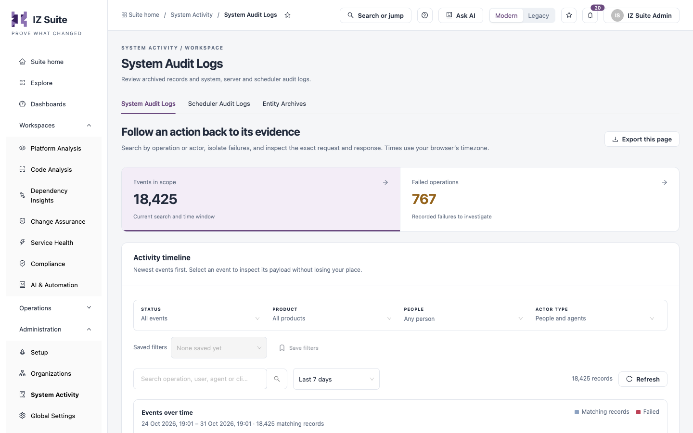

# System Activity

**System Activity** is where administrators trace what happened in IZ Suite: who did what, which background work ran, which servers were running, and what an archived record looked like when it was archived. Every screen here is read-only.

Open it from **Administration** → **System Activity** in the sidebar.

<figure><figcaption>
System Activity
</figcaption></figure>

| Tab                                             | What it is for                                                              |
| ----------------------------------------------- | --------------------------------------------------------------------------- |
| [System Audit Logs](system-audit-logs.md)       | Every operation people and agents performed, with its request and response. |
| [Scheduler Audit Logs](scheduler-audit-logs.md) | Background work the server queued, who ran it and its log.                  |
| [Entity Archives](entity-archives.md)           | Snapshots of records saved when they were archived.                         |


The audit log tabs need a role that can view the system audit log; **Entity Archives** needs a role that can view entity archives.


The time-based tabs share the same tools: a time window (**Last 24 hours**, **Last 7 days**, **Last 30 days**, **Custom range**, **All retained history**), a chart of records over time where you click a bar to investigate that period, **Saved filters**, **Refresh** and **Export this page**. Filters and the selected record are kept in the page address, so you can share a link to an investigation. Times use your browser's timezone.

## Next steps

* [System Audit Logs](system-audit-logs.md): follow an action back to its evidence.
* [Scheduler Audit Logs](scheduler-audit-logs.md): check that background work runs.
* Administration: the other administration screens.
