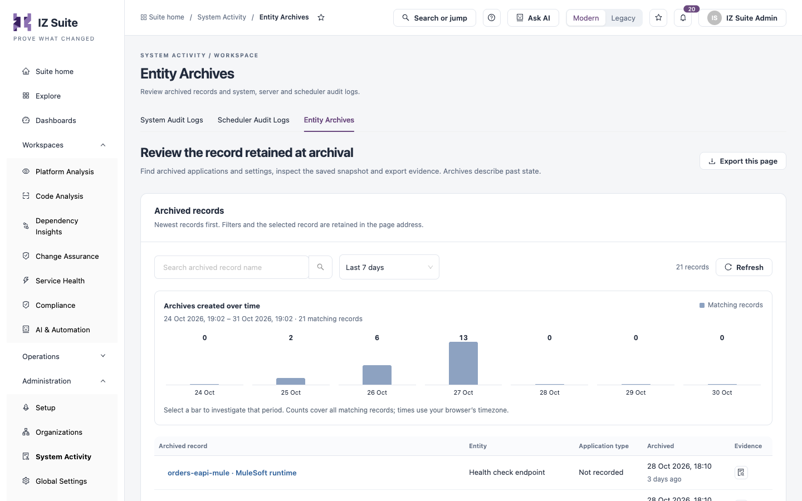
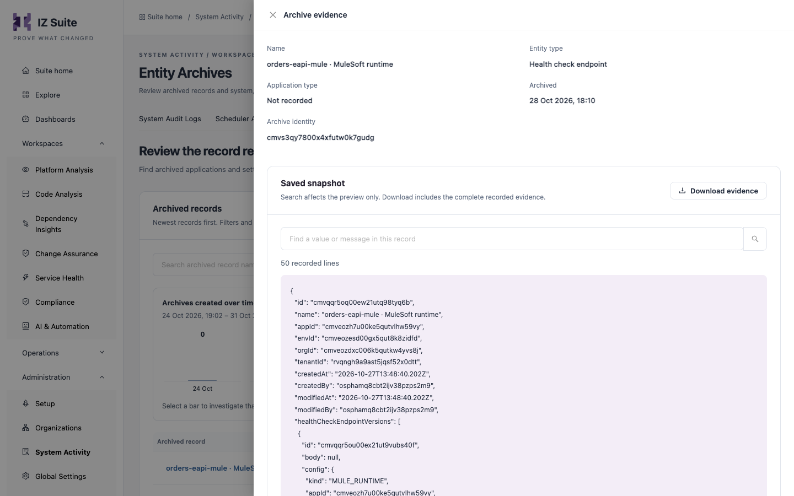

# Entity Archives

When IZ Suite archives a record, for example an application, a setting or a health check endpoint, it keeps a snapshot of that record as it was at that moment. **Entity Archives** lists those snapshots so you can find an archived record, inspect what it contained and export it as evidence. Archives describe past state; nothing here restores a record.

Open it from **Administration** → **System Activity** → **Entity Archives** in the sidebar.

<figure><figcaption>
Entity Archives
</figcaption></figure>


You need a role that can view entity archives.


## Filters

| Filter                          | Description                                                                                                   |
| ------------------------------- | ------------------------------------------------------------------------------------------------------------- |
| **Search archived record name** | Finds archived records by name.                                                                               |
| Time window                     | **Last 24 hours**, **Last 7 days** (default), **Last 30 days**, **Custom range** or **All retained history**. |

**Archives created over time** charts the archived records per period. Click a bar to investigate that period. **Saved filters**, **Refresh** and **Export this page** work as on the other tabs.

## Archived records

Newest records first.

| Column               | Description                                                |
| -------------------- | ---------------------------------------------------------- |
| **Archived record**  | The record's name.                                         |
| **Entity**           | The kind of record, for example **Health check endpoint**. |
| **Application type** | The application type, when the record has one.             |
| **Archived**         | When the record was archived.                              |
| **Evidence**         | **Inspect snapshot** opens the archive drawer.             |

## Inspect a snapshot

<figure><figcaption>
Archive evidence
</figcaption></figure>

1. Click **Inspect snapshot** on the row.
2. Review **Name**, **Entity type**, **Application type**, **Archived** and **Archive identity**.
3. Under **Saved snapshot**, read the record as it was saved. Use **Find a value or message in this record** to search it.
4. Click **Download evidence** to save the complete snapshot.

Search affects the preview only; the download includes the complete recorded evidence. If a record is unavailable, it may have expired under the retention policy.


What is archived, and when, follows the archival policies in global settings. For example, older scans, completed one-time job executions and older audit logs are archived after their retention period.


## Next steps

* [Scheduler Audit Logs](scheduler-audit-logs.md): check that archival tasks ran.
* [System Audit Logs](system-audit-logs.md): find who changed a record before it was archived.
* [System Activity](./): the other tabs.
