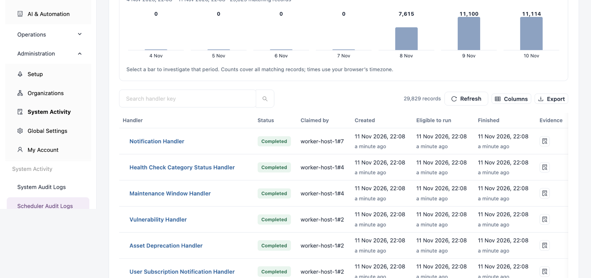

# Scheduler Audit Logs

**Scheduler Audit Logs** lists the background tasks the server queued for your workspace, such as notifications, archival, health check status and maintenance windows. For each one you see who ran it, when, its outcome and its full log. Use it to check that background work runs and to read the error when a task fails. This history does not start or retry work.

Open it from **Administration** → **System Activity** → **Scheduler Audit Logs** in the sidebar.

<figure><figcaption>
Scheduler Audit Logs
</figcaption></figure>


You need a role that can view the system audit log. On a multi-tenant installation, each tenant sees only its own background work.


## Filters

| Filter                 | Description                                                                                                                                                                                              |
| ---------------------- | -------------------------------------------------------------------------------------------------------------------------------------------------------------------------------------------------------- |
| **Status**             | **All recorded statuses**, or one of **Scheduled**, **Pending**, **Executing**, **Downloading**, **Analyzing**, **Completed**, **Failed**, **Stopped**, **License quota exceeded**, **License expired**. |
| **Search handler key** | Finds tasks by name, for example `Archival`.                                                                                                                                                             |
| Time window            | **Last 24 hours**, **Last 7 days** (default), **Last 30 days**, **Custom range** or **All retained history**.                                                                                            |

**Background jobs created over time** charts matching and failed records per period. Click a bar to investigate that period. **Saved filters**, **Refresh** and **Export this page** work as on the other tabs.

## Background Work

Newest records first.

| Column              | Description                                                                                     |
| ------------------- | ----------------------------------------------------------------------------------------------- |
| **Handler**         | The task, for example "Maintenance Window Handler" or "User Subscription Notification Handler". |
| **Status**          | The task's recorded status.                                                                     |
| **Claimed by**      | The worker that ran the task. Empty until a worker claims it.                                   |
| **Created**         | When the task was queued.                                                                       |
| **Eligible to run** | The earliest time the task may run. Normally the same as **Created**.                           |
| **Finished**        | When the task finished.                                                                         |
| **Evidence**        | **Inspect log** opens the task drawer.                                                          |

| Status        | Meaning                                                                                                                                           |
| ------------- | ------------------------------------------------------------------------------------------------------------------------------------------------- |
| **Pending**   | Queued and waiting for a worker. Tasks normally stay pending for a few seconds; many pending tasks mean no worker is running or workers are busy. |
| **Executing** | A worker claimed the task and is running it.                                                                                                      |
| **Completed** | The task finished successfully.                                                                                                                   |
| **Failed**    | The task raised an error. Open its log to read it.                                                                                                |

## Inspect a Task

1. Click **Inspect log** on the row.
2. Review **Handler**, **Status**, **Claimed by**, **Work identity** and **Tenant**.
3. Under **Execution timeline**, see when the task was **Created**, became **Eligible to run**, was **Claimed by worker** and **Finished**. Only recorded timestamps are shown.
4. Under **Recorded log**, read the task's log, one line per event with a timestamp and a level such as `INFO`, `WARN` or `ERROR`. Use **Find a value or message in this record** to search it.
5. Click **Download evidence** to save the complete log.

## Next Steps

* [System Audit Logs](system-audit-logs.md): find the operations people and agents performed.
* [Entity Archives](entity-archives.md): see the records archival tasks saved.
* [System Activity](./): the other tabs.
