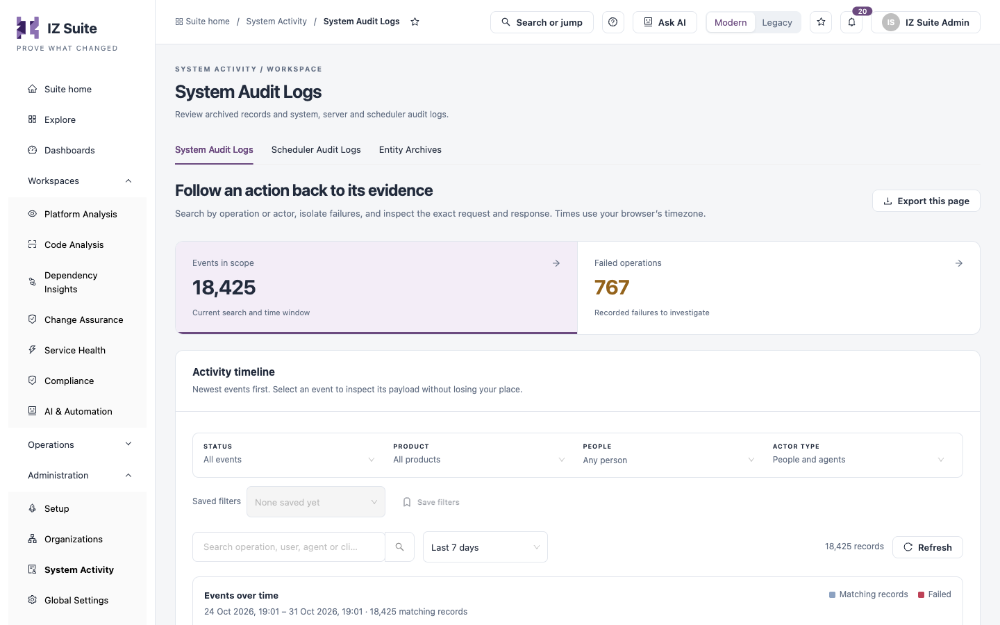

# System Audit Logs

**System Audit Logs** records every operation performed in IZ Suite, by people and by agents. Use it to follow an action back to its evidence: find the operation or actor, isolate failures and inspect the exact request and response.

Open it from **Administration** → **System Activity** → **System Audit Logs** in the sidebar.

<figure><figcaption>
System Audit Logs
</figcaption></figure>


You need a role that can view the system audit log. To see only your own activity, use **My Activity** under **My Account**.


## Counts and filters

| Tile                  | Description                                                    |
| --------------------- | -------------------------------------------------------------- |
| **Events in scope**   | Events matching the current search and time window.            |
| **Failed operations** | Recorded failures to investigate. Click to list only failures. |

| Filter                                         | Description                                                                                                   |
| ---------------------------------------------- | ------------------------------------------------------------------------------------------------------------- |
| **Status**                                     | **All events**, **Failures** or **Successful**.                                                               |
| **Product**                                    | The product area the operation belongs to.                                                                    |
| **People**                                     | One or more people.                                                                                           |
| **Actor type**                                 | **People** or **Agents**.                                                                                     |
| **Search operation, user, agent or client IP** | Free-text search.                                                                                             |
| Time window                                    | **Last 24 hours**, **Last 7 days** (default), **Last 30 days**, **Custom range** or **All retained history**. |

**Events over time** charts matching and failed records per period. Click a bar to investigate that period. **Saved filters** and **Save filters** keep a filter combination.

## Activity timeline

Newest events first. Failed events are highlighted.

| Column                | Description                                                                        |
| --------------------- | ---------------------------------------------------------------------------------- |
| **Event**             | The operation, for example "Save suite ai access rule". Click to inspect it.       |
| **Actor**             | The person, or the agent marked "(agent)".                                         |
| **Product / feature** | The product area and feature.                                                      |
| **When**              | When the operation started.                                                        |
| **Duration**          | How long it took, in milliseconds.                                                 |
| **Status**            | **Success** or **Failed**.                                                         |
| **Client IP**         | The address the request came from.                                                 |
| **Page**              | Hidden by default. The screen the action was taken from. Show it with **Columns**. |

**Export this page** downloads the events on the current page as CSV.

## Inspect an event

1. Click the event name (or **Inspect event** at the end of the row).
2. Review **Actor**, **Recorded at**, **Result**, **Duration**, **Client IP** and **Event identity**.
3. Open the **Request**, **Response** or **Variables** tab to see what was sent and returned.
4. Click **Download this event** to save it as a JSON file.

The panel keeps your place in the list. If an event is no longer available, it may have been removed by your retention policy.


Audit logs are kept for the retention period set in the archival policies under global settings; older records are archived. Certain field values in requests may be masked based on their sensitivity.


## Next steps

* [Scheduler Audit Logs](scheduler-audit-logs.md): trace background work the server ran.
* [Entity Archives](entity-archives.md): see what an archived record looked like.
* [System Activity](./): the other tabs.
