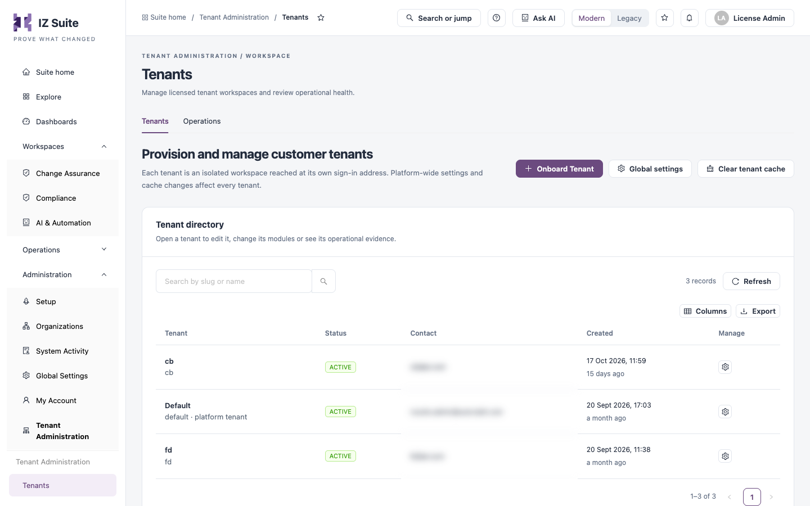

# Tenant Administration

**Tenant Administration** is where the platform administrators of a multi-tenant IZ Suite provision customer tenants, change them, and check that their background work is running.

Open it from **Administration** → **Tenant Administration** in the sidebar.


Available only to platform administrators in the platform tenant.


<figure><figcaption>
Tenant Administration
</figcaption></figure>

## What a Tenant Is

A tenant is an isolated workspace inside one IZ Suite. Each tenant has its own:

* organizations, environments and applications;
* users, roles and access tokens;
* quality profiles, metric profiles, quality gates and schedules;
* global settings, sign-in options and email templates;
* licence, with its own licensed modules and allowances;
* notifications, audit records and dashboards.

Data never crosses tenants. A person signed in to one tenant cannot see or search another tenant's data, and reports, dashboards and MCP tools return only the data of the tenant the person belongs to.

### Sign-In Address

Each tenant has its own sign-in address. By default it is the tenant's **Slug** in front of the IZ Suite host, for example `https://acme.izsuite.example.com`. A tenant can also have an **External Link**: a host name of its own, such as `https://quality.acme.com`, that points at IZ Suite. IZ Suite picks the tenant from the address of every request, so the browser, single sign-on, access tokens, the CLI, IDE extensions and MCP clients must all use the tenant's own address. See [Tenants](tenants.md#sign-in-addresses).

### Modules and Licence

Every tenant has its own licence key. The key decides which modules the tenant's users see and how many applications, scans or IDE keys they may use. A licence key can be applied to one tenant only. Tenant administrators see their licence in their own **Global Settings** → **Subscription**.

## The Platform Tenant

The platform tenant is the tenant that exists after installation and holds the platform operator's licence. Only its administrators see **Tenant Administration**, and only when the licence includes multi-tenancy. In the platform tenant the workspace products (Platform Analysis, Code Analysis, Dependency Insights) and Service Health are hidden; they are used inside customer tenants.

The platform tenant itself is listed in the tenant directory as **platform tenant**. It always stays **ACTIVE** and cannot be deleted, lose its organizations or have its managed settings changed.


You need a role that can manage tenants, in the platform tenant.


## Sections

| Section                                 | What it is for                                                                                                                                                                        |
| --------------------------------------- | ------------------------------------------------------------------------------------------------------------------------------------------------------------------------------------- |
| [Tenants](tenants.md)                   | The tenant directory: open a tenant to edit it, decide which settings you manage for it, delete its organizations or the tenant. Also **Global settings** and **Clear tenant cache**. |
| [Onboard a Tenant](onboard-a-tenant.md) | Provision a new tenant with its first administrator, organization and licence.                                                                                                        |
| [Operations](operations.md)             | Recorded activity per tenant and the most recent job runs across tenants.                                                                                                             |

## Platform-Wide Actions

Two actions on **Tenants** affect more than one tenant at a time:

* **Global settings** writes one value into the same setting of several tenants, for example a new AI model or API key for every tenant whose AI settings you manage. See [Tenants](tenants.md#global-settings).
* **Clear tenant cache** makes every server look up again which tenant an address belongs to. Use it after you change a tenant's slug or external link. See [Tenants](tenants.md#clear-tenant-cache).

## Next steps

* [Onboard a Tenant](onboard-a-tenant.md): create a tenant and hand it over to its administrator.
* [Tenants](tenants.md): change a tenant, its sign-in address or the settings you manage for it.
* [Operations](operations.md): find tenants whose background work is failing.
