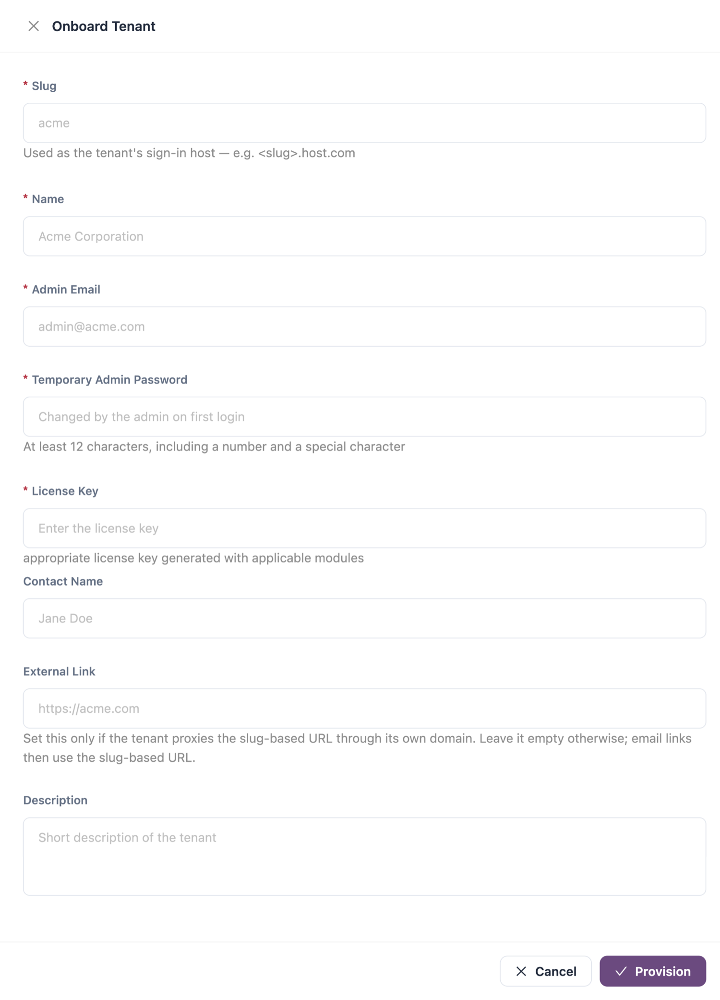

# Onboard a Tenant

Onboarding creates a new, isolated tenant: its record, its first administrator, its first organization and environment, and a copy of the built-in configuration, licensed with the key you enter.

Open it from **Administration** → **Tenant Administration** → **Tenants**, then click **Onboard Tenant**.


Available only to platform administrators in the platform tenant.


## Before You Start

Have ready:

* a licence key issued for this tenant with the modules it bought. A key can be applied to one tenant only;
* the email address of the person who will administer the tenant;
* a temporary password for that person, which you hand over separately;
* the slug, and DNS and certificates in place for `<slug>.<your IZ Suite host>` (and for the external link, if the tenant uses its own domain).

## Provision the Tenant

<figure><figcaption>
Onboard Tenant
</figcaption></figure>

1. Click **Onboard Tenant**. The drawer **Onboard Tenant** opens.
2. Fill in the fields.
3. Click **Provision**.

| Field                        | Description                                                                                                                                                                                                                                                                                                                         |
| ---------------------------- | ----------------------------------------------------------------------------------------------------------------------------------------------------------------------------------------------------------------------------------------------------------------------------------------------------------------------------------- |
| **Slug**                     | Required. Short identifier that becomes the tenant's sign-in host: `acme` gives `acme.<your IZ Suite host>`. The hint under the field previews the host. It must be unique; use lower-case letters and digits so it is a valid host name, and avoid the reserved words listed in [Sign-in addresses](tenants.md#sign-in-addresses). |
| **Name**                     | Required. Display name, for example `Acme Corporation`. It also names the tenant's first organization (`Acme Corporation Org`) and administrator (`Acme Corporation Admin`).                                                                                                                                                        |
| **Admin Email**              | Required. Email of the tenant's first administrator. It also becomes the tenant's contact email.                                                                                                                                                                                                                                    |
| **Temporary Admin Password** | Required. At least 12 characters, including a number and a special character. The administrator must change it at the first sign-in.                                                                                                                                                                                                |
| **License Key**              | Required. The licence key generated for this tenant with its modules. It is checked with the licence server before anything is created.                                                                                                                                                                                             |
| **Contact Name**             | The tenant's contact person.                                                                                                                                                                                                                                                                                                        |
| **External Link**            | A full URL such as `https://acme.com`. Set it only if the tenant routes its own domain to IZ Suite. Leave it empty otherwise; email links then use the slug address.                                                                                                                                                                |
| **Description**              | Free text.                                                                                                                                                                                                                                                                                                                          |

Provisioning takes a few seconds. Nothing is created when the slug is already used, the licence key is already applied to another tenant, the licence server rejects the key, or the password is too weak; the drawer shows the reason.

## What Gets Created

| Item                         | Details                                                                                                                                                                                                                                                   |
| ---------------------------- | --------------------------------------------------------------------------------------------------------------------------------------------------------------------------------------------------------------------------------------------------------- |
| Tenant                       | Status **ACTIVE**, with the slug, name, contact and external link you entered.                                                                                                                                                                            |
| Administrator                | A person who signs in with **IZ User** using the admin email and the temporary password.                                                                                                                                                                  |
| Organization and environment | `<Name> Org` with one environment, `Production`.                                                                                                                                                                                                          |
| Built-in configuration       | A copy of the platform's built-in roles and permissions, quality profiles, metric profiles and quality gates, default schedules, notification events, automation tasks, global settings and email templates. Compliance standards are shared, not copied. |
| Sign-in options              | Only **IZ User** is enabled. Single sign-on settings are copied empty and switched off, for the tenant to configure.                                                                                                                                      |
| Email links                  | Links in the tenant's emails use the external link, or `https://<slug>.<your IZ Suite host>` when there is none.                                                                                                                                          |
| Licence                      | The key is applied: the tenant gets the modules and allowances of its licence, and modules outside it stay hidden.                                                                                                                                        |
| Managed settings             | **AI Agent Settings** and **Reporting Config** managed by the tenant, **Email Settings** managed by the platform. See [Managed settings](tenants.md#managed-settings).                                                                                    |

Platform-only items are not copied: tenant management, job types, seed data, the worker node and MCP server settings, and the multi-tenancy licence module.

## Hand Over the Tenant

When provisioning finishes, a **Tenant provisioned** panel shows:

| Item                         | Description                                                                                          |
| ---------------------------- | ---------------------------------------------------------------------------------------------------- |
| **Login URL**                | The tenant's sign-in address, `https://<slug>.<your IZ Suite host>`. Click the copy icon to copy it. |
| **Admin Email**              | The administrator's email.                                                                           |
| **rows seeded** / **tables** | How much built-in configuration was copied into the tenant.                                          |

Send the login URL and admin email to the tenant administrator. Send the temporary password through a separate, secure channel: it is not shown again.


If the administrator loses the temporary password, they can use **Forgot password?** on the sign-in form once email works for the tenant.


## First Sign-In of the Tenant Administrator

1. Open the login URL and click **IZ User**.
2. Sign in with the admin email and the temporary password.
3. Set a new password when asked.
4. In **Global Settings** → **Settings**, set up single sign-on if the tenant uses it, with redirect addresses on the tenant's own address. Review the password, lockout and two-factor policy.
5. Invite people in **Organizations** → **Users** and give them roles.
6. Continue with **Setup**: agents, connected systems and schedules for what the tenant licensed.

## Next Steps

* [Tenants](tenants.md): change the new tenant or the settings you manage for it.
* [Operations](operations.md): check that the tenant's first jobs run.
* [Setup](../setup.md): the checklist the tenant administrator works through next.
