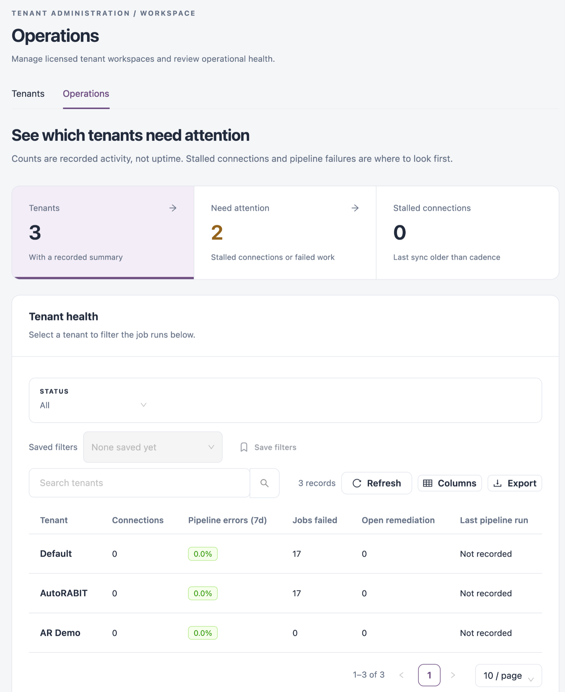
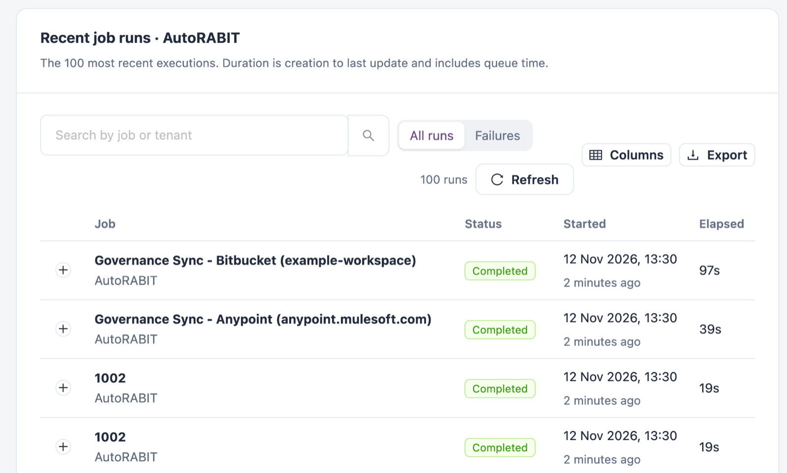

# Operations

**Operations** compares the recorded activity of every tenant and lists the most recent job runs across all of them. Platform administrators use it to spot a tenant whose background work is failing before its users report it.

Open it from **Administration** → **Tenant Administration** → **Operations** in the sidebar, or from the **Operations** tab of **Tenants**.


Available only to platform administrators in the platform tenant.


The figures are recorded activity, not uptime. Failed work and stalled connections are where to look first.

<figure><figcaption>
Operations
</figcaption></figure>

## Summary Tiles

| Tile                    | Description                                                                                                      |
| ----------------------- | ---------------------------------------------------------------------------------------------------------------- |
| **Tenants**             | Number of tenants with a recorded summary. Click it to show all tenants in **Tenant health**.                    |
| **Need attention**      | Tenants with at least one stalled connection, failed job or pipeline error. Click it to show only those tenants. |
| **Stalled connections** | Change Assurance connections, across all tenants, whose last sync is older than their expected cadence.          |

## Tenant Health

One row per tenant. Choose **All** or **Needs attention** in **STATUS**; save a combination you use often with **Save filters** and pick it again from **Saved filters**. Search with **Search tenants**. **Refresh** reloads the figures, **Columns** shows or hides columns and **Export** downloads the table.

| Column                   | Description                                                                                                   |
| ------------------------ | ------------------------------------------------------------------------------------------------------------- |
| **Tenant**               | The tenant's name. Click it to filter **Recent job runs** to that tenant; click it again to clear the filter. |
| **Connections**          | Number of Change Assurance connections. When some are stalled, the tag reads `<n> stalled of <total>`.        |
| **Pipeline errors (7d)** | Share of Change Assurance pipeline runs that failed in the last 7 days. Red above 0%.                         |
| **Jobs failed**          | Job executions of the tenant that ended as failed, counted over all recorded history.                         |
| **Open remediation**     | Change Assurance remediation tasks that are open or in progress.                                              |
| **Last pipeline run**    | When the tenant's Change Assurance pipeline last ran.                                                         |

A connection counts as stalled when it is connected and has never synced, or when its last sync is older than twice its schedule interval (at least 15 minutes). A connection without a schedule is stalled after 24 hours without a sync. Connections that are new, testing, failing or disabled are shown by their own status, not as stalled.

The same figures appear under **Operational evidence** when you open a tenant on [Tenants](tenants.md#open-a-tenant).

## Recent Job Runs

The 100 most recent job executions across all tenants, newest first. With a tenant selected in **Tenant health**, the title reads **Recent job runs · \<tenant>** and the table shows that tenant's 100 most recent runs. **Recent job runs** in a tenant's drawer opens this view for that tenant.

<figure><figcaption>
Recent job runs of one tenant
</figcaption></figure>

Choose **All runs** or **Failures**, and search with **Search by job or tenant** (job name, job type or tenant). **Refresh** reloads the runs, **Columns** shows or hides columns and **Export** downloads the list.

| Column      | Description                                                                                                |
| ----------- | ---------------------------------------------------------------------------------------------------------- |
| **Job**     | The job's name, with the tenant below.                                                                     |
| **Status**  | The run's status: green when completed, red when failed, amber otherwise (for example pending or running). |
| **Started** | When the run was created.                                                                                  |
| **Elapsed** | Seconds from creation to the run's last update, queue time included.                                       |

Expand a run to read the message recorded for it, for example the error of a failed run. The tenant's administrators see the full run in their execution history.

## Next Steps

* [Tenants](tenants.md): open a tenant that needs attention.
* [Execution History](../../operations/schedules/execution-history.md): what the tenant's administrators see for each run.
* [Tenant Administration](./): back to the overview.
