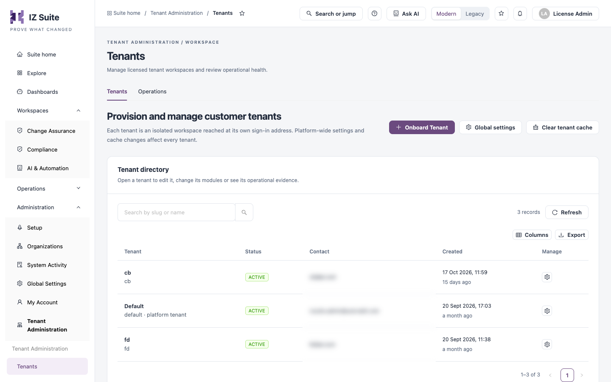
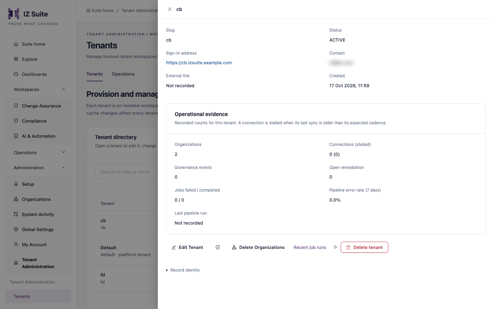
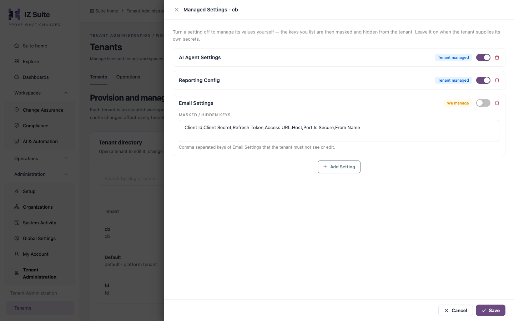

# Tenants

**Tenants** lists every tenant of the installation. Platform administrators use it to change a tenant, hand settings over to it or keep them, and remove organizations or whole tenants.

Open it from **Administration** → **Tenant Administration** → **Tenants** in the sidebar.


Available only to platform administrators in the platform tenant.


<figure><figcaption>
The tenant directory
</figcaption></figure>

## Page Actions

| Button                 | What it does                                                                                               |
| ---------------------- | ---------------------------------------------------------------------------------------------------------- |
| **Onboard Tenant**     | Provisions a new tenant. See [Onboard a Tenant](onboard-a-tenant.md).                                      |
| **Global settings**    | Sets one entry of a setting in several tenants at once. See [Global settings](tenants.md#global-settings). |
| **Clear tenant cache** | Makes every server look up addresses again. See [Clear tenant cache](tenants.md#clear-tenant-cache).       |

## Tenant Directory

Search with **Search by slug or name**. **Refresh** reloads the list, **Columns** shows or hides columns and **Export** downloads the list. Tenants are listed newest first.

| Column      | Description                                                                                                                   |
| ----------- | ----------------------------------------------------------------------------------------------------------------------------- |
| **Tenant**  | The tenant's name, with its slug below. The platform tenant is marked **platform tenant**. Click the name to open the tenant. |
| **Status**  | **ACTIVE**, **TRIAL** or **SUSPENDED**.                                                                                       |
| **Contact** | The contact email. A new tenant gets its administrator's email.                                                               |
| **Created** | When the tenant was provisioned.                                                                                              |
| **Manage**  | Opens the tenant.                                                                                                             |

## Open a Tenant

Click a tenant's name, or its **Manage** icon. The tenant drawer shows:

| Item                     | Description                                                                                                                                                                                                                                                                           |
| ------------------------ | ------------------------------------------------------------------------------------------------------------------------------------------------------------------------------------------------------------------------------------------------------------------------------------- |
| **Slug**                 | The tenant's identifier in its sign-in address.                                                                                                                                                                                                                                       |
| **Status**               | The tenant's status.                                                                                                                                                                                                                                                                  |
| **Sign-in address**      | `https://<slug>.<your IZ Suite host>`. Opens the tenant's sign-in page in a new tab.                                                                                                                                                                                                  |
| **Contact**              | Contact name and email.                                                                                                                                                                                                                                                               |
| **External link**        | The tenant's own host name, when set.                                                                                                                                                                                                                                                 |
| **Created**              | When the tenant was provisioned.                                                                                                                                                                                                                                                      |
| **Operational evidence** | Recorded counts for the tenant, the same figures as on [Operations](operations.md#tenant-health): **Organizations**, **Connections (stalled)**, **Governance events**, **Open remediation**, **Jobs failed / completed**, **Pipeline error rate (7 days)** and **Last pipeline run**. |
| **Record identity**      | The tenant's internal identifier, for support requests.                                                                                                                                                                                                                               |

<figure><figcaption>
A tenant's drawer
</figcaption></figure>

The actions under the drawer are:

| Action                             | What it does                                                                                                         |
| ---------------------------------- | -------------------------------------------------------------------------------------------------------------------- |
| **Edit Tenant**                    | Changes the tenant's details. See [Edit a tenant](tenants.md#edit-a-tenant).                                         |
| Shield icon (**Managed Settings**) | Decides which settings the tenant manages and which you manage. See [Managed settings](tenants.md#managed-settings). |
| **Delete Organizations**           | Deletes organizations of the tenant. See [Delete organizations](tenants.md#delete-organizations).                    |
| **Recent job runs**                | Opens [Operations](operations.md#recent-job-runs) filtered to this tenant.                                           |
| **Delete tenant**                  | Deletes the tenant. See [Delete a tenant](tenants.md#delete-a-tenant).                                               |

For the platform tenant only **Edit Tenant** and **Recent job runs** are available.

## Edit a Tenant

1. Open the tenant.
2. Click **Edit Tenant**. The drawer **Edit Tenant \<slug>** opens.
3. Change the fields and click **Save**.

| Field             | Description                                                                                                                                                                      |
| ----------------- | -------------------------------------------------------------------------------------------------------------------------------------------------------------------------------- |
| **Slug**          | Required. The tenant's identifier in its sign-in address. Changing it changes the address already shared with the tenant. See [Sign-in addresses](tenants.md#sign-in-addresses). |
| **Name**          | Required. Display name.                                                                                                                                                          |
| **Status**        | Required. **ACTIVE**, **SUSPENDED** or **TRIAL**. The platform tenant must stay **ACTIVE**, so the field is locked for it.                                                       |
| **Contact Name**  | The tenant's contact person.                                                                                                                                                     |
| **Contact Email** | The contact person's email.                                                                                                                                                      |
| **External Link** | A host name of the tenant's own, as a full URL (for example `https://quality.acme.com`).                                                                                         |
| **Description**   | Free text.                                                                                                                                                                       |

Clearing an optional field removes its value. A change to **Slug** or **External Link** reaches every server within about 15 seconds.

## Sign-In Addresses

IZ Suite decides the tenant from the address a request arrives on. There is no tenant picker on the sign-in page: the address the person opens decides which tenant they sign in to.

* **Slug address**: `https://<slug>.<your IZ Suite host>`, for example `https://acme.izsuite.example.com`. This is the **Sign-in address** in the tenant drawer and the **Login URL** shown after onboarding.
* **External link**: the full host name of the tenant's **External Link**, for example `https://quality.acme.com`. The scheme and a trailing slash are ignored when the host is matched. Set it only when the tenant routes its own domain to IZ Suite.

Host names are matched without regard to case or port. The sign-in page shows only the sign-in options enabled in that tenant's **Global Settings** → **Settings**. A new tenant has only **IZ User** (email and password) enabled.

Because the tenant comes from the address:

* every identity provider used for single sign-on must redirect back to the tenant's own address, so a sign-in app registered for one tenant cannot serve another unless the provider allows several redirect addresses;
* access tokens work only on the address of the tenant they were created in;
* the CLI, IDE extensions and MCP clients must use the tenant's address as the IZ Suite server address.


Before you change a slug or external link, agree the change with the tenant and update the redirect addresses at their identity providers. People, pipelines and MCP clients that still use the old address stop reaching the tenant.


Do not use these reserved words as a slug, because the sign-in page does not treat them as a tenant: `www`, `app`, `localhost`, `izsuite`, `integralzone`, `dev`, `uat`, `perf`, `sit`, `test`, `stage`, `staging`, `preview`, `demo`, `qa`, `sandbox`, `prod`, `production`. A host given as an IP address never selects a tenant.

## Managed Settings

Some global settings hold secrets or values you may want to run on the tenant's behalf, such as AI provider keys or report storage. **Managed Settings** decides, per tenant and per setting, who supplies the values.

<figure><figcaption>
Managed settings of a tenant
</figcaption></figure>

1. Open the tenant and click the shield icon. The drawer **Managed Settings - \<slug>** opens.
2. For each setting, choose who manages it with the switch:
   * On, tagged **Tenant managed**: the tenant supplies its own values and can see and edit them in its **Global Settings** → **Settings**.
   * Off, tagged **We manage**: you supply the values. Under **MASKED / HIDDEN KEYS**, list the setting's entries the tenant must not see or edit, separated by commas, for example `AI_AGENT_API_KEY, VECTOR_DB_TOKEN`.
3. To add a setting, click **Add Setting** and type its name, for example `AI Agent Settings`. Each setting can be listed once.
4. To remove a setting from the list, click its delete icon.
5. Click **Save**.

A new tenant starts with:

| Setting               | Managed by | Masked keys                                                                                           |
| --------------------- | ---------- | ----------------------------------------------------------------------------------------------------- |
| **AI Agent Settings** | Tenant     | None                                                                                                  |
| **Reporting Config**  | Tenant     | None                                                                                                  |
| **Email Settings**    | Platform   | `Client Id`, `Client Secret`, `Refresh Token`, `Access URL`, `Host`, `Port`, `Is Secure`, `From Name` |

Secret values are always masked for tenant users, whoever manages the setting.

## Global Settings

**Global settings** writes one entry of a setting into several tenants in one step, for example a new `AI_MODEL` in **AI Agent Settings** for every tenant whose AI you run.

1. Click **Global settings**. The drawer **Update Global Settings** opens.
2. Fill in the fields and click **Submit**.

| Field           | Description                                                                                                           |
| --------------- | --------------------------------------------------------------------------------------------------------------------- |
| **Tenants**     | Required. The tenants to update, listed by slug and name.                                                             |
| **Setting Key** | Required. The name of the setting, exactly as in **Global Settings** → **Settings**, for example `AI Agent Settings`. |
| **Key**         | Required. The entry inside the setting, for example `AI_MODEL`.                                                       |
| **Value**       | Required. The new value. Secret entries are stored encrypted.                                                         |

The result lists every selected tenant as **Updated** or **Skipped**, with the reason. A tenant is skipped when it does not have the setting, when the setting does not hold several entries, or when the entry is missing from it.

## Clear Tenant Cache

Every server remembers which tenant each address belongs to. Saving a tenant already refreshes this everywhere; use **Clear tenant cache** when an address still reaches the wrong tenant, for example after a DNS change.

1. Click **Clear tenant cache**. The drawer **Invalidate Tenant Cache** opens.
2. Click **Invalidate**.

The current server forgets its addresses at once and the other servers within about 15 seconds. The next request on each address looks the tenant up again. No tenant data changes.

## Delete Organizations

Removes organizations, and everything under them, from a tenant without deleting the tenant.

1. Open the tenant and click **Delete Organizations**. The drawer **Delete Organizations - \<slug>** lists the tenant's organizations as a tree with **Name**, **Ext Id**, **Source** and **Created**.
2. Select the organizations to delete. Selecting an organization also selects its sub-organizations.
3. Click **Delete Selected**.


Deleting an organization is permanent. All of its data (environments, applications, scans, jobs and permissions) is removed, and its sub-organizations are deleted with it.


## Delete a Tenant

1. Open the tenant and click **Delete tenant**. The drawer **Delete this tenant?** opens and shows how many organizations and connections the tenant holds.
2. Type the tenant's slug in **Enter the tenant slug**.
3. Click **Delete tenant**.


Deleting a tenant removes all of its data: users, roles, tokens, organizations, applications, scans, schedules, settings, licence and audit records, and the source files IZ Suite kept for it. Its sign-in address stops working. This cannot be undone. The licence key can then be used for another tenant. The platform tenant cannot be deleted.


## Next steps

* [Onboard a Tenant](onboard-a-tenant.md): provision a new tenant.
* [Operations](operations.md): see which tenants need attention.
* [Tenant Administration](./): how tenants, addresses and licences fit together.
