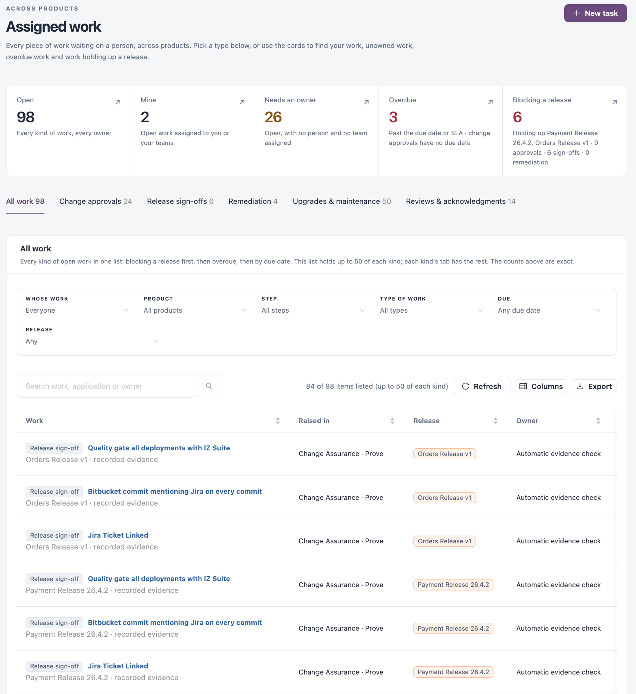
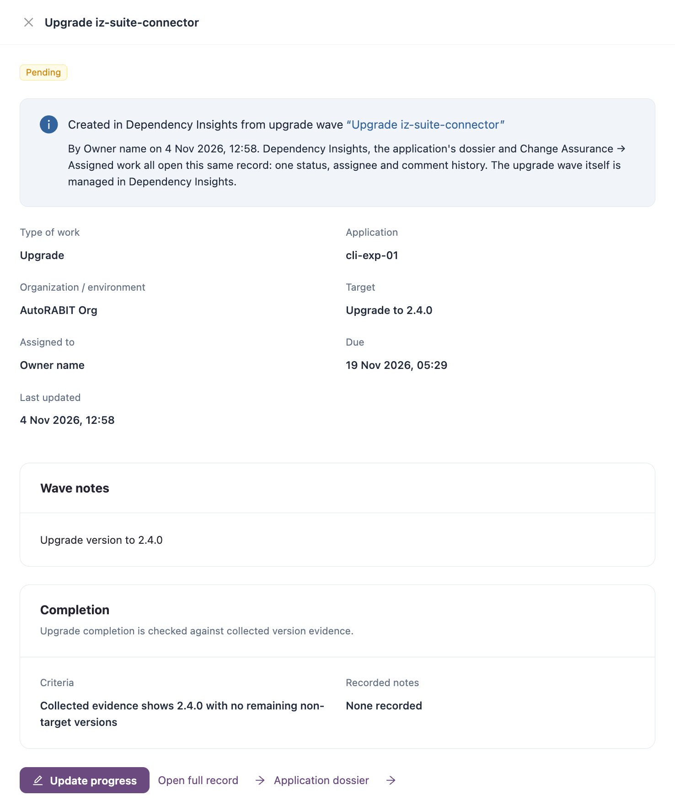

# Assigned Work

**Assigned work** is one queue for every piece of work waiting on a person, across products: change approvals, release sign-offs, remediation tasks, upgrades, maintenance, change reviews and acknowledgments.

Open it from any of these:

* **Assigned work** in the sidebar, below **Findings**.
* **Suite home** → **My open work**, which opens the queue on your own open work.
* **Assigned work** on [Updates & Maintenance](workspaces/dependency-insights/updates-and-maintenance/), and the work record links in [Risk & Lifecycle](workspaces/dependency-insights/risk-and-lifecycle.md) (tracked work) and [Dependency Explorer](workspaces/dependency-insights/dependency-explorer.md) (change reviews).


Change approvals, release sign-offs and remediation tasks appear when your workspace has **Change Assurance** and your role can see them. Without them, the page lists upgrades, maintenance, change reviews, acknowledgments and notices, with the cards **Open work**, **Assigned to me**, **Overdue** and **Blocked**.


<figure><figcaption></figcaption></figure>

**New task** creates a remediation task; it opens on the **Remediation** tab. See [Remediation](/broken/pages/a705b51096a19b10646162411e6e7c68533e3756).

## Summary cards

Select a card to filter the list.

| Card                   | Description                                                             |
| ---------------------- | ----------------------------------------------------------------------- |
| **Open**               | Every kind of open work, every owner.                                   |
| **Mine**               | Open work assigned to you or your teams.                                |
| **Needs an owner**     | Open work with no person and no team assigned.                          |
| **Overdue**            | Past the due date or SLA. Change approvals have no due date.            |
| **Blocking a release** | Open work that holds up an open release, with the releases it holds up. |

A card says when it leaves out a kind of work your role cannot read.

## Types of work

The tabs below the cards show one type of work each, with its count: **All work**, **Change approvals**, **Release sign-offs**, **Remediation**, **Upgrades & maintenance** and **Reviews & acknowledgments**.

### All work

Every kind of open work in one list: work blocking a release first, then overdue work, then by due date. The list holds up to 50 items of each kind; each kind's own tab has the rest. The counts on the cards are exact.

| Filter           | Description                                                                                                                        |
| ---------------- | ---------------------------------------------------------------------------------------------------------------------------------- |
| **Whose work**   | **Everyone**, **Mine**, **My teams** or **Unassigned**.                                                                            |
| **Product**      | The product the work was raised in.                                                                                                |
| **Step**         | **Assure**, **Prove** or **Improve**.                                                                                              |
| **Type of work** | **Change approval**, **Release sign-off**, **Remediation**, **Upgrade**, **Maintenance**, **Change review** or **Acknowledgment**. |
| **Due**          | **Any due date** or **Overdue**.                                                                                                   |
| **Release**      | **Any** or **Blocking a release**.                                                                                                 |

Search with **Search work, application or owner**.

| Column        | Description                                                                                                             |
| ------------- | ----------------------------------------------------------------------------------------------------------------------- |
| **Work**      | The type of work and its title.                                                                                         |
| **Raised in** | Where the work was created.                                                                                             |
| **Release**   | The releases the work holds up.                                                                                         |
| **Owner**     | The person or team, or **Unassigned**.                                                                                  |
| **Due**       | The due date, or how long the work has been waiting.                                                                    |
| **Status**    | The work's status.                                                                                                      |
| **Actions**   | **Review approval**, **Open release sign-off**, **Open in Remediation** or **Open work record**, depending on the type. |

### Upgrades & maintenance, Reviews & acknowledgments

These tabs list upgrade tasks from upgrade waves, and work from update and maintenance rules, tracked work and dependency change reviews. Each item has a clear completion condition.

| Filter   | Description                                                      |
| -------- | ---------------------------------------------------------------- |
| Search   | **Search by rule, wave or target**.                              |
| Status   | **Open**, **Overdue**, **Blocked** or **Include closed**.        |
| Assignee | **Anyone**, **Me or my teams** or **Not assigned**.              |
| Due      | **Any due date**, **Due in the next 7 days** or **No due date**. |

| Column          | Description                                                                               |
| --------------- | ----------------------------------------------------------------------------------------- |
| **Work**        | The rule or wave title, the type of work and its target. Select it to open the item.      |
| **Application** | The application, version and organization.                                                |
| **Release**     | The open releases the work holds up.                                                      |
| **Assigned to** | The owner, or **Not assigned**.                                                           |
| **Due**         | The due date, or **No due date**.                                                         |
| **Status**      | For example **Pending**, **In progress**, **Blocked**, **Completed** or **Acknowledged**. |


Only the assignee or a lifecycle manager can update an item while its rule or wave is active.


### Change approvals, Release sign-offs, Remediation

**Change approvals** lists the approvals waiting on you or your teams; **Review approval** opens the approval. **Release sign-offs** lists the sign-offs that releases are waiting for; **Open release sign-off** opens the release. **Remediation** lists the remediation tasks routed to you, the same list as in [Remediation](/broken/pages/a705b51096a19b10646162411e6e7c68533e3756). Resolving a task records the decision; it does not change the source system.

## Work item

Selecting an item opens it in a drawer. **Open full record** opens the same item on its own page, with **All assigned work** to return to the queue. The item is the same record wherever you open it: Dependency Insights, the application dossier and this queue share one status, assignee and comment history.

<figure><figcaption></figcaption></figure>

The record shows:

* Where it was created, with a link to the upgrade wave or rule.
* **Type of work**, **Application**, **Organization / environment**, **Target**, **Assigned to**, **Due** and **Last updated**.
* **Wave notes**, **What changed** or **Proposed change**, from the wave or rule.
* **Applications in this work** for maintenance and review items, with **Open work** for each application.
* **Completion**: the **Criteria** and the **Recorded notes**. Upgrades are checked against collected version evidence. Other work is recorded by the assignee and is not verified automatically.
* **Application dossier** and **Maintenance rule** (or **Review rule**) links.
* **Comments and history**, kept in an append-only audit trail with who made each entry and when.

### Update progress

1. Open the item and select **Update progress** (or **Record acknowledgment** for an acknowledgment).
2. Choose the **Status**: **Pending**, **In progress**, **Blocked** or **Completed**; or **Pending** or **Acknowledged** for an acknowledgment.
3. Enter the **Notes**. For **Completed** this is the **Completion evidence**, and for **Blocked** it is **What is blocking this work?**; both are **Required**.
4. Optionally choose who to **Reassign to**. Only people with Dependency Insights, lifecycle and application access to this work can be assigned. Leave it empty to keep the current assignee.
5. Save the update.


An upgrade item is accepted as completed only when collected evidence shows the target version.


### Add a comment

Type in **Add context, progress or a hand-off note** and select **Add comment**.

## Next Steps

* [Updates & Maintenance](workspaces/dependency-insights/updates-and-maintenance/): create the rules that assign work.
* [Change Assurance Remediation](/broken/pages/a705b51096a19b10646162411e6e7c68533e3756): playbooks and routing behind remediation tasks.
* [Actions](workspaces/dependency-insights/updates-and-maintenance/actions.md): follow upgrade waves and their tasks.
* [Risk & Lifecycle](workspaces/dependency-insights/risk-and-lifecycle.md): create tracked work from the priority matrix.
