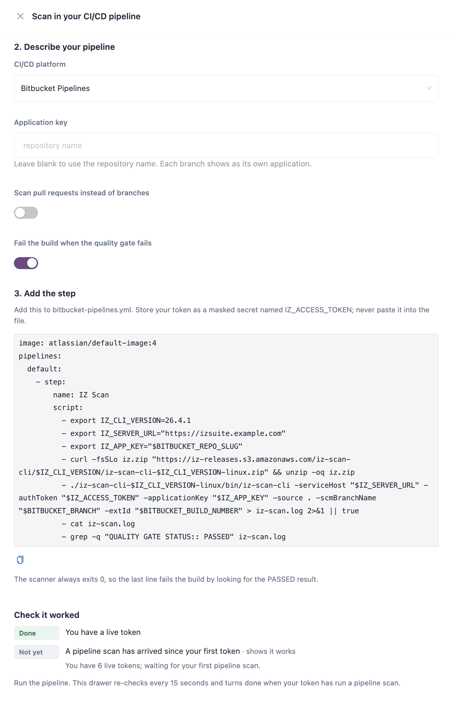

# CI-CD Integration

Code Analysis can scan your code inside your CI/CD pipeline. Each run sends its findings to IZ Suite, the server judges them against the quality gate, and the pipeline passes or fails on that result. Branch and pull request results then appear in Code Analysis next to the repositories IZ Suite scans on a schedule.


Requires the **Code Analysis** licence.


<figure><figcaption></figcaption></figure>

## How a Pipeline Scan Works

1. **Token.** You create an access token with the **Pipeline scanner** role and store it as a masked secret in your CI/CD platform. See [Pipeline Access Tokens](pipeline-access-tokens.md).
2. **Scanner.** A pipeline step runs the [command-line scanner](command-line-scanner.md) or the [Maven plugin](maven-plugin.md) on the checked-out code. It signs in to your IZ Suite address with the token.
3. **Analysis.** The scanner finds the technologies in the source folder (for example Mule, API specifications, Java or CloudFormation), fetches the active quality profile and rules of each, and analyzes the files on the build machine. Your source code is analyzed where the pipeline runs.
4. **Results.** The scanner sends the findings and measurements to IZ Suite as a new assessment of the application and branch (or pull request) you name. When your workspace keeps source files, it also uploads the files the findings cite.
5. **Quality gate.** IZ Suite judges the assessment against the quality gate of each technology and returns **PASSED** or **FAILED**. The gate is decided only on the server. See [Break the Build on a Quality Gate](break-the-build-on-a-quality-gate.md).
6. **Build result.** The scanner writes `QUALITY GATE STATUS:: PASSED` (or `FAILED`) to its log. The pipeline step fails the build when the gate did not pass. If the status cannot be read, no status line is written and the step fails too.

The results then appear in **Workspaces** → **Code Analysis**: branches under **Branches & baselines** with the source **CLI / upload**, and pull requests under **Pull requests**.

## Choose an Option

| Option                                          | Use it when                                                                                                                                   | What it needs                                                                          |
| ----------------------------------------------- | --------------------------------------------------------------------------------------------------------------------------------------------- | -------------------------------------------------------------------------------------- |
| [Command-Line Scanner](command-line-scanner.md) | Any CI/CD platform and any supported technology. This is what Setup generates for Bitbucket Pipelines, GitHub Actions, GitLab CI and Jenkins. | A Linux, macOS or Windows build machine. The download includes its own Java runtime.   |
| [Maven Plugin](maven-plugin.md)                 | Your project already builds with Maven (for example a Mule application) and you want the scan as a Maven goal.                                | Maven and a JDK on the build machine, a `pom.xml`, and the IZ Suite plugin repository. |

Both run the same analysis and send the same results. The difference is how a failed gate stops the build: the Maven goal fails by itself when `abortOnQualityGateFailure` is `true`, while the command-line scanner's step checks the log line. See [Break the Build on a Quality Gate](break-the-build-on-a-quality-gate.md).

## Before You Start

| You need                       | Where it comes from                                                                                                                                                                                                                                         |
| ------------------------------ | ----------------------------------------------------------------------------------------------------------------------------------------------------------------------------------------------------------------------------------------------------------- |
| **Server address**             | The address people use to reach your IZ Suite workspace, for example `https://izsuite.example.com`. Use your workspace's own host name, not a local or IP address, or the scan lands in the wrong workspace.                                                |
| **Access token**               | A token with the **Pipeline scanner** role. See [Pipeline Access Tokens](pipeline-access-tokens.md).                                                                                                                                                        |
| **Application key**            | A unique key for the application, such as the repository name. Results are filed under it, and each branch or pull request shows as a version of the same application. Use letters, numbers, dots, dashes and underscores. The key is stored in lower case. |
| **Organization** (optional)    | The organization the application belongs to. Without it, results land in your default organization. See [Command-Line Scanner](command-line-scanner.md).                                                                                                    |
| **Licence for the technology** | The scanner skips technologies your licence does not cover.                                                                                                                                                                                                 |


The quickest start is **Administration** → **Setup** → **Scan in your CI/CD pipeline**. It creates the token and writes the pipeline step for your CI/CD platform with your server address filled in. See [Setup](../administration/setup.md).


## How Applications and Branches Are Named

* The first scan of an application key creates the application. Later scans add assessments to it.
* Each branch (`-scmBranchName`) or pull request (`-pullRequestId`) is a version of the application. Branch names are stored in lower case. Without a branch or pull request, the scan is recorded on the branch `master`.
* For applications scanned from a pipeline, the first branch scanned becomes the default branch. You can choose another one on the **Management** tab of the branch dossier (**Make default**).
* `-applicationName` sets the name shown in lists. Without it, the application key is shown.

## Which Projects the Server Accepts

Administrators can limit which application keys pipelines may scan, with the include and exclude patterns of the scan settings in **Administration** → **Global Settings** (setting `Falcon Scan Settings`):

| Key                                   | Description                                                                                                            |
| ------------------------------------- | ---------------------------------------------------------------------------------------------------------------------- |
| `PROJECT_NAME_INCLUDE_PATTERN`        | Application keys allowed to be scanned. By default, every key is allowed.                                              |
| `PROJECT_NAME_EXCLUDE_PATTERN`        | Application keys that are never scanned. By default, none.                                                             |
| `ABORT_ON_PATTERN_VALIDATION_FAILURE` | `true` (default): a refused key stops the scan with an error. `false`: the scanner logs the refusal and sends nothing. |
| `ALLOW_ALREADY_SCANNED_PROJECTS`      | `true` (default): an application that was scanned before is scanned even when the patterns would now refuse it.        |

When your key does not match the include pattern, the Setup drawer warns that the scan may be refused.

## Next Steps

* [Pipeline Access Tokens](pipeline-access-tokens.md): create the token your pipeline uses.
* [Pipeline Examples](pipeline-examples.md): copy a ready-made step for your CI/CD platform.
* [Break the Build on a Quality Gate](break-the-build-on-a-quality-gate.md): decide when a pipeline fails.
* [Branches & Baselines](../workspaces/code-analysis/branches-and-baselines.md): review the branches your pipelines scan.
