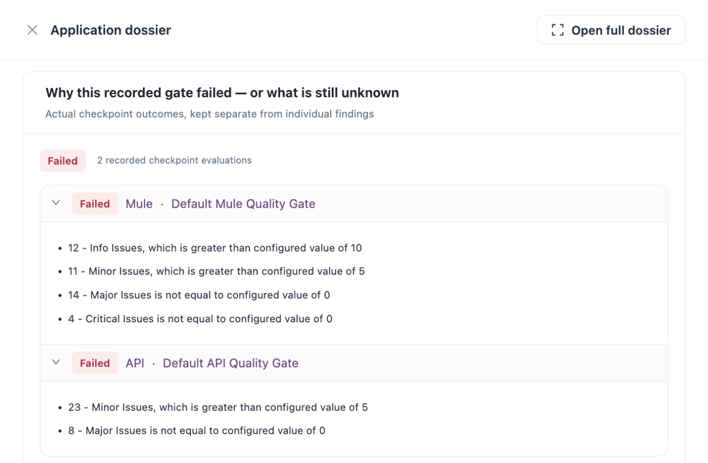

# Break the Build on a Quality Gate

A quality gate is the set of conditions an assessment must meet, for example "no Critical issues". After every pipeline scan, IZ Suite judges the results against the gate and returns **PASSED** or **FAILED**. Your pipeline uses that result to stop a build that does not meet your standards.


Requires the **Code Analysis** licence.


<figure><figcaption></figcaption></figure>

## How the Gate Is Decided

Pipeline scans, scheduled scans and the screens all show the same result.

1. **Per technology.** Each technology in the scan is judged by the quality gate of its active quality profile. Which gate applies follows the organization defaults and application selections described in [Quality Gates](../operations/quality-control/quality-gates.md).
2. **Per condition.** Issue-count conditions count the findings of each severity. **Vulnerable Dependencies** and **Deprecated Assets** count the application's own vulnerable components and deprecations, checked when the gate is judged, so a pipeline does not wait for a scheduled run (see [Quality Gates](../operations/quality-control/quality-gates.md)). Other conditions read the measured value the scan recorded. A condition whose value was not measured, and a Boolean condition, is not evaluated. **New code** conditions are evaluated only for issue counts, **Vulnerable Dependencies** and **Deprecated Assets**.
3. **Exceptions.** Findings under an approved exception that has not expired never count.
4. **Overall result.** The scan passes only when every gated technology passes. A scan with no gated technology passes.

### Branches and Pull Requests

| Scan                                                                                        | Conditions used                                                                                    | Findings counted                                                                                                                                                                           |
| ------------------------------------------------------------------------------------------- | -------------------------------------------------------------------------------------------------- | ------------------------------------------------------------------------------------------------------------------------------------------------------------------------------------------ |
| Branch (`-scmBranchName`)                                                                   | **Overall code** conditions.                                                                       | Every open finding of the branch. A gate does not turn green just because the branch was scanned again; findings count until they are fixed.                                               |
| Pull request with a scanned target branch (`-pullRequestId` and `-pullRequestTargetBranch`) | **New code** conditions. When the gate has none, its **Overall code** conditions, as for a branch. | With new-code conditions: only findings that are not open on the target branch, and vulnerable dependencies or deprecated assets the target branch does not have. Otherwise every finding. |
| Pull request without a target branch, or whose target branch was never scanned              | **Overall code** conditions.                                                                       | Every finding, as for a branch.                                                                                                                                                            |

Define **New code** conditions in [Quality Gates](../operations/quality-control/quality-gates.md) to hold pull requests to a stricter standard than the whole branch, for example "0 new Major issues". See [Pull Request Analysis](pull-request-analysis.md).

## Fail the Build

The scanner writes the result to its log as the last gate line:

```
QUALITY GATE STATUS:: PASSED
```

or `QUALITY GATE STATUS:: FAILED`. When the server cannot return a status, the log says `Could not get the quality gate status from IZ Suite` with the reason, and there is no status line.



There are two ways to fail the step. The simplest is `-abortOnQualityGateFailure true`: the scanner then exits with code `1` when the gate failed or no status came back, and logs `Aborting the build due to Quality Gate failure` (or `Could not get the quality gate status from IZ Suite ... Failing the build because abortOnQualityGateFailure is set.`).

The steps that Setup generates do it the other way: they send the output to a file and fail the step unless the PASSED line is there:

```bash
./iz-scan-cli-$IZ_CLI_VERSION-linux/bin/iz-scan-cli -serviceHost "$IZ_SERVER_URL" -authToken "$IZ_ACCESS_TOKEN" -applicationKey "$IZ_APP_KEY" -source . -scmBranchName "$BRANCH" > iz-scan.log 2>&1 || true
cat iz-scan.log
grep -q "QUALITY GATE STATUS:: PASSED" iz-scan.log
```

The `grep` fails the step when the gate failed, when no status came back and when the scan stopped with an error. Setup adds this line when **Fail the build when the quality gate fails** is on.



Add `-DabortOnQualityGateFailure=true` (or `<abortOnQualityGateFailure>true</abortOnQualityGateFailure>` in the plugin configuration). The goal then fails the Maven build with `Scan failed` when the gate failed or no status came back:

```bash
mvn -B -s iz-settings.xml com.integralzone.izsuite:iz-scan-cli:26.4.1:scan -DserviceHost="https://izsuite.example.com" -DauthToken="$IZ_ACCESS_TOKEN" -DapplicationKey="orders-sapi" -Dsource=. -DscmBranchName="$BRANCH" -DabortOnQualityGateFailure=true
```

Without it, the Maven build passes whatever the gate result.




A failed gate does not undo the scan. The assessment, its findings and its gate result are recorded in IZ Suite either way.


## See Why the Gate Failed

1. Open the link the scanner logs after `Browse the project results at ::`, or open the branch from **Workspaces** → **Code Analysis** → **Branches & baselines**.
2. In the branch dossier, open **Posture & evidence**.
3. Under **Why this recorded gate failed — or what is still unknown**, each technology is listed as "technology · gate name". Failed technologies open expanded and list the conditions they missed, for example "4 - Critical Issues is not equal to configured value of 0"; new-code ones start with "New code:". A failed **Vulnerable Dependencies** or **Deprecated Assets** condition names what was found; open the **Risk & lifecycle** panel for the details.
4. Click **Investigate issues** to work through the findings.

To accept a finding instead of fixing it, use **Actions** → **Exceptions** in the dossier. Findings under an approved, unexpired exception do not count when the gate is judged.

## Next Steps

* [Quality Gates](../operations/quality-control/quality-gates.md): change the conditions and which organizations use a gate.
* [Pull Request Analysis](pull-request-analysis.md): judge pull requests on new code.
* [Branches & Baselines](../workspaces/code-analysis/branches-and-baselines.md): open the branch dossier.
* [CI/CD Integration](./): how a pipeline scan works.
