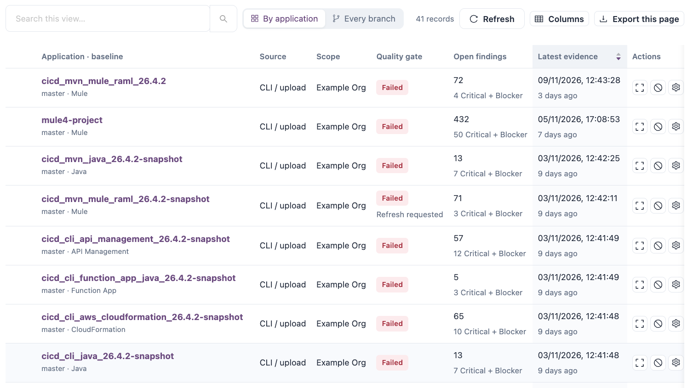

# Command-Line Scanner

The command-line scanner analyzes a source folder on the build machine and sends the results to IZ Suite. It runs on any CI/CD platform and on a workstation.


Requires the **Code Analysis** licence.


<figure><figcaption></figcaption></figure>

## Download

The scanner is a zip file per operating system. Each zip includes its own Java runtime, so the build machine needs no Java installation.

| Operating system      | File                                       |
| --------------------- | ------------------------------------------ |
| Linux (x64)           | `iz-scan-cli-<version>-linux.zip`          |
| Linux (ARM64)         | `iz-scan-cli-<version>-linux-aarch64.zip`  |
| macOS (Intel)         | `iz-scan-cli-<version>-macosx.zip`         |
| macOS (Apple silicon) | `iz-scan-cli-<version>-macosx-aarch64.zip` |
| Windows (x64)         | `iz-scan-cli-<version>-windows.zip`        |

Download it from `https://iz-releases.s3.amazonaws.com/iz-scan-cli/<version>/<file>`, for example:

```bash
export IZ_CLI_VERSION=26.4.1
curl -fsSLo iz.zip "https://iz-releases.s3.amazonaws.com/iz-scan-cli/$IZ_CLI_VERSION/iz-scan-cli-$IZ_CLI_VERSION-linux.zip" && unzip -oq iz.zip
```

The zip unpacks to `iz-scan-cli-<version>-<os>/`. The scanner is `bin/iz-scan-cli` (`bin\iz-scan-cli.bat` on Windows). The pipeline steps that Setup generates always use the current scanner version. 26.4.1 above is only an example: use the scanner version for your IZ Suite release, for example 26.4.1 or 26.4.2. See [Download the Command-Line Scanner](download-the-command-line-scanner.md).

## Run a Scan

Run the scanner from the project folder, or point `-source` at it:

```bash
./iz-scan-cli-$IZ_CLI_VERSION-linux/bin/iz-scan-cli -serviceHost "https://izsuite.example.com" -authToken "$IZ_ACCESS_TOKEN" -applicationKey "orders-eapi" -source . -scmBranchName "main" > iz-scan.log 2>&1 || true
cat iz-scan.log
grep -q "QUALITY GATE STATUS:: PASSED" iz-scan.log
```

Write each option, then a space, then its value: `-applicationKey orders-eapi`. Quote values that contain spaces. Each option also works with two dashes (`--applicationKey`). Run the scanner without options to print the option list.

## Options

| Option                       | Required | Description                                                                                                                                                                                         | Default                  |
| ---------------------------- | -------- | --------------------------------------------------------------------------------------------------------------------------------------------------------------------------------------------------- | ------------------------ |
| `-serviceHost`               | Yes      | The address of your IZ Suite workspace, for example `https://izsuite.example.com`.                                                                                                                  | None                     |
| `-authToken`                 | Yes      | The access token, read from a masked secret. See [Pipeline Access Tokens](pipeline-access-tokens.md).                                                                                               | None                     |
| `-applicationKey`            | Yes      | The unique key results are filed under, for example the repository name. Stored in lower case.                                                                                                      | None                     |
| `-applicationName`           | No       | The name shown for the application.                                                                                                                                                                 | The application key      |
| `-source`                    | No       | The folder that holds the source files.                                                                                                                                                             | The current folder       |
| `-organization`              | No       | The organization the application belongs to: its organization ID, external ID or name. The organization ID is in [Organizations](../administration/organizations/).                                 | The default organization |
| `-scmBranchName`             | No       | The branch being scanned. Stored in lower case.                                                                                                                                                     | `master`                 |
| `-pullRequestId`             | No       | The pull request being scanned, for example its number. When set, the scan is recorded as this pull request and `-scmBranchName` is ignored. See [Pull Request Analysis](pull-request-analysis.md). | None                     |
| `-pullRequestTargetBranch`   | No       | The branch the pull request merges into. Its latest scan is the pull request's baseline, so the pull request is judged on new code. Used only with `-pullRequestId`.                                | None                     |
| `-extId`                     | No       | An external reference, such as your CI build number, recorded with the scan.                                                                                                                        | None                     |
| `-abortOnQualityGateFailure` | No       | `true` makes the scanner exit with code `1` when the gate fails or no gate status came back; see Exit code.                                                                                         | `false`                  |
| `-sarifReport`               | No       | A file path. The scanner writes the findings there as a SARIF 2.1.0 report.                                                                                                                         | No report                |
| `-dumpIssues`                | No       | A file path. The scanner writes every finding there as JSON: rule ID, rule name, description, file and line.                                                                                        | No file                  |
| `-fixAllIssues`              | No       | `true` applies the automatic fix of every active rule that has one to the files in the source folder before scanning, and logs the changes in `auto-fix-log.txt` in that folder.                    | `false`                  |
| `-scmCommit`                 | No       | Accepted for compatibility. The scanner does not send it.                                                                                                                                           | None                     |


`-fixAllIssues true` changes the files in your working copy. Use it only in a job whose changes you review, never in a job that publishes the build.


## What the Scanner Checks First

Before it analyzes anything, the scanner:

1. Signs in with the token and resolves `-organization`. An unknown organization stops the scan. When the token's role does not cover the organization, the scan stops later, when the application is set up.
2. Checks the application key against the include and exclude patterns of the scan settings, unless the application was scanned before and the settings allow it. See [CI/CD Integration](./).
3. Checks the licence: without a Code Analysis licence it logs `Invalid License. Contact support@integralzone.com to get a valid license` and records nothing; a technology your licence does not cover is skipped.
4. Detects the technologies in the source folder. When it finds none, it logs an error and records nothing.

Each technology is analyzed with the active quality profile of the organization. A technology with no active profile is skipped with a warning.

## Outputs

| Output       | Description                                                                                                                                                                                                                                                                                       |
| ------------ | ------------------------------------------------------------------------------------------------------------------------------------------------------------------------------------------------------------------------------------------------------------------------------------------------- |
| Log          | Progress, the rules found, `Quality gate for <technology>: PASSED` or `FAILED`, and at the end `QUALITY GATE STATUS:: PASSED` or `QUALITY GATE STATUS:: FAILED`. When the server cannot return a gate status, the log says `Could not get the quality gate status from IZ Suite` with the reason. |
| Results link | `Browse the project results at :: <link>` opens the Findings tab of this scan in Code Analysis.                                                                                                                                                                                                   |
| SARIF report | The file named by `-sarifReport`, for code scanning tools such as GitHub code scanning.                                                                                                                                                                                                           |
| Issues file  | The JSON file named by `-dumpIssues`.                                                                                                                                                                                                                                                             |
| In IZ Suite  | A new assessment of the application and branch or pull request, with its findings, measurements and quality gate. Mule applications also get their MUnit coverage; see [Test Coverage Reports](test-coverage-reports.md).                                                                         |

## Exit Code

| Exit code | When                                                                                                                                                                                                                              |
| --------- | --------------------------------------------------------------------------------------------------------------------------------------------------------------------------------------------------------------------------------- |
| `0`       | The scan finished. Without `-abortOnQualityGateFailure true`, this includes a failed quality gate, an invalid licence and an error during analysis.                                                                               |
| `1`       | An option is wrong or missing; signing in, finding the organization, the application key check or setting up the application failed; or `-abortOnQualityGateFailure true` is set and the gate failed or no gate status came back. |

The steps from Setup keep the scanner's output in a file and fail the build unless it has the PASSED line, which covers the same cases:

```bash
grep -q "QUALITY GATE STATUS:: PASSED" iz-scan.log
```

See [Break the Build on a Quality Gate](break-the-build-on-a-quality-gate.md).

## Proxy and Java Options

When the build machine reaches the internet through a proxy, pass the proxy to Java before you run the scanner:



```bash
export JAVA_TOOL_OPTIONS="-Dhttps.proxyHost=PROXY_HOST -Dhttps.proxyPort=PROXY_PORT -Dhttp.proxyHost=PROXY_HOST -Dhttp.proxyPort=PROXY_PORT -Djava.net.useSystemProxies=true"
```



```bat
set "JAVA_TOOL_OPTIONS=-Dhttps.proxyHost=PROXY_HOST -Dhttps.proxyPort=PROXY_PORT -Dhttp.proxyHost=PROXY_HOST -Dhttp.proxyPort=PROXY_PORT -Djava.net.useSystemProxies=true"
```



Replace `PROXY_HOST` and `PROXY_PORT`, and always set both ports. Other Java options, such as more memory, go in the `IZ_SCAN_CLI_OPTS` environment variable, for example `export IZ_SCAN_CLI_OPTS="-Xmx4g"`.

## Next Steps

* [Pipeline Examples](pipeline-examples.md): the complete step for your CI/CD platform.
* [Break the Build on a Quality Gate](break-the-build-on-a-quality-gate.md): how the gate decides the build.
* [Pull Request Analysis](pull-request-analysis.md): scan pull requests on new code.
* [Maven Plugin](maven-plugin.md): run the same scan as a Maven goal.
