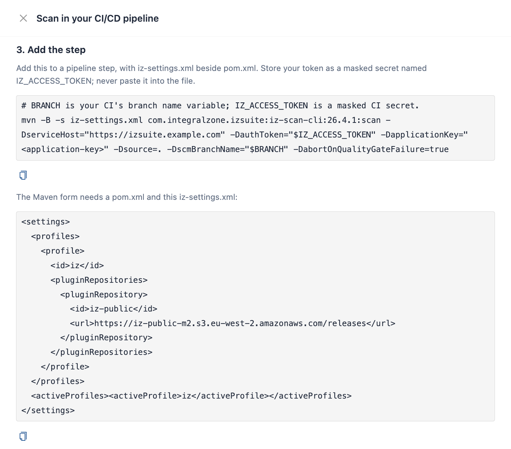

# Maven Plugin

1. Navigate to the main menu **`Administration`** -> **`Organizations`**
2. In the displayed list of organizations, each one will have an associated **`Organization Id`**  as shown below.
3. Use the Organization ID when performing the CICD scan with the **`-Dorganization`** parameter

The scanner is also published as a Maven plugin. Run its `scan` goal in a Maven project to analyze the project and send the results to IZ Suite. It runs the same analysis as the [command-line scanner](command-line-scanner.md), and the Maven build fails by itself when the scan fails or, if you ask for it, when the quality gate fails.


Requires the **Code Analysis** licence.


<figure><figcaption></figcaption></figure>

## Requirements

* Apache Maven and a JDK on the build machine.


* A `pom.xml` in the folder where you run the goal.
* Network access to the IZ Suite plugin repository and to your IZ Suite address.

## Plugin Coordinates

| Item              | Value                                                                                                                    |
| ----------------- | ------------------------------------------------------------------------------------------------------------------------ |
| Group ID          | `com.integralzone.izsuite`                                                                                               |
| Artifact ID       | `iz-scan-cli`                                                                                                            |
| Version           | The scanner version for your IZ Suite release, for example `26.4.1` or `26.4.2`. The examples on this page use `26.4.1`. |
| Goal              | `scan`                                                                                                                   |
| Plugin repository | `https://iz-public-m2.s3.eu-west-2.amazonaws.com/releases`                                                               |

## Add the Plugin Repository

Maven must find the plugin in the IZ Suite repository. Either keep a small settings file next to `pom.xml` and pass it with `-s`, as Setup does, or add the repository to your own `settings.xml` or `pom.xml`.


```xml
<settings>
  <profiles>
    <profile>
      <id>iz</id>
      <pluginRepositories>
        <pluginRepository>
          <id>iz-public</id>
          <url>https://iz-public-m2.s3.eu-west-2.amazonaws.com/releases</url>
        </pluginRepository>
      </pluginRepositories>
    </profile>
  </profiles>
  <activeProfiles><activeProfile>iz</activeProfile></activeProfiles>
</settings>
```



`-s iz-settings.xml` replaces your user settings for that run. If your build also needs other repositories or credentials from your own `settings.xml`, add the plugin repository there instead and leave out `-s`.


## Run the Scan

Pass the options as `-D` properties:

```bash
mvn -B -s iz-settings.xml com.integralzone.izsuite:iz-scan-cli:26.4.1:scan -DserviceHost="https://izsuite.example.com" -DauthToken="$IZ_ACCESS_TOKEN" -DapplicationKey="orders-sapi" -Dsource=. -DscmBranchName="$BRANCH" -DabortOnQualityGateFailure=true
```

`BRANCH` stands for your CI/CD platform's branch-name variable, and `IZ_ACCESS_TOKEN` for the masked secret that holds the token. See [Pipeline Access Tokens](pipeline-access-tokens.md).

### Configure It in pom.xml

You can also keep the fixed options in `pom.xml` and pass only the secret on the command line:


```xml
<build>
  <plugins>
    <plugin>
      <groupId>com.integralzone.izsuite</groupId>
      <artifactId>iz-scan-cli</artifactId>
      <version>26.4.1</version>
      <configuration>
        <serviceHost>https://izsuite.example.com</serviceHost>
        <applicationKey>orders-sapi</applicationKey>
        <source>.</source>
        <abortOnQualityGateFailure>true</abortOnQualityGateFailure>
      </configuration>
    </plugin>
  </plugins>
</build>
```


```bash
mvn -B -s iz-settings.xml com.integralzone.izsuite:iz-scan-cli:scan -DauthToken="$IZ_ACCESS_TOKEN" -DscmBranchName="$BRANCH"
```

## Parameters

| Parameter                   | Required | Description                                                                   | Default                  |
| --------------------------- | -------- | ----------------------------------------------------------------------------- | ------------------------ |
| `serviceHost`               | Yes      | The address of your IZ Suite workspace.                                       | None                     |
| `authToken`                 | Yes      | The access token. Pass it from a masked secret, never in `pom.xml`.           | None                     |
| `applicationKey`            | Yes      | The unique key results are filed under. Stored in lower case.                 | None                     |
| `source`                    | Yes      | The folder that holds the source files, usually `.`.                          | None                     |
| `applicationName`           | No       | The name shown for the application.                                           | The application key      |
| `organization`              | No       | The organization ID, external ID or name.                                     | The default organization |
| `scmBranchName`             | No       | The branch being scanned. Stored in lower case.                               | `master`                 |
| `pullRequestId`             | No       | The pull request being scanned. When set, the branch is ignored.              | None                     |
| `pullRequestTargetBranch`   | No       | The branch the pull request merges into, used as its baseline.                | None                     |
| `extId`                     | No       | An external reference, such as the build number, recorded with the scan.      | None                     |
| `abortOnQualityGateFailure` | No       | `true` fails the Maven build when the gate fails or no gate status came back. | `false`                  |
| `sarifReport`               | No       | File path for a SARIF 2.1.0 report of the findings.                           | No report                |
| `dumpIssues`                | No       | File path for a JSON list of the findings.                                    | No file                  |
| `fixAllIssues`              | No       | `true` applies automatic fixes to the source files before scanning.           | `false`                  |
| `scmCommit`                 | No       | Accepted for compatibility. Not sent.                                         | None                     |

The parameters behave as the command-line options of the same name. See [Command-Line Scanner](command-line-scanner.md).

## Build Result

The goal fails the build with `Scan failed` when:

* `abortOnQualityGateFailure` is `true` and the quality gate failed, or no gate status came back.
* The scan stopped before analysis, for example because the token was refused, the organization was not found or the application key is not allowed.

An invalid licence or an error during analysis does not fail the build unless `abortOnQualityGateFailure` is `true`.

Otherwise the build continues, and the log shows `QUALITY GATE STATUS:: PASSED` or `FAILED`. See [Break the Build on a Quality Gate](break-the-build-on-a-quality-gate.md).

## Proxy

Behind a proxy, add the proxy properties to the Maven command:

```bash
-Dhttps.proxyHost=PROXY_HOST -Dhttps.proxyPort=PROXY_PORT -Dhttp.proxyHost=PROXY_HOST -Dhttp.proxyPort=PROXY_PORT -Djava.net.useSystemProxies=true
```

Replace `PROXY_HOST` and `PROXY_PORT`, and always set both ports.

## Next Steps

* [Pipeline Examples](pipeline-examples.md): the Maven step in a pipeline.
* [Test Coverage Reports](test-coverage-reports.md): send MUnit coverage with the scan.
* [Break the Build on a Quality Gate](break-the-build-on-a-quality-gate.md): when the build fails.
* [Command-Line Scanner](command-line-scanner.md): the option reference.
