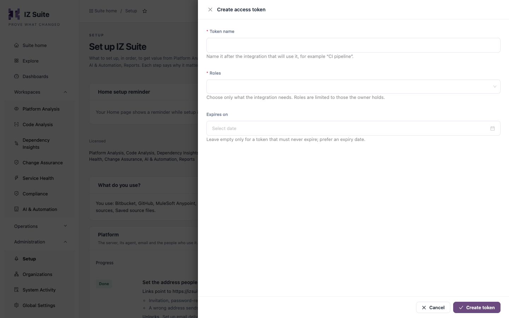

# Pipeline Access Tokens

A pipeline signs in to IZ Suite with an access token. The token acts as the person who created it, with only the roles chosen for it. For pipelines, give it the **Pipeline scanner** role and nothing else.


Requires the **Code Analysis** licence.


## The Pipeline scanner role

**Pipeline scanner** is a role made for pipeline tokens. It lets the scanner read what it needs to run and record results, and nothing more:

* Read the quality profiles, quality gates, metric profiles, quality rules and global settings the scanner uses.
* Create and update Code Analysis applications for each licensed technology, in the default organization.

To create it, open **Administration** → **Setup** → **Create roles for pipelines and AI assistants**, tick **Create a Pipeline scanner role**, keep **Also give me these roles so my tokens can carry them** ticked, and click **Create roles**. Nothing already in a role is removed; if the role exists, missing permissions are added. See [Setup](https://knowledgebase.autorabit.com/product-guides/integral-zone/iz-suite/administration/setup#platform).


A token can carry only roles its owner holds. If **Pipeline scanner** is not offered when you create the token, ask an administrator to give you the role in [Roles](https://knowledgebase.autorabit.com/product-guides/integral-zone/iz-suite/administration/organizations/roles).



The scanner reads global settings, and that permission also shows the secrets saved in them. Treat a pipeline token like a password: keep it in a masked secret and never in a file you commit.


### Scan into other organizations

The role's scan rights cover the default organization. When your pipeline passes `-organization` to file results under another organization, the token's role must also cover that organization: open the role's **Permission matrix** in [Roles](https://knowledgebase.autorabit.com/product-guides/integral-zone/iz-suite/administration/organizations/roles#permission-matrix), click **Add permissions** and pick the organizations. Otherwise the scan stops with an error saying the organization was not found or the token lacks permission to configure the application there.

## Create a token for a pipeline

You can create the token from Setup or from **Access tokens**. Both open the same form.

<figure><figcaption>
Create access token
</figcaption></figure>

1. Open **Administration** → **Setup** → **Scan in your CI/CD pipeline** and click **Create access token** (or click **Create access token** in [Access Tokens](https://knowledgebase.autorabit.com/product-guides/integral-zone/iz-suite/administration/organizations/access-tokens#create-an-access-token)).
2. Enter a **Token name**, for example "CI pipeline". Use one token per pipeline or repository so you can disable one without stopping the others.
3. Under **Roles**, choose **Pipeline scanner**.
4. Set **Expires on**. Prefer an expiry date and rotate the token before it.
5. Click **Create token**.
6. Copy the value under **Copy this token now**. It is shown only once.

## Store the token as a pipeline secret

Store the value as a masked secret named `IZ_ACCESS_TOKEN`. The steps that Setup generates read it from there and never contain the token.

| CI/CD platform      | Where to store it                                                                                              |
| ------------------- | -------------------------------------------------------------------------------------------------------------- |
| Bitbucket Pipelines | A secured repository or workspace variable `IZ_ACCESS_TOKEN`.                                                  |
| GitHub Actions      | A repository or organization secret `IZ_ACCESS_TOKEN`, read as `${{ secrets.IZ_ACCESS_TOKEN }}`.               |
| GitLab CI           | A masked CI/CD variable `IZ_ACCESS_TOKEN`.                                                                     |
| Jenkins             | A **Secret text** credential with the ID `iz-access-token`, bound to `IZ_ACCESS_TOKEN` with `withCredentials`. |
| Maven               | Any of the above; the command passes it as `-DauthToken="$IZ_ACCESS_TOKEN"`.                                   |


Never paste the token into a pipeline file, a `pom.xml` or a settings file. Anyone who can read the repository could then scan as you.


## Check that the token works

The **Scan in your CI/CD pipeline** step in Setup checks every 15 seconds and turns **Done** when a pipeline scan has arrived since you created your first token. Run the pipeline once and watch the step.

## Rotate, disable or remove a token

* **Rotate**: create a new token with the same role, replace the secret value in your CI/CD platform, run the pipeline once, then disable the old token.
* **Disable**: click **Disable token** on the token's row in [Access Tokens](https://knowledgebase.autorabit.com/product-guides/integral-zone/iz-suite/administration/organizations/access-tokens#disable-or-enable-a-token) or **Disable credential** in [Security Credentials](https://knowledgebase.autorabit.com/product-guides/integral-zone/iz-suite/my-account/security-credentials). The pipeline loses access on its next request. You can enable it again later.
* **Expired tokens** stop working on their expiry date. The **Expiring in 30 days** tile in **Access tokens** lists the ones to rotate soon.

A token's value cannot be shown again. If it is lost, create a new token.

## Next steps

* [Command-Line Scanner](command-line-scanner.md): use the token with the scanner.
* [Pipeline Examples](pipeline-examples.md): add the scan step to your pipeline.
* [Access Tokens](https://knowledgebase.autorabit.com/product-guides/integral-zone/iz-suite/administration/organizations/access-tokens): review every token in the workspace.
* [CI/CD Integration](./): how a pipeline scan works.
