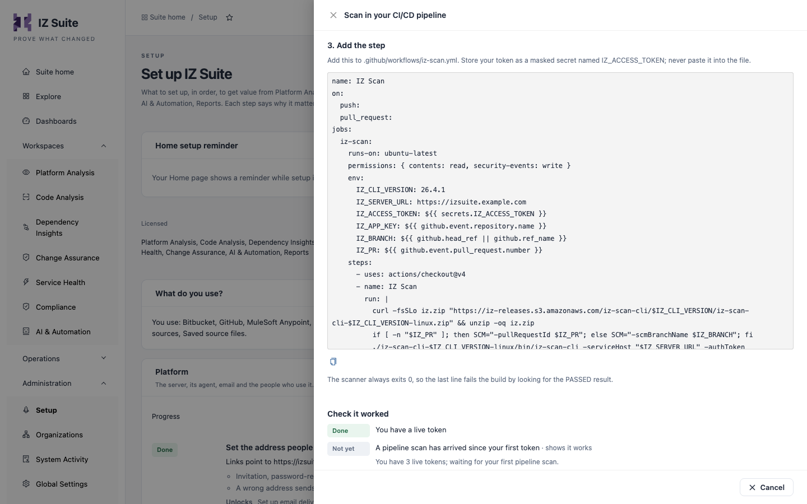

# Pipeline Examples

These are the pipeline steps that **Administration** → **Setup** → **Scan in your CI/CD pipeline** generates. In the app, the drawer fills in your server address and the current scanner version; here they show `https://izsuite.example.com` and version `26.4.1`.


Requires the **Code Analysis** licence.


<figure><figcaption><p>The GitHub Actions step in Setup</p></figcaption></figure>

## Before you add a step

1. Create a token with the **Pipeline scanner** role and store it as a masked secret named `IZ_ACCESS_TOKEN` (in Jenkins, a **Secret text** credential with the ID `iz-access-token`). See [Pipeline Access Tokens](pipeline-access-tokens.md).
2. Choose the application key. The Bitbucket, GitHub and GitLab steps use the repository name; replace it if you want another key.
3. Decide whether a failed quality gate fails the build. In Setup, **Fail the build when the quality gate fails** adds the last line (`grep ...`) or, for Maven, `-DabortOnQualityGateFailure=true`. It is on by default.

## Steps per platform

Every step except Maven downloads the Linux scanner, runs it with its output in `iz-scan.log`, prints the log, and fails the step unless the log has `QUALITY GATE STATUS:: PASSED`. Checking the log also catches a scan that stopped with an error; `-abortOnQualityGateFailure true` is the alternative. See [Break the Build on a Quality Gate](break-the-build-on-a-quality-gate.md).



Runs on every push, on the pushed branch.


```yaml
image: atlassian/default-image:4
pipelines:
  default:
    - step:
        name: IZ Scan
        script:
          - export IZ_CLI_VERSION=26.4.1
          - export IZ_SERVER_URL="https://izsuite.example.com"
          - export IZ_APP_KEY="$BITBUCKET_REPO_SLUG"
          - curl -fsSLo iz.zip "https://iz-releases.s3.amazonaws.com/iz-scan-cli/$IZ_CLI_VERSION/iz-scan-cli-$IZ_CLI_VERSION-linux.zip" && unzip -oq iz.zip
          - ./iz-scan-cli-$IZ_CLI_VERSION-linux/bin/iz-scan-cli -serviceHost "$IZ_SERVER_URL" -authToken "$IZ_ACCESS_TOKEN" -applicationKey "$IZ_APP_KEY" -source . -scmBranchName "$BITBUCKET_BRANCH" -extId "$BITBUCKET_BUILD_NUMBER" > iz-scan.log 2>&1 || true
          - cat iz-scan.log
          - grep -q "QUALITY GATE STATUS:: PASSED" iz-scan.log
```


With **Scan pull requests instead of branches** turned on, Setup writes a `pull-requests` pipeline instead:


```yaml
image: atlassian/default-image:4
pipelines:
  pull-requests:
    '**':
      - step:
          name: IZ Scan
          script:
            - export IZ_CLI_VERSION=26.4.1
            - export IZ_SERVER_URL="https://izsuite.example.com"
            - export IZ_APP_KEY="$BITBUCKET_REPO_SLUG"
            - curl -fsSLo iz.zip "https://iz-releases.s3.amazonaws.com/iz-scan-cli/$IZ_CLI_VERSION/iz-scan-cli-$IZ_CLI_VERSION-linux.zip" && unzip -oq iz.zip
            - ./iz-scan-cli-$IZ_CLI_VERSION-linux/bin/iz-scan-cli -serviceHost "$IZ_SERVER_URL" -authToken "$IZ_ACCESS_TOKEN" -applicationKey "$IZ_APP_KEY" -source . -pullRequestId "$BITBUCKET_PR_ID" -extId "$BITBUCKET_BUILD_NUMBER" > iz-scan.log 2>&1 || true
            - cat iz-scan.log
            - grep -q "QUALITY GATE STATUS:: PASSED" iz-scan.log
```




Runs on pushes and pull requests. A pull request is scanned as a pull request, a push as a branch. The step also writes a SARIF report and uploads it to GitHub code scanning; when code scanning is not available, the upload fails but the job does not.


```yaml
name: IZ Scan
on:
  push:
  pull_request:
jobs:
  iz-scan:
    runs-on: ubuntu-latest
    permissions: { contents: read, security-events: write }
    env:
      IZ_CLI_VERSION: 26.4.1
      IZ_SERVER_URL: https://izsuite.example.com
      IZ_ACCESS_TOKEN: ${{ secrets.IZ_ACCESS_TOKEN }}
      IZ_APP_KEY: ${{ github.event.repository.name }}
      IZ_BRANCH: ${{ github.head_ref || github.ref_name }}
      IZ_PR: ${{ github.event.pull_request.number }}
    steps:
      - uses: actions/checkout@v4
      - name: IZ Scan
        run: |
          curl -fsSLo iz.zip "https://iz-releases.s3.amazonaws.com/iz-scan-cli/$IZ_CLI_VERSION/iz-scan-cli-$IZ_CLI_VERSION-linux.zip" && unzip -oq iz.zip
          if [ -n "$IZ_PR" ]; then SCM="-pullRequestId $IZ_PR"; else SCM="-scmBranchName $IZ_BRANCH"; fi
          ./iz-scan-cli-$IZ_CLI_VERSION-linux/bin/iz-scan-cli -serviceHost "$IZ_SERVER_URL" -authToken "$IZ_ACCESS_TOKEN" -applicationKey "$IZ_APP_KEY" -source . $SCM -extId "$GITHUB_RUN_ID" -sarifReport iz-scan.sarif > iz-scan.log 2>&1 || true
          cat iz-scan.log
          grep -q "QUALITY GATE STATUS:: PASSED" iz-scan.log
      # needs GitHub code scanning; without it (or on a fork's pull request) the upload fails, never the job
      - uses: github/codeql-action/upload-sarif@v3
        if: always() && hashFiles('iz-scan.sarif') != ''
        continue-on-error: true
        with: { sarif_file: iz-scan.sarif }
```




A merge request pipeline is scanned as a pull request, any other pipeline as a branch. The log is kept as a job artifact.


```yaml
iz-scan:
  image: ubuntu:24.04
  variables:
    IZ_CLI_VERSION: "26.4.1"
    IZ_SERVER_URL: "https://izsuite.example.com"
    IZ_APP_KEY: "$CI_PROJECT_NAME"
  script:
    - apt-get update -qq && apt-get install -y -qq curl unzip
    - curl -fsSLo iz.zip "https://iz-releases.s3.amazonaws.com/iz-scan-cli/$IZ_CLI_VERSION/iz-scan-cli-$IZ_CLI_VERSION-linux.zip" && unzip -oq iz.zip
    - if [ -n "$CI_MERGE_REQUEST_IID" ]; then SCM="-pullRequestId $CI_MERGE_REQUEST_IID"; else SCM="-scmBranchName $CI_COMMIT_REF_NAME"; fi
    - ./iz-scan-cli-$IZ_CLI_VERSION-linux/bin/iz-scan-cli -serviceHost "$IZ_SERVER_URL" -authToken "$IZ_ACCESS_TOKEN" -applicationKey "$IZ_APP_KEY" -source . $SCM -extId "$CI_PIPELINE_ID" > iz-scan.log 2>&1 || true
    - cat iz-scan.log
    - grep -q "QUALITY GATE STATUS:: PASSED" iz-scan.log
  artifacts: { when: always, paths: [iz-scan.log] }
```




In a multibranch pipeline, a change request (`CHANGE_ID`) is scanned as a pull request, anything else as its branch. Replace `<application-key>` with your key.


```groovy
pipeline {
  agent any
  environment { IZ_CLI_VERSION = '26.4.1'; IZ_SERVER_URL = 'https://izsuite.example.com'; IZ_APP_KEY = '<application-key>' }
  stages { stage('IZ Scan') { steps {
    withCredentials([string(credentialsId: 'iz-access-token', variable: 'IZ_ACCESS_TOKEN')]) {
      sh '''
        curl -fsSLo iz.zip "https://iz-releases.s3.amazonaws.com/iz-scan-cli/$IZ_CLI_VERSION/iz-scan-cli-$IZ_CLI_VERSION-linux.zip" && unzip -oq iz.zip
        if [ -n "$CHANGE_ID" ]; then SCM="-pullRequestId $CHANGE_ID"; else SCM="-scmBranchName ${BRANCH_NAME:-main}"; fi
        ./iz-scan-cli-$IZ_CLI_VERSION-linux/bin/iz-scan-cli -serviceHost "$IZ_SERVER_URL" -authToken "$IZ_ACCESS_TOKEN" -applicationKey "$IZ_APP_KEY" -source . $SCM -extId "$BUILD_NUMBER" > iz-scan.log 2>&1 || true
        cat iz-scan.log
        grep -q "QUALITY GATE STATUS:: PASSED" iz-scan.log
      '''
    } } } }
}
```




Add this command to a pipeline step, with `iz-settings.xml` next to `pom.xml`. `BRANCH` is your CI/CD platform's branch-name variable.

```bash
# BRANCH is your CI's branch name variable; IZ_ACCESS_TOKEN is a masked CI secret.
mvn -B -s iz-settings.xml com.integralzone.izsuite:iz-scan-cli:26.4.1:scan -DserviceHost="https://izsuite.example.com" -DauthToken="$IZ_ACCESS_TOKEN" -DapplicationKey="<application-key>" -Dsource=. -DscmBranchName="$BRANCH" -DabortOnQualityGateFailure=true
```


```xml
<settings>
  <profiles>
    <profile>
      <id>iz</id>
      <pluginRepositories>
        <pluginRepository>
          <id>iz-public</id>
          <url>https://iz-public-m2.s3.eu-west-2.amazonaws.com/releases</url>
        </pluginRepository>
      </pluginRepositories>
    </profile>
  </profiles>
  <activeProfiles><activeProfile>iz</activeProfile></activeProfiles>
</settings>
```


The Maven goal fails the build by itself on a failed quality gate. See [Maven Plugin](maven-plugin.md).



## Judge pull requests on new code

The pull request steps above pass `-pullRequestId` only. IZ Suite then has no target branch to compare with, so the pull request is judged on all its findings, like a branch. To judge it on the code it changes, add `-pullRequestTargetBranch` with the branch it merges into, next to `-pullRequestId`:

| Platform              | Add to the scanner command                                        |
| --------------------- | ----------------------------------------------------------------- |
| Bitbucket Pipelines   | `-pullRequestTargetBranch "$BITBUCKET_PR_DESTINATION_BRANCH"`     |
| GitHub Actions        | `-pullRequestTargetBranch "$GITHUB_BASE_REF"`                     |
| GitLab CI             | `-pullRequestTargetBranch "$CI_MERGE_REQUEST_TARGET_BRANCH_NAME"` |
| Jenkins (multibranch) | `-pullRequestTargetBranch "$CHANGE_TARGET"`                       |

For GitHub Actions, GitLab CI and Jenkins, put it inside the pull request branch of the `if`, for example in GitHub Actions:

```bash
if [ -n "$IZ_PR" ]; then SCM="-pullRequestId $IZ_PR -pullRequestTargetBranch $GITHUB_BASE_REF"; else SCM="-scmBranchName $IZ_BRANCH"; fi
```

The target branch must have been scanned under the same application key. See [Pull Request Analysis](pull-request-analysis.md).

## Other CI/CD platforms

Any platform that can run a shell step works the same way: download the zip for the build machine's operating system, run the scanner with the options in [Command-Line Scanner](command-line-scanner.md#options), and check the log for `QUALITY GATE STATUS:: PASSED`.

## Next steps

* [Command-Line Scanner](command-line-scanner.md): every option the steps use.
* [Pull Request Analysis](pull-request-analysis.md): how pull requests are judged.
* [Break the Build on a Quality Gate](break-the-build-on-a-quality-gate.md): what makes the step fail.
* [Setup](https://knowledgebase.autorabit.com/product-guides/integral-zone/iz-suite/administration/setup): generate the step with your own server address.
