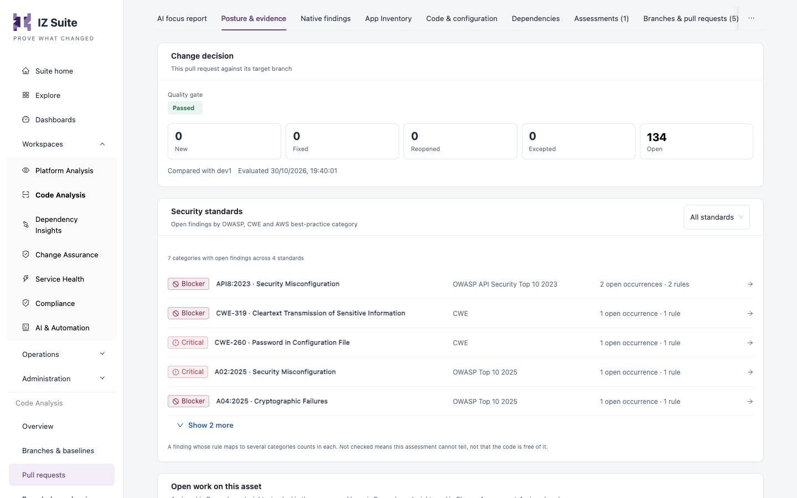

# Pull Request Analysis

A pull request scan tells you, before you merge, whether the change meets the quality gate. When IZ Suite knows the branch the pull request merges into, it compares the two and judges the pull request only on the findings the change introduces.


Requires the **Code Analysis** licence.


<figure><figcaption><p>A pull request compared with its target branch</p></figcaption></figure>

## Two ways to scan pull requests

| Source              | How it works                                                                                                                             | Set it up                                                                                   |
| ------------------- | ---------------------------------------------------------------------------------------------------------------------------------------- | ------------------------------------------------------------------------------------------- |
| Your CI/CD pipeline | The pipeline runs the scanner with `-pullRequestId` when it builds a pull request. Works with any repository host.                       | [Scan from the pipeline](pull-request-analysis.md#scan-from-the-pipeline)                   |
| Bitbucket webhook   | Bitbucket tells IZ Suite when a pull request is created or updated, and IZ Suite scans it with its agent. Nothing runs in your pipeline. | [Scan from the Bitbucket webhook](pull-request-analysis.md#scan-from-the-bitbucket-webhook) |

## Scan from the pipeline

Run the scanner with the pull request and the branch it merges into:

```bash
./iz-scan-cli-$IZ_CLI_VERSION-linux/bin/iz-scan-cli -serviceHost "https://izsuite.example.com" -authToken "$IZ_ACCESS_TOKEN" -applicationKey "orders-eapi" -source . -pullRequestId "$BITBUCKET_PR_ID" -pullRequestTargetBranch "$BITBUCKET_PR_DESTINATION_BRANCH" > iz-scan.log 2>&1 || true
cat iz-scan.log
grep -q "QUALITY GATE STATUS:: PASSED" iz-scan.log
```

| Option                     | Description                                                                                                                                                                                  |
| -------------------------- | -------------------------------------------------------------------------------------------------------------------------------------------------------------------------------------------- |
| `-pullRequestId`           | The pull request's number or ID. The scan is recorded as this pull request, a version of the application next to its branches. When it is set, `-scmBranchName` is ignored.                  |
| `-pullRequestTargetBranch` | The branch the pull request merges into, as it was passed to `-scmBranchName` when that branch was scanned (case does not matter). Without it, the pull request has nothing to compare with. |

With Maven, use `-DpullRequestId` and `-DpullRequestTargetBranch`.


The pull request steps that Setup generates pass `-pullRequestId` but not `-pullRequestTargetBranch`, so those pull requests are judged on all their findings. Add the target branch as shown in [Pipeline Examples](pipeline-examples.md#judge-pull-requests-on-new-code).


The scanner does not send the pull request's source branch, so pull requests scanned from a pipeline show **Source not recorded** as their source branch.

## Scan from the Bitbucket webhook

1. Connect Bitbucket and choose the repositories to scan. See [Manage Scanning](https://knowledgebase.autorabit.com/product-guides/integral-zone/iz-suite/workspaces/code-analysis/manage-scanning).
2. In **Administration** → **Setup**, open **Scan pull requests from Bitbucket**, turn on **Scan pull requests** and save a **Webhook secret** (or click **Generate a secret**).
3. In each Bitbucket repository, add a webhook with the URL and secret the step shows, and the triggers Pull request created, updated, merged and declined.

See [Setup](https://knowledgebase.autorabit.com/product-guides/integral-zone/iz-suite/administration/setup#connections) for the step's fields. A 401 answer in Bitbucket means the secrets differ; a 403 means no secret is saved.

When the webhook reports a pull request:

* Only repositories that are enabled for scanning have their pull requests scanned.
* IZ Suite records the pull request with its source and target branch, so it is always compared with its target.
* If the target branch has never been scanned, IZ Suite scans it first and scans the pull request once that scan completes.
* At most 25 pull request scans wait at once; later repository syncs pick up the rest.

## How a pull request is judged

The target branch's open findings are the pull request's baseline.

| Situation                                       | Result                                                                                                                                                                                                                                                                                      |
| ----------------------------------------------- | ------------------------------------------------------------------------------------------------------------------------------------------------------------------------------------------------------------------------------------------------------------------------------------------- |
| Target branch scanned                           | Each finding is marked new when it is not open on the target branch. The gate uses the **New code** conditions on the new findings (or the **Overall code** conditions on the new findings when the gate has no new-code conditions). The dossier says **Compared with** the target branch. |
| Target branch never scanned, or no target given | Every finding is counted against the **Overall code** conditions, as for a branch. The pull request is still listed as a pull request.                                                                                                                                                      |

Findings under an approved, unexpired exception never count. See [Break the Build on a Quality Gate](break-the-build-on-a-quality-gate.md#branches-and-pull-requests).


Scan your main branches first, from the same pipeline and with the same application key, so pull requests are judged only on the code they change.


## Where the results appear

* **Workspaces** → **Code Analysis** → **Pull requests** lists the pull requests assessed in the last 30 days with their first and latest gate and their new findings. See [Pull Requests](https://knowledgebase.autorabit.com/product-guides/integral-zone/iz-suite/workspaces/code-analysis/pull-requests).
* The pull request dossier's **Posture & evidence** panel shows the **Change decision** against the target branch: the gate and the **New**, **Fixed**, **Reopened**, **Excepted** and **Open** counts.
* **Native findings** with **New code only** keeps the findings that are not open on the target branch.
* Your pipeline log shows the gate result and a link to the scan's findings.

## Next steps

* [Pull Requests](https://knowledgebase.autorabit.com/product-guides/integral-zone/iz-suite/workspaces/code-analysis/pull-requests): review assessed pull requests.
* [Pipeline Examples](pipeline-examples.md): pull request steps for each platform.
* [Quality Gates](https://knowledgebase.autorabit.com/product-guides/integral-zone/iz-suite/operations/quality-control/quality-gates): add new-code conditions to your gates.
* [CI/CD Integration](./): how a pipeline scan works.
