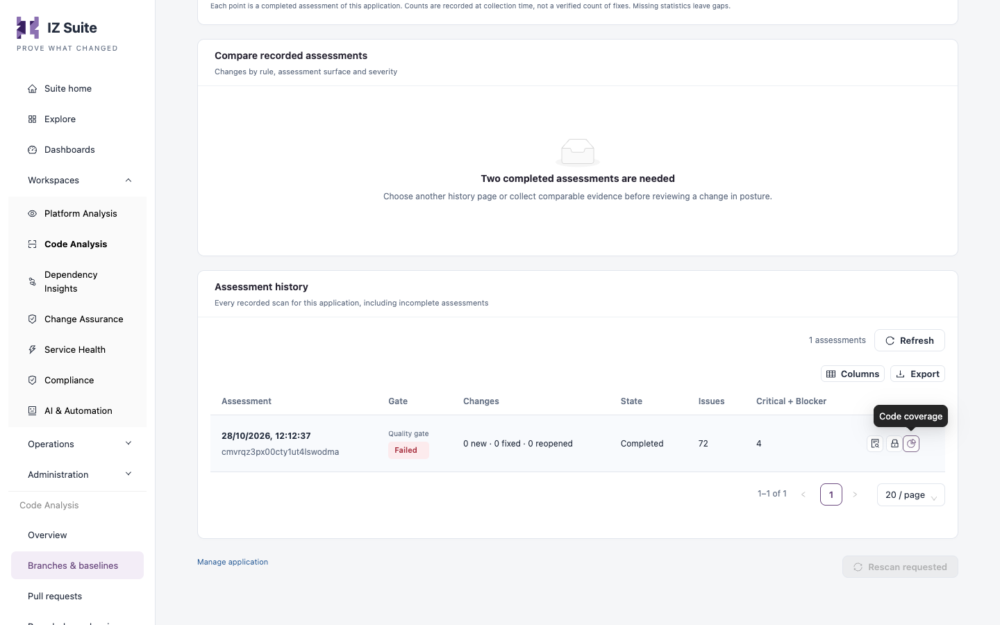

# Test Coverage Reports

When you scan a Mule application, the scanner also picks up the MUnit coverage report your build produced and records it with the assessment: the overall coverage, the coverage of each file and flow, and which lines were covered.


Requires the **Code Analysis** licence.



The scanner does not run MUnit tests and does not create the report. It only reads a report your build has already written, in JSON format.


## Produce the report

1. Configure the MUnit Maven plugin in the Mule application's `pom.xml` to measure coverage and write the coverage report in **JSON** format.
2. In your pipeline, run the MUnit tests before the scan step, in the same workspace, so the report is on disk when the scanner runs.
3. Check that the build leaves the report at `target/site/munit/coverage/munit-coverage.json`, under the project folder.

## Send it with the scan

No extra option is needed. When the scanner analyzes a Mule application, it looks for `target/site/munit/coverage/munit-coverage.json` under the folder given by `-source` (the current folder by default) and uploads:

| Measurement      | Description                                              |
| ---------------- | -------------------------------------------------------- |
| Overall coverage | The coverage percentage of the whole application.        |
| File coverage    | The coverage percentage of each Mule configuration file. |
| Flow coverage    | The coverage percentage of each flow, within its file.   |
| Line coverage    | The covered and uncovered lines of each flow.            |

This works the same with the [command-line scanner](command-line-scanner.md) and the [Maven plugin](maven-plugin.md).

| Situation                 | What happens                                                                                                |
| ------------------------- | ----------------------------------------------------------------------------------------------------------- |
| The report is missing     | The log says `Mule Coverage report not found` and the assessment records 0% coverage.                       |
| The report cannot be read | The log says `Error parsing coverage report` with the reason. The scan and its findings are still recorded. |


Point `-source` at the Mule project folder itself (the folder with `pom.xml`), not at a parent folder, or the scanner will not find the report.


## Review the coverage

<figure><figcaption>
Open the coverage of an assessment
</figcaption></figure>

1. Open the branch from **Workspaces** → **Code Analysis** → **Branches & baselines**.
2. In the branch dossier, open **Assessments**.
3. Under **Assessment history**, click **Code coverage** on the assessment's row. The action is shown for Mule applications only.
4. The **Application Code Coverage** page shows the **Overall Coverage** and the coverage of each file. Expand a file to see its flows, and click **View Line Coverage** on a flow to see its covered and uncovered lines.

## Next steps

* [Maven Plugin](maven-plugin.md): scan the Mule project as a Maven goal.
* [Pipeline Examples](pipeline-examples.md): add the scan step after your tests.
* [Branches & Baselines](https://knowledgebase.autorabit.com/product-guides/integral-zone/iz-suite/workspaces/code-analysis/branches-and-baselines): open the branch dossier.
* [CI/CD Integration](./): how a pipeline scan works.
