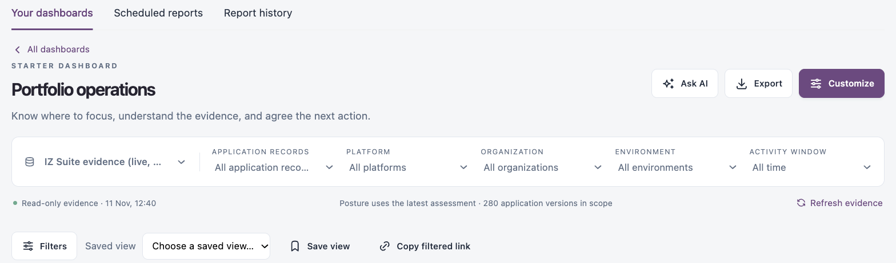

# Dashboards

Dashboards let you build views of your evidence from familiar fields, without defining data sets, and turn them into PDF reports on demand or on a schedule. Every dashboard reads read-only evidence with your own access, and every chart and table opens the records behind it.

Open **Dashboards** in the sidebar. Its pages, **Your dashboards**, **Scheduled reports** and **Report history**, are also tabs at the top of each page.

| Page                                      | What it covers                                                                                                                               |
| ----------------------------------------- | -------------------------------------------------------------------------------------------------------------------------------------------- |
| [Your Dashboards](your-dashboards.md)     | Open starter and custom dashboards, create and customize your own, build your own widgets, filter them, export a PDF and ask AI for a brief. |
| [Scheduled Reports](scheduled-reports.md) | Generate a PDF of a dashboard once or on a recurring schedule, kept in Report history and emailed if you choose.                             |
| [Report History](report-history.md)       | Download generated PDFs, check their scope and retry failed ones.                                                                            |


You need a role that can view, create or update dashboards to see **Dashboards** in the sidebar. Creating dashboards, scheduling reports and changing report branding each need their own permission; buttons you cannot use are not shown.


## Evidence Sources and Scope

Every dashboard uses the same scope bar:

<figure><figcaption></figcaption></figure>

| Control                 | Options                                                                                                  |
| ----------------------- | -------------------------------------------------------------------------------------------------------- |
| Evidence source         | **IZ Suite evidence (live, your access)**, or **Commerce · sample scenario** (illustrative sample data). |
| **Application records** | **All application records**, **Mule runtime applications** or **Code repositories**.                     |
| **Platform**            | **All platforms**, or one platform (for example AWS, Azure AIS, Code, MuleSoft).                         |
| **Organization**        | **All organizations**, or one organization.                                                              |
| **Environment**         | **All environments**, or one environment.                                                                |
| **Activity window**     | **All time**, **Last 7 days**, **Last 30 days** or **Last 90 days**.                                     |

Below the bar, IZ Suite shows when the evidence was read and how many application versions are in scope. Posture always uses the latest assessment; the activity window applies to activity such as completed assessments. Click **Refresh evidence** to read it again.

At the bottom of each dashboard, a list of evidence notes explains what the numbers count, for example that application counts are application/version records and that monitor status is the last recorded check, not an availability percentage.

## Next Steps

* [Your Dashboards](your-dashboards.md): start from a starter dashboard.
* [Report History](report-history.md): download the PDFs you generated.
* [Scheduled Reports](scheduled-reports.md): get a PDF before every review.
