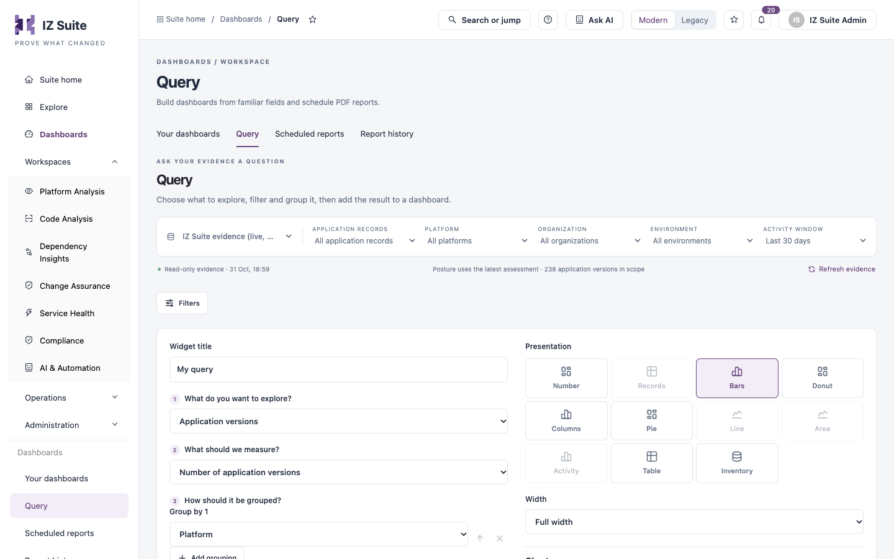

# Query

**Query** lets you ask your evidence a question: choose what to explore, what to measure and how to group it, preview the answer as a chart or table, then add it to a dashboard as a widget.

Open it from **Dashboards** → **Query** in the sidebar.

<figure><figcaption>
Building a query
</figcaption></figure>

The scope bar and **Filters** work as on a dashboard. See [Dashboards](./#evidence-sources-and-scope).

## Build a Query

1. Enter a **Widget title**.
2. In **1 What do you want to explore?**, choose the evidence.
3. In **2 What should we measure?**, choose the measure. The list depends on what you explore.
4. In **3 How should it be grouped?**, choose **Group by 1**. Click **Add grouping** to add more fields.
5. In **Focus**, narrow the evidence if needed.
6. Under **Presentation**, choose how to show the result, and choose its **Width**.
7. Check the **Live preview** and the results table below it.
8. Click **Add to dashboard…**.

### What You Can Explore

You can explore **Application versions**, **Open findings**, **Assessment history**, **Published AI reviews**, **Recorded scan metrics**, **Application list metrics**, **Change Assurance records**, **Compliance mapped checks** and **Monitor status records**.

Some evidence needs a licence or permission: AI reviews need a role that can view or run AI tasks, Change Assurance records need the Change Assurance licence and a role that can view changes or evidence, compliance checks need a role that can view compliance standards, and monitor records need a role that can view monitors. Evidence you cannot read is left out, and the evidence notes under the results say so.

Measures include, for example, **Number of application versions**, **Critical / blocker occurrences**, **Failed quality gates**, **Configured workers** and **Allocated vCores**.

### Grouping and Focus

You can group by up to four fields, in order (for example **Platform**, **Organization**, **Environment**, **Asset type**, **Quality gate**, **Application**, **Region** or **Runtime version**). Use bars or tables for more than one field. Time trends use **Day** on its own.

**Focus** narrows the evidence, for example to **Mule runtime applications only**, **Critical / blocker only** or **Applications with failed gates**.

### Presentation

| Field                         | Description                                                                                                                                                                                  |
| ----------------------------- | -------------------------------------------------------------------------------------------------------------------------------------------------------------------------------------------- |
| **Presentation**              | **Number**, **Records**, **Bars**, **Donut**, **Columns**, **Pie**, **Line**, **Area**, **Activity**, **Table** or **Inventory**. Choices that do not fit the current grouping are disabled. |
| **Width**                     | **Half width** or **Full width** on the dashboard.                                                                                                                                           |
| **Colour palette**            | **IZ Suite**, **Ocean**, **Forest** or **High contrast**.                                                                                                                                    |
| **Show numeric values**       | Shows the values on the chart.                                                                                                                                                               |
| **Category labels & colours** | Renames a category or changes its colour. Labels change presentation only; the original evidence and drill-through stay linked.                                                              |
| **Reset chart styling**       | Returns the chart to its default style.                                                                                                                                                      |

## Results

Under **Live preview**, the results table lists each group with its value and the evidence it counts. Use **Previous** and **Next** to page through it. The preview uses the filters above; once added to a dashboard, the widget uses that dashboard's filters.

## Add the Result to a Dashboard

1. Click **Add to dashboard…**.
2. In **Add to a dashboard**, choose one of your dashboards, or **A new dashboard** (private to you, and saved with the filters you queried with).
3. Click **Add to dashboard**.


You can add to dashboards you can edit. Creating a new dashboard needs a role that can create dashboards.


## Next steps

* [Your Dashboards](your-dashboards.md): arrange and save the widgets you added.
* [Scheduled Reports](scheduled-reports.md): send the dashboard as a PDF on a schedule.
* [Dashboards](./): back to the overview.
