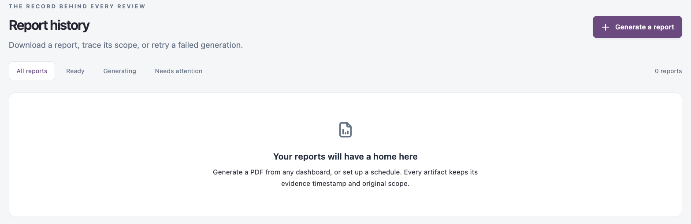

# Report History

Report history is the record behind every review. It keeps every PDF generated from a dashboard, by export or by schedule, with the scope and evidence timestamp it was generated with.

Open it from **Dashboards** → **Report history** in the sidebar.

<figure><figcaption></figcaption></figure>

## Filter the List

| Tab                 | Shows                     |
| ------------------- | ------------------------- |
| **All reports**     | Every report.             |
| **Ready**           | Reports you can download. |
| **Generating**      | Reports being generated.  |
| **Needs attention** | Reports that failed.      |

The number of reports in the view is shown on the right.

## Report List

| Column                 | Description                                                                                                                                                                                                               |
| ---------------------- | ------------------------------------------------------------------------------------------------------------------------------------------------------------------------------------------------------------------------- |
| **Report**             | The dashboard name, its layout revision and what triggered it (for example a manual export, a schedule or a retry).                                                                                                       |
| **Scope & provenance** | Live evidence or the sample scenario, the number of application versions, the platform scope and the evidence timestamp.                                                                                                  |
| **Generated**          | When the report finished (or was requested) and the file size.                                                                                                                                                            |
| **Status**             | **Ready**, **Queued**, **Generating** or **Failed**, with the error for a failed report. When the report was emailed, also the delivery result, for example **Emailed to 1** or **Not emailed: email is not configured**. |
| (last column)          | **PDF** downloads a ready report. **Retry** queues a failed one again. Delete (bin icon) removes the report.                                                                                                              |

When there are no reports, the page says **Your reports will have a home here**.

## Generate a Report

1. Click **Generate a report**. The dashboard you last opened (the first starter dashboard if none) opens with **Export your dashboard**.
2. To report on another dashboard, close the drawer, open that dashboard from [Your Dashboards](your-dashboards.md) and click **Export**.
3. Click **Generate PDF**.

The report appears in the list as **Queued**, then **Generating**, then **Ready**.

## Retry or Delete a Report

* **Retry** queues a new report using the current saved dashboard.
* Delete (bin icon) asks **Delete this report?** and deletes it with its PDF.


Deleting a report also deletes its PDF. This cannot be undone.


## Next Steps

* [Scheduled Reports](scheduled-reports.md): have reports generated for you.
* [Your Dashboards](your-dashboards.md): export a dashboard as a PDF.
* [Dashboards](./): back to the overview.
