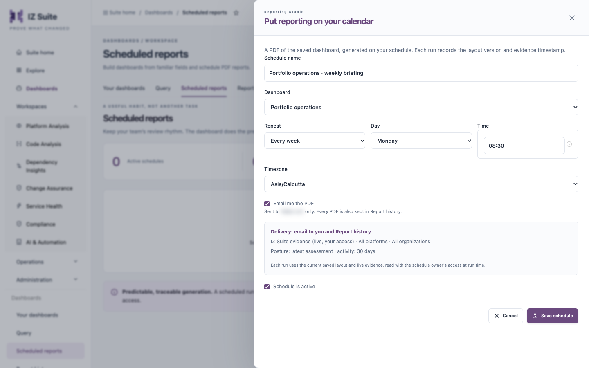

# Scheduled Reports

A scheduled report prepares a PDF of a saved dashboard before your next review. Each run uses the dashboard's current saved layout and live evidence, read with the schedule owner's access at run time, and records the layout revision and evidence timestamp.

Open it from **Dashboards** → **Scheduled reports** in the sidebar.

## Schedule Summary

| Tile                      | What it shows                                                                       |
| ------------------------- | ----------------------------------------------------------------------------------- |
| **Active schedules**      | Schedules that are switched on.                                                     |
| **Scheduled PDFs ready**  | PDFs generated by schedules and ready to download.                                  |
| **Timezone-aware timing** | Schedules run daily or weekly in their own time zone, with daylight saving handled. |

## Schedules List

| Column                   | Description                                                                                         |
| ------------------------ | --------------------------------------------------------------------------------------------------- |
| **Schedule / dashboard** | The schedule's name and the dashboard it generates. Click the name to edit the schedule.            |
| **Frequency**            | **Daily**, or the weekday, with the time and time zone.                                             |
| **Next run**             | When it runs next, or **Paused**. Also shows whether it reads live evidence or the sample scenario. |
| **Delivery**             | **Email to you** or **Report history only**.                                                        |
| **Status**               | **Active** or **Paused**, with the last error if a run failed.                                      |
| **Actions**              | **Run now**, **Pause** or **Resume**, and delete.                                                   |

When there are no schedules, the page says **A calmer Monday starts here**.

## Create a Schedule

<figure><figcaption>
A new schedule
</figcaption></figure>

1. Click **New schedule**, or **Schedule this dashboard** at the bottom of a dashboard.
2. Fill in the form in **Put reporting on your calendar**.
3. Check the delivery summary: where the PDF goes and the evidence scope it uses.
4. Click **Save schedule**.

| Field                  | Description                                                                                              |
| ---------------------- | -------------------------------------------------------------------------------------------------------- |
| **Schedule name**      | The name in the list. **Required.**                                                                      |
| **Dashboard**          | The saved dashboard to generate.                                                                         |
| **Repeat**             | **Every week** or **Every day**.                                                                         |
| **Day**                | The weekday, for a weekly schedule.                                                                      |
| **Time**               | The time of day.                                                                                         |
| **Timezone**           | The time zone the time is in.                                                                            |
| **Email me the PDF**   | Emails each PDF to your own address only. Every PDF is also kept in [Report History](report-history.md). |
| **Schedule is active** | Clear it to save the schedule paused.                                                                    |

The schedule uses the evidence source and scope that were set when you opened it, as shown in the delivery summary.


You need a role that can create reports to create a schedule, a role that can update reports to edit, pause or resume one, and a role that can delete or update reports to delete one.


## Manage Schedules

* **Run now**: queues a PDF immediately. It appears in Report history.
* **Pause** / **Resume**: stops or restarts the schedule.
* Delete (bin icon): deletes the schedule. PDFs it already generated stay in Report history.

## Next steps

* [Report History](report-history.md): download the PDFs your schedules produce.
* [Your Dashboards](your-dashboards.md): set the report layout and branding of the PDF.
* [Dashboards](./): back to the overview.
