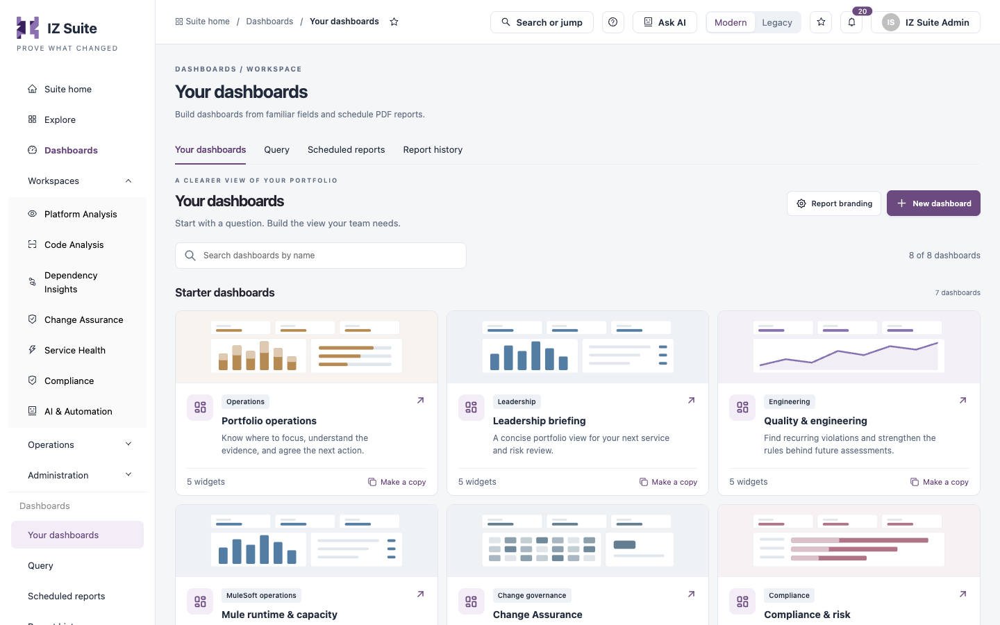
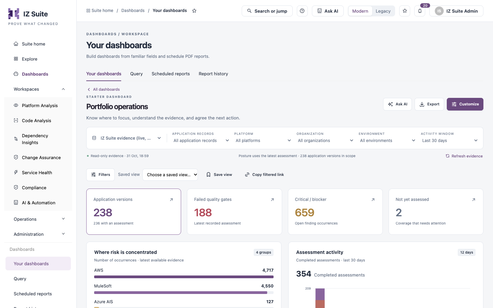

# Your Dashboards

**Your dashboards** is the dashboard library. Start from a ready-made starter dashboard, make a copy, or build a dashboard for your team from scratch.

Open it from **Dashboards** → **Your dashboards** in the sidebar.

<figure><figcaption>
The dashboard library
</figcaption></figure>

## Dashboard Library

| Control                       | What it does                                                                                                         |
| ----------------------------- | -------------------------------------------------------------------------------------------------------------------- |
| **Search dashboards by name** | Filters the cards. The count shows how many dashboards match.                                                        |
| **Report branding**           | Sets the name, colour, logo and footer of generated PDFs. See [Report Branding](your-dashboards.md#report-branding). |
| **New dashboard**             | Creates a dashboard. See [Create a Dashboard](your-dashboards.md#create-a-dashboard).                                |
| Dashboard card                | Opens the dashboard. The card shows its category, description and number of widgets.                                 |
| **Make a copy**               | Starts a new draft from that dashboard.                                                                              |
| **Create a dashboard**        | Same as **New dashboard**.                                                                                           |

**Starter dashboards** come with IZ Suite and cannot be changed:

| Dashboard                   | Category            | What it shows                                                                                         |
| --------------------------- | ------------------- | ----------------------------------------------------------------------------------------------------- |
| **Portfolio operations**    | Operations          | Where to focus, the evidence behind it, and the next action.                                          |
| **Leadership briefing**     | Leadership          | A concise portfolio view for your next service and risk review.                                       |
| **Quality & engineering**   | Engineering         | Recurring violations, to strengthen the rules behind future assessments.                              |
| **Mule runtime & capacity** | MuleSoft operations | Java and Mule runtime versions, worker allocation and vCores across business groups and environments. |
| **Change Assurance**        | Change governance   | Gate outcomes, human approvals and assessment readiness for changes in the selected activity window.  |
| **Compliance & risk**       | Compliance          | Mapped checks, current evidence coverage and treatment decisions.                                     |
| **Service status**          | Service operations  | Latest monitor results and where coverage is assigned.                                                |

**Custom dashboards** are the ones you and your colleagues created. Each card is tagged **Private** (only you) or **Shared** (everyone in the workspace can view it).

## Open a Dashboard

<figure><figcaption>
A dashboard
</figcaption></figure>

The heading shows whether it is a **STARTER DASHBOARD**, **YOUR DASHBOARD** or a **SHARED DASHBOARD**. Click **All dashboards** to return to the library.

| Control                     | What it does                                                                                                                                    |
| --------------------------- | ----------------------------------------------------------------------------------------------------------------------------------------------- |
| Scope bar                   | Evidence source, application records, platform, organization, environment and activity window. See [Dashboards](./#evidence-sources-and-scope). |
| **Refresh evidence**        | Reads the evidence again.                                                                                                                       |
| **Filters**                 | Opens **Filter the evidence** to add conditions on a field: **Is any of**, **Is none of** or **Contains text**.                                 |
| **Saved view**              | Applies a filtered view saved on this dashboard.                                                                                                |
| **Save view**               | Saves the current filters as a named view. The dashboard itself must be saved first.                                                            |
| **Copy filtered link**      | Copies a link to the dashboard with the current filters.                                                                                        |
| **Ask AI**                  | Asks AI for a brief on the dashboard. Shown when AI is available and your role can run AI tasks.                                                |
| **Export**                  | Generates a PDF. See [Export a PDF](your-dashboards.md#export-a-pdf).                                                                           |
| **Customize**               | Edits the dashboard. On a starter dashboard, this starts your own copy.                                                                         |
| **Make a copy**             | On a dashboard shared by someone else: starts your own copy.                                                                                    |
| Delete                      | Deletes your own dashboard.                                                                                                                     |
| **Schedule this dashboard** | At the bottom of the dashboard: opens a new schedule for it. See [Scheduled Reports](scheduled-reports.md).                                     |

Click a number, bar or row in any widget to open the records behind it.

## Create a Dashboard

1. Click **New dashboard**.
2. Enter the **Dashboard name** (up to 120 characters). **Required.**
3. In **Start from**, choose **A blank canvas** or a starter dashboard to copy its widgets.
4. Select **Share with everyone in this workspace (view only)** to share it, or leave it clear to keep it private.
5. Click **Create draft**.
6. Add and arrange widgets, as described in [Customize a Dashboard](your-dashboards.md#customize-a-dashboard).
7. Click **Save dashboard**.


You need a role that can create dashboards. A draft is not saved until you click **Save dashboard**; if you leave with unsaved changes, IZ Suite asks **Discard unsaved changes?** Click **Keep editing** to go back.


## Customize a Dashboard

1. Open the dashboard and click **Customize**.
2. Change the name if needed, and select or clear **Share with everyone in this workspace (view only)**.
3. Click **Add widget** (or the **Add a widget** tile) to open **What would you like to see?**. Search the ready-made widgets and click one to add it, or click **Build your own** to define one as in [Query](/broken/pages/d2fd9a615db2b0c41860bfc867037b83e20fcbdd).
4. Rearrange the widgets: drag them, or use the move up and move down arrows. Use the gear to edit a widget and the bin to remove it.
5. Optionally, click **Report layout** to set the PDF layout, or **Suggest a layout** to have AI propose widgets.
6. Click **Save dashboard**, or **Cancel** to drop the changes.

### Report Layout

These settings are saved with the dashboard and apply to manual and scheduled PDFs.

| Field                                  | Description                                                                   |
| -------------------------------------- | ----------------------------------------------------------------------------- |
| **Add a branded cover page**           | Starts the PDF with a cover page in your report branding.                     |
| **Report subtitle**                    | Up to 300 characters, for example `Monthly engineering review`.               |
| **Prepared for**                       | Up to 150 characters, for example `Engineering leadership`.                   |
| **Add an automatic table of contents** | Adds a contents page that follows the widget order and links to each section. |

Click **Apply to dashboard**, then save the dashboard.

## Export a PDF

1. Open the dashboard and set the scope and filters you want in the report.
2. Click **Export**.
3. Check **Included**: the widgets, source labels, scope and evidence notes that go into the PDF, and the row limits for tables.
4. Click **Generate PDF**, or **Schedule instead** to set up a schedule.

The PDF is generated in the background with the current filters and evidence timestamp; the saved dashboard does not change. Follow its progress and download it in [Report History](report-history.md).

## Ask AI for a Brief

1. Open the dashboard and click **Ask AI**.
2. Type **Your question**, or choose a suggested one.
3. Click **Generate answer**.
4. Review the answer, marked **AI-generated · review before use**, and click **Add brief to this view** to show it above the widgets.

The brief cites the applications it used; click one to open its records. **Remove brief from this view** hides it again.


An AI brief is AI-assisted and needs human review before you share it. It uses your workspace AI model and budget.


## Report Branding

Report branding sets the defaults for newly generated PDFs in this reporting workspace.

| Field                         | Description                                             |
| ----------------------------- | ------------------------------------------------------- |
| **Organization / brand name** | The name generated reports carry.                       |
| **Report accent colour**      | The accent colour of generated reports.                 |
| **Logo**                      | A PNG, JPEG or WebP image up to 5 MB, embedded in PDFs. |
| **Footer / classification**   | Text for the footer, for example `Confidential`.        |

Click **Save branding**. New exports and scheduled reports use it.


You need a role that can edit global settings to change report branding.


## Next steps

* [Query](/broken/pages/d2fd9a615db2b0c41860bfc867037b83e20fcbdd): build a widget from a question.
* [Scheduled Reports](scheduled-reports.md): generate a dashboard PDF every day or week.
* [Report History](report-history.md): download your PDFs.
* [Dashboards](./): back to the overview.
